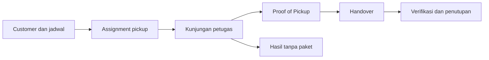

# Retail Pickup

**Operasional pickup retail, dari penugasan lapangan hingga rekonsiliasi AWB.**

[](https://github.com/ifxxca/dust/actions/workflows/tests.yml)


Retail Pickup (`dust`) menghubungkan tim kantor dan petugas lapangan dalam satu
platform: mengelola customer, menjadwalkan pickup, mencatat Proof of Pickup (POP),
memverifikasi handover, serta meninjau laporan dan rekonsiliasi shipment JNE.
Web dan aplikasi Android menggunakan backend yang sama.

> **Retail Pickup V1: FEATURE FROZEN, RELEASE NOT APPROVED.**
> Ditetapkan pada 29 Oktober 2026. Cakupan fitur V1 dibekukan; pengembangan fitur
> baru untuk V1 dihentikan. Rilis dan aktivasi pilot belum disetujui.
> Hasil verifikasi engineering tidak merupakan persetujuan rilis.
> Blocker penerimaan yang belum ditutup tetap berlaku.
> Rilis memerlukan persetujuan terpisah setelah blocker penerimaan ditutup.

[Kemampuan](#kemampuan-utama) · [Alur kerja](#alur-kerja-dan-aturan-penting) ·
[Setup lokal](#menjalankan-lokal) · [Android](#aplikasi-android) ·
[Quality checks](#pengecekan-kualitas) · [Dokumentasi](#dokumentasi)

## Kemampuan utama

| Area                        | Cakupan                                                                                                            |
| --------------------------- | ------------------------------------------------------------------------------------------------------------------ |
| Customer dan penugasan      | Data customer, jadwal regular/on-demand, assignment, takeover, dan pickup manual sesuai kewenangan.                |
| Eksekusi dan POP            | Kunjungan, hasil tanpa paket, jumlah per kategori, foto, tanda tangan, finalisasi, dan koreksi dengan jejak audit. |
| Handover                    | Sesi DRAFT, pengelompokan pickup, verifikasi penerimaan, selisih, dan penutupan sesi.                              |
| Sertim Cashless             | Pengumpulan bukti AWB dan koreksi Admin dengan batas finalisasi/penutupan yang berlaku.                            |
| Laporan JNE                 | Pipeline Hybrid/APEX, impor laporan, identitas AWB, provenance sumber, dan observasi tracking.                     |
| Rekonsiliasi dan monitoring | Pencocokan berbasis bukti, penanganan konflik, monitoring pickup/pemrosesan, laporan, dan ekspor CSV.              |
| Android                     | Workspace petugas, kamera/scanner, pemulihan draft lokal, dan push notification bila dikonfigurasi.                |

Dukungan integrasi yang telah diimplementasikan tetap memerlukan penerimaan
kontrak sumber dan konfigurasi yang sesuai sebelum diaktifkan untuk pilot.
Receipt email **tetap ditunda (TA-09)**; panduan ini tidak mengaktifkan SMTP.

## Alur kerja dan aturan penting



Laporan Hybrid/APEX diproses melalui impor, proyeksi shipment, dan rekonsiliasi.
Data yang datang terlambat tetap dapat memperbarui rekonsiliasi tanpa membuka
kembali handover.

- **Hari operasional:** 05.00–04.59 **Asia/Jakarta**. Contoh: pukul 04.59 tanggal
  20 masih termasuk hari operasional tanggal 19.
- **Kuantitas POP dan bukti AWB terpisah.** Kesamaan jumlah paket bukan bukti
  kepemilikan customer, kategori, atau keberhasilan proses eksternal.
- **Finalisasi dan histori dilindungi.** Impor dan rekonsiliasi tidak boleh
  diam-diam mengubah POP final, baseline verifikasi, atau penutupan handover.
- **Koreksi Sertim setelah finalisasi/closure hanya oleh Admin.** Window
  pengumpulan ditutup saat handover pertama kali ditutup; reopen handover tidak
  otomatis membuka window tersebut.
- **Identitas memerlukan bukti.** Customer, akun JNE, sumber shipment, dan atribusi
  pickup dibedakan; konflik tetap terlihat dan memerlukan tinjauan.
- **Laporan JNE adalah snapshot.** Waktu laporan dan observasi tidak boleh
  disamakan dengan kondisi real-time. Hasil pengiriman eksternal yang belum pasti
  tidak boleh diulang otomatis.

| Role               | Fokus                                                          |
| ------------------ | -------------------------------------------------------------- |
| `cs`               | Customer, task, jadwal, dan penugasan.                         |
| `pickup_staff`     | Eksekusi lapangan sesuai kepemilikan task.                     |
| `retail_staff`     | Operasional pickup dan pemeriksaan handover sesuai kewenangan. |
| `admin_supervisor` | Administrasi, monitoring, dan koreksi sesuai aturan lifecycle. |

Backend tetap memeriksa role, kepemilikan, status, dan versi data untuk setiap
operasi. Detail aturan tersedia di [business rules](docs/jne-reconciliation/business-rules.md).

## Teknologi dan struktur

Aplikasi menggunakan **Laravel modular monolith** dengan satu backend untuk web,
Android, job, dan integrasi laporan.

| Lapisan                  | Teknologi                                                            |
| ------------------------ | -------------------------------------------------------------------- |
| Backend                  | PHP 8.5, Laravel 13, Fortify, Sanctum, Wayfinder                     |
| Web                      | React 19, TypeScript, Inertia 3, Tailwind CSS 4, Vite 8 / Vite+      |
| Android                  | Capacitor 8, React, TypeScript                                       |
| Data dan background jobs | MySQL; SQLite untuk setup lokal bawaan dan banyak tes; queue Laravel |
| Worker laporan           | Node.js 24+, Playwright                                              |
| Pengujian                | Pest 5, Vitest, Node.js test runner                                  |

```text
app/                 Actions, controller, model, policy, job, dan command
resources/js/        Web Inertia React
resources/mobile/    Client Android dan pengujian client
android/             Proyek native Capacitor
workers/jne-report/  Worker browser Hybrid/APEX dan tes fixture
routes/              Route web/API dan scheduler
database/            Migration, factory, dan seeder
tests/               Pengujian backend
docs/                Aturan bisnis, desain, UAT, dan riwayat implementasi
.github/workflows/   Pipeline CI
```

## Menjalankan lokal

### Prasyarat

- PHP **8.5**, Composer **2**, dan ekstensi yang diperlukan Laravel serta SQLite.
- Node.js **24+** dan npm, selaras dengan CI dan kebutuhan worker laporan.
- Database lokal terpisah. `.env.example` menggunakan SQLite; validasi perilaku
  MySQL, locking, dan concurrency memerlukan MySQL terisolasi.
- Untuk Android: JDK **21**, Android SDK **36**, serta emulator/perangkat Android **10+**.

### 1. Siapkan checkout dan environment

```sh
git clone https://github.com/ifxxca/dust.git
cd dust
composer install
php -r "file_exists('.env') || copy('.env.example', '.env');"
php -r "file_exists('database/database.sqlite') || touch('database/database.sqlite');"
php artisan key:generate --no-interaction
```

Clone baru mengikuti default branch `main`. Jika melanjutkan pekerjaan pada branch
lain, pilih branch yang dimaksud sebelum menyiapkan aplikasi.

Sesuaikan `.env` untuk database lokal. Konfigurasi bawaan menggunakan session,
cache, dan queue berbasis database, serta mail driver `log`.

```dotenv
APP_NAME="Retail Pickup Management"
DB_CONNECTION=sqlite
PICKUP_TIMEZONE=Asia/Jakarta
MAIL_MAILER=log
```

### 2. Siapkan database dan aset

Jalankan migration berikut **hanya pada database lokal yang telah dipilih**:

```sh
php artisan migrate --no-interaction
npm ci
npm run build
```

Build menghasilkan helper route Wayfinder yang diperlukan frontend. File hasil
generate dan build tidak disimpan dalam Git.

### 3. Buat administrator lokal

Gunakan email unik dan password minimal 12 karakter. Contoh PowerShell:

```powershell
$env:M1_ADMIN_PASSWORD = Read-Host 'Password admin' -MaskInput
php artisan app:create-operational-admin admin@example.com --name="Admin Retail" --no-interaction
Remove-Item Env:M1_ADMIN_PASSWORD
```

Ganti email contoh dengan akun tim. Registrasi publik tidak diaktifkan.

### 4. Jalankan development

```sh
composer run dev
```

Buka alamat server yang ditampilkan terminal. Konfigurasi development juga
mendaftarkan scheduler dan worker queue `reconciliation`, `documents`, `deliveries`,
dan `mobile-push`. Gunakan database development tanpa backlog operasional;
command ini menjalankan proses background yang terdaftar.

Worker browser JNE memiliki setup terpisah di
[workers/jne-report](workers/jne-report/README.md). Menjalankan aplikasi lokal tidak
merupakan persetujuan untuk mengambil laporan live atau mengaktifkan integrasi.

## Konfigurasi operasional

| Konfigurasi                 | Fungsi / batas penggunaan                                                      |
| --------------------------- | ------------------------------------------------------------------------------ |
| `PICKUP_TIMEZONE`           | Zona operasional; bawaan `Asia/Jakarta`.                                       |
| `PICKUP_GENERATION_POLICY`  | `today` atau `catchup_7_days`; kosong berarti generator terjadwal belum aktif. |
| `PICKUP_AUTOMATION_ENABLED` | Gate automasi pickup; bawaan `false`.                                          |
| `PICKUP_AWB_SEND_ENABLED`   | Gate pengiriman AWB; bawaan `false`.                                           |
| `PICKUP_RECEIPT_CHANNEL`    | Kanal receipt; tetap ditunda untuk V1, jangan diaktifkan melalui panduan ini.  |
| `MOBILE_PUSH_ENABLED`       | Push notification; bawaan `false`, memerlukan konfigurasi Firebase.            |
| `MOBILE_API_URL`            | Origin backend yang ditanam saat build mobile.                                 |

Konfigurasi kontrak sumber, evidence, kategori, dan tracking JNE dijelaskan di
[UAT readiness](docs/jne-reconciliation/uat-readiness.md). Dokumen itu mencatat
kondisi pada tanggal penyusunannya; status freeze dan larangan rilis di atas
merupakan keputusan proyek yang berlaku.

## Aplikasi Android

### Build debug

Tetapkan origin backend yang dapat dijangkau perangkat di `.env`. HTTPS digunakan
untuk lingkungan selain pengecualian host development yang diizinkan konfigurasi.
Origin harus tanpa path API, query, atau kredensial.

```dotenv
MOBILE_API_URL=https://api.example.com
```

Ganti origin contoh, lalu jalankan:

```sh
npm run build:mobile
npm run sync:android
```

Build APK melalui PowerShell:

```powershell
cd android
.\gradlew.bat assembleDebug
cd ..
```

Pada macOS/Linux gunakan `./gradlew assembleDebug` dari direktori `android`.
APK berada di `android/app/build/outputs/apk/debug/app-debug.apk`.
Konfigurasi Firebase `google-services.json` diperlukan bila menggunakan push;
file tersebut dan kredensial server tidak disimpan dalam Git.

### Batas penerimaan release

Build aset production menggunakan `npm run build:mobile:release`, lalu
`npm run sync:android`. Build production mewajibkan HTTPS dan Android memeriksa
aset tersebut sebelum build release.

Application ID saat ini adalah `com.retailpickup.mobile.dev`. Signing, identitas
distribusi, target HTTPS, dan penerimaan perangkat fisik tetap harus diselesaikan
sebelum distribusi. Build yang berhasil tidak memberikan persetujuan pilot.

Draft lokal membantu pemulihan saat koneksi terputus atau proses aplikasi berhenti.
Transaksi tetap memerlukan koneksi; sinkronisasi offline penuh tidak termasuk
Mobile V1. Draft lokal tidak membuktikan transaksi diterima server atau sukses
pada sistem eksternal.

## Pengecekan kualitas

| Perintah                     | Cakupan                                                            |
| ---------------------------- | ------------------------------------------------------------------ |
| `php artisan test --compact` | Tes backend Pest; gunakan environment pengujian terisolasi.        |
| `composer types:check`       | PHPStan/Larastan.                                                  |
| `npm run types:check`        | TypeScript web dan mobile.                                         |
| `npm run check`              | Pemeriksaan frontend melalui Vite+.                                |
| `npm run build`              | Build web.                                                         |
| `npm run build:mobile`       | Build client mobile development.                                   |
| `composer ci:check`          | Frontend checks, TypeScript, format PHP, PHPStan, dan tes backend. |

Tes client web dan mobile yang juga dijalankan CI:

```sh
node node_modules/vitest/vitest.mjs run resources/js resources/mobile/src --config vite.mobile.config.ts --mode development --root .
```

Tes worker menggunakan fixture lokal:

```sh
npm --prefix workers/jne-report test
```

Workflow [tests](.github/workflows/tests.yml) berjalan pada push ke `main` dan pull
request, menggunakan PHP 8.5, Node.js 24, dan MySQL 8.4 untuk tes terkait. Badge CI
merujuk workflow tersebut; tidak menjamin branch kerja telah diuji atau rilis
sudah disetujui. Tes fungsional tidak menyertifikasi kapasitas produksi.

## Dokumentasi

| Kebutuhan                 | Referensi                                                                                                                                                                   |
| ------------------------- | --------------------------------------------------------------------------------------------------------------------------------------------------------------------------- |
| Kebutuhan produk          | [PRD platform](docs/prd.md), [PRD Mobile V1](docs/PRD_MOBILE_V1.md)                                                                                                         |
| Desain backend dan mobile | [Desain M1](docs/m1-technical-design.md), [desain mobile](docs/mobile/TECHNICAL_DESIGN.md)                                                                                  |
| Implementasi Android      | [Rencana implementasi](docs/mobile/IMPLEMENTATION_PLAN.md), [refinement V1.1](docs/mobile/V1_1_REFINEMENT.md), [handover V2](docs/mobile/HANDOVER_V2.md)                    |
| Aturan dan alur JNE       | [Business rules](docs/jne-reconciliation/business-rules.md), [data flow](docs/jne-reconciliation/data-flow.md), [matching rules](docs/jne-reconciliation/matching-rules.md) |
| Integrasi dan UAT         | [Worker laporan](workers/jne-report/README.md), [rencana UAT](docs/jne-reconciliation/uat-plan.md), [readiness](docs/jne-reconciliation/uat-readiness.md)                   |
| Riwayat engineering       | [Implementasi Pickup dan monitoring](docs/pickup-implementation-history.md)                                                                                                 |

Dokumen implementasi dan UAT memuat hasil pada tahap masing-masing. Riwayat tes,
benchmark lokal, dan catatan live retrieval terdahulu bukan persetujuan rilis V1.
Sebagian bukti QA berada di `storage/` dan hanya tersedia lokal. Dependency,
`.env`, kredensial, APK, dan hasil build tidak disertakan dalam clone repository.
