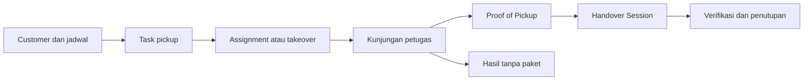

# dust · Retail Pickup Management

**Satu alur kerja untuk penjemputan, bukti pickup, dan serah terima paket.**

[](https://github.com/ifxxca/dust/actions/workflows/tests.yml)


Platform operasional pickup retail untuk mengelola customer, menjadwalkan dan
menugaskan pickup, mencatat hasil kunjungan, mengumpulkan Proof of Pickup (POP),
serta memverifikasi paket saat serah terima. Tim kantor bekerja melalui web;
petugas lapangan menggunakan aplikasi Android yang terhubung ke backend yang sama.

> **Status:** pengembangan aktif. Implementasi dan hasil verifikasi engineering
> tercatat di dokumentasi proyek. UAT perangkat fisik, pengujian FCM nyata, signing,
> konfigurasi HTTPS pilot, dan persetujuan pilot masih menjadi pekerjaan lanjutan.

[Fitur](#fitur) · [Mulai](#menjalankan-lokal) · [Android](#aplikasi-android) ·
[Pengecekan](#pengecekan-kualitas) · [Dokumentasi](#dokumentasi)

## Fitur

| Area            | Kemampuan                                                                                                        |
| --------------- | ---------------------------------------------------------------------------------------------------------------- |
| Customer        | Data customer, kontak, alamat, koordinat, dan status aktif.                                                      |
| Pickup          | Task regular dan on-demand, assignment individual/massal, takeover, serta pickup manual oleh petugas.            |
| Eksekusi        | Mulai kunjungan, catat hasil, dan tangani kunjungan tanpa paket.                                                 |
| Proof of Pickup | Jumlah paket per kategori, foto, tanda tangan, catatan, review, dan finalisasi.                                  |
| Handover        | Kelompokkan task, ubah anggota saat DRAFT, verifikasi jumlah, dan tutup sesi serah terima.                       |
| Monitoring      | Dashboard operasional, riwayat, selisih, dan koreksi dengan jejak audit.                                         |
| Android         | Workspace petugas, kamera, pemulihan draft lokal, dan notifikasi assignment melalui Firebase jika dikonfigurasi. |
| Receipt         | Pencatatan status receipt dan pengiriman email jika kanal SMTP sudah dikonfigurasi.                              |

Draft lokal membantu memulihkan pekerjaan saat koneksi terputus atau aplikasi
ditutup. Pengiriman transaksi tetap memerlukan koneksi; sinkronisasi offline penuh
belum menjadi cakupan Mobile V1. Provider WhatsApp juga belum termasuk implementasi.

## Alur operasional



Hak akses mengikuti role dan kondisi data pada backend:

| Role               | Fokus                                                                   |
| ------------------ | ----------------------------------------------------------------------- |
| `cs`               | Mengelola customer, task, jadwal, dan penugasan.                        |
| `pickup_staff`     | Menjalankan pickup dan workflow lapangan sesuai kepemilikan task.       |
| `retail_staff`     | Operasional pickup dan pemeriksaan serah terima sesuai kewenangan.      |
| `admin_supervisor` | Administrasi akun, pemantauan, dan operasional sesuai aturan lifecycle. |

## Teknologi dan struktur

Backend menggunakan **Laravel 13**, **Fortify**, **Sanctum**, dan **Wayfinder**.
Web menggunakan **React 19**, **TypeScript**, **Inertia 3**, **Tailwind CSS 4**, dan
**Vite 8 / Vite+**. Aplikasi Android menggunakan **Capacitor 8** dengan React dan
TypeScript. Pengujian backend menggunakan **Pest 5**.

```text
app/                 Actions, HTTP API, model, policy, job, dan command
database/            Migrasi, factory, dan seeder
resources/js/        Halaman dan komponen web Inertia React
resources/mobile/    Client Android React dan pengujian client
routes/              Route web, API, dan penjadwalan command
android/             Proyek native Android Capacitor
tests/               Pengujian backend
docs/                PRD, desain teknis, dan catatan implementasi
presentation/        Aset dan materi presentasi
.github/workflows/   Pipeline CI
```

Ketiga bagian aplikasi berada dalam satu repository sehingga perubahan backend,
web, dan Android dapat dilacak bersama.

## Menjalankan lokal

### Prasyarat

- PHP **8.5**, sesuai lingkungan pengembangan dan CI, beserta ekstensi Laravel dan SQLite.
- Composer **2**.
- Node.js **22.12+** dan npm; Node.js 24 juga dapat digunakan.
- SQLite untuk konfigurasi lokal bawaan.
- Untuk Android: JDK **21**, Android SDK **36**, serta emulator atau perangkat Android **10+**.

### 1. Ambil source dan siapkan environment

```sh
git clone https://github.com/ifxxca/dust.git
cd dust
composer install
php -r "file_exists('.env') || copy('.env.example', '.env');"
php -r "file_exists('database/database.sqlite') || touch('database/database.sqlite');"
php artisan key:generate --no-interaction
```

Sesuaikan `.env` sebelum migrasi. Konfigurasi awal menggunakan SQLite, session,
cache, dan queue berbasis database, serta mail driver `log`.

```dotenv
APP_NAME="Retail Pickup Management"
DB_CONNECTION=sqlite
PICKUP_TIMEZONE=Asia/Jakarta
```

### 2. Siapkan database dan frontend

```sh
php artisan migrate --no-interaction
npm ci
npm run build
```

Build web menghasilkan fungsi route Wayfinder yang diperlukan frontend. File hasil
generate tidak disimpan dalam Git.

### 3. Buat akun administrator

Command berikut menggunakan email unik dan password minimal 12 karakter dari
environment variable `M1_ADMIN_PASSWORD`. Contoh PowerShell:

```powershell
$env:M1_ADMIN_PASSWORD = Read-Host 'Password admin' -MaskInput
php artisan app:create-operational-admin admin@example.com --name="Admin Retail" --no-interaction
Remove-Item Env:M1_ADMIN_PASSWORD
```

Gunakan email administrator milik tim. Setelah masuk, kelola akun operasional
melalui halaman administrasi. Registrasi publik tidak diaktifkan.

### 4. Jalankan aplikasi

```sh
composer run dev
```

Buka alamat server yang ditampilkan di terminal. Command ini menjalankan proses
development Laravel, termasuk worker khusus `mobile-push` yang didaftarkan proyek.

## Konfigurasi operasional

| Variable                   | Kegunaan                                                                       |
| -------------------------- | ------------------------------------------------------------------------------ |
| `PICKUP_TIMEZONE`          | Zona waktu operasional; bawaan `Asia/Jakarta`.                                 |
| `PICKUP_GENERATION_POLICY` | `today` atau `catchup_7_days`; kosong berarti generator terjadwal belum aktif. |
| `PICKUP_RECEIPT_CHANNEL`   | Set `email` setelah konfigurasi SMTP siap.                                     |
| `MOBILE_PUSH_ENABLED`      | Mengaktifkan integrasi push; bawaan `false`.                                   |
| `FCM_PROJECT_ID`           | Project ID Firebase untuk notifikasi.                                          |
| `FCM_CREDENTIALS_PATH`     | Lokasi file kredensial service account pada server.                            |
| `MOBILE_API_URL`           | Origin backend yang ditanam saat build mobile.                                 |

Untuk pengembangan jadwal regular, jalankan scheduler di terminal terpisah setelah
kebijakan generator dipilih:

```sh
php artisan schedule:work --no-interaction
```

Pengiriman push menggunakan queue tersendiri. Jika menjalankan proses secara
manual, worker default saja tidak mengambil job pada queue ini:

```sh
php artisan queue:work database --queue=mobile-push --sleep=2 --tries=1 --timeout=60 --no-interaction
```

## Aplikasi Android

### Build debug

Tambahkan origin backend yang dapat dijangkau perangkat ke `.env`. Build
development membatasi HTTP ke host yang diizinkan konfigurasi; gunakan origin HTTPS
untuk lingkungan lain. Origin harus tanpa path API, query, atau kredensial.

```dotenv
MOBILE_API_URL=https://api.example.com
```

Ganti contoh tersebut dengan origin backend tim, kemudian jalankan:

```sh
npm run build:mobile
npm run sync:android
```

Build APK melalui PowerShell:

```powershell
cd android
.\gradlew.bat assembleDebug
cd ..
```

Pada macOS/Linux gunakan `./gradlew assembleDebug` dari direktori `android`.
APK debug dihasilkan di `android/app/build/outputs/apk/debug/app-debug.apk`.

Integrasi Firebase Android memerlukan `google-services.json` untuk application ID
yang sesuai. File konfigurasi Firebase dan kredensial server tidak disimpan dalam
repository. Tanpa konfigurasi tersebut, gunakan aplikasi tanpa push notification.

### Persiapan release

```sh
npm run build:mobile:release
npm run sync:android
```

Build production mewajibkan `MOBILE_API_URL` HTTPS. Proyek Android juga memeriksa
aset production sebelum release. Konfigurasi saat ini masih menggunakan application
ID development `com.retailpickup.mobile.dev`; signing, identitas distribusi, dan UAT
perangkat nyata perlu diselesaikan sebelum distribusi pilot.

## Pengecekan kualitas

| Perintah                     | Cakupan                                                                                    |
| ---------------------------- | ------------------------------------------------------------------------------------------ |
| `php artisan test --compact` | Pengujian backend Pest.                                                                    |
| `composer types:check`       | Analisis statis PHP menggunakan Larastan/PHPStan.                                          |
| `npm run check`              | Pemeriksaan frontend melalui Vite+.                                                        |
| `npm run types:check`        | TypeScript web dan mobile.                                                                 |
| `npm run build`              | Build web.                                                                                 |
| `npm run build:mobile`       | Build client mobile development.                                                           |
| `composer ci:check`          | Pemeriksaan frontend, tipe, format PHP, analisis statis, dan tes backend sesuai script CI. |

GitHub Actions menjalankan `composer setup` dan `composer ci:check` pada push ke
`main` dan pull request menggunakan PHP 8.5 serta Node.js 22. Badge di atas merujuk
langsung pada hasil workflow tersebut.

## Dokumentasi

- [PRD Retail Pickup Management](docs/prd.md) — kebutuhan dan keputusan bisnis dasar.
- [Desain teknis M1](docs/m1-technical-design.md) — rancangan awal backend dan web.
- [PRD Mobile V1](docs/PRD_MOBILE_V1.md) — cakupan dan perjalanan pengguna Android.
- [Desain teknis mobile](docs/mobile/TECHNICAL_DESIGN.md) — arsitektur dan addendum kebijakan.
- [Rencana dan catatan implementasi](docs/mobile/IMPLEMENTATION_PLAN.md) — keputusan, verifikasi, dan pekerjaan lanjutan.
- [Refinement Mobile V1.1](docs/mobile/V1_1_REFINEMENT.md) — perbaikan pengalaman penggunaan mobile.
- [Handover V2](docs/mobile/HANDOVER_V2.md) — perubahan workflow, hasil engineering, dan batas verifikasi.

Sebagian catatan implementasi merujuk bukti QA lokal di `storage/`. File tersebut,
dependency, `.env`, APK, dan hasil build diabaikan oleh Git sehingga tidak tersedia
dari clone repository.
