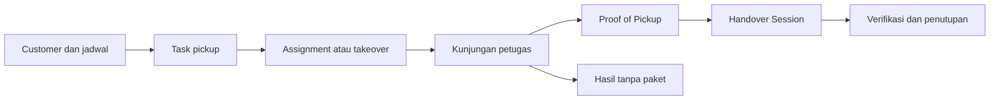

# dust · Retail Pickup Management

**Satu alur kerja untuk penjemputan, bukti pickup, dan serah terima paket.**

[](https://github.com/ifxxca/dust/actions/workflows/tests.yml)


Platform operasional pickup retail untuk mengelola customer, menjadwalkan dan
menugaskan pickup, mencatat hasil kunjungan, mengumpulkan Proof of Pickup (POP),
serta memverifikasi paket saat serah terima. Tim kantor bekerja melalui web;
petugas lapangan menggunakan aplikasi Android yang terhubung ke backend yang sama.

> **Retail Pickup V1: FEATURE FROZEN, RELEASE NOT APPROVED.**
> Ditetapkan pada 29 Oktober 2026. Cakupan fitur V1 dibekukan; pengembangan fitur
> baru untuk V1 dihentikan. Rilis dan aktivasi pilot belum disetujui.
> Hasil verifikasi engineering tidak merupakan persetujuan rilis.
> Blocker penerimaan yang belum ditutup tetap berlaku.
> Rilis memerlukan persetujuan terpisah setelah blocker penerimaan ditutup.

[Fitur](#fitur) · [Mulai](#menjalankan-lokal) · [Android](#aplikasi-android) ·
[Pengecekan](#pengecekan-kualitas) · [Dokumentasi](#dokumentasi)

## Fitur

| Area            | Kemampuan                                                                                                        |
| --------------- | ---------------------------------------------------------------------------------------------------------------- |
| Customer        | Data customer, kontak, alamat, koordinat, dan status aktif.                                                      |
| Pickup          | Task regular dan on-demand, assignment individual/massal, takeover, serta pickup manual oleh petugas.            |
| Eksekusi        | Mulai kunjungan, catat hasil, dan tangani kunjungan tanpa paket.                                                 |
| Proof of Pickup | Jumlah paket per kategori, foto, tanda tangan, catatan, review, dan finalisasi.                                  |
| Handover        | Kelompokkan task, ubah anggota saat DRAFT, verifikasi jumlah, dan tutup sesi serah terima.                       |
| Monitoring      | Dashboard operasional, riwayat, selisih, dan koreksi dengan jejak audit.                                         |
| Android         | Workspace petugas, kamera, pemulihan draft lokal, dan notifikasi assignment melalui Firebase jika dikonfigurasi. |
| Receipt         | Pencatatan status receipt dan pengiriman email jika kanal SMTP sudah dikonfigurasi.                              |

Draft lokal membantu memulihkan pekerjaan saat koneksi terputus atau aplikasi
ditutup. Pengiriman transaksi tetap memerlukan koneksi; sinkronisasi offline penuh
belum menjadi cakupan Mobile V1. Provider WhatsApp juga belum termasuk implementasi.

## Hasil Pickup — Web Admin

Menu **Retail Operations → Hasil Pickup** tersedia untuk `admin_supervisor` aktif.
`/hasil-pickup` menampilkan monitoring dan laporan; `/hasil-pickup/{task}` membuka
detail operasional, termasuk tab Pemrosesan Paket V2. `/hasil-pickup/export` mengunduh CSV terautentikasi sesuai filter.
Ketiga route menggunakan nama `pickup-results.*` dan helper Wayfinder pada Web.

### Definisi dan filter

Default periode Web adalah **hari operasional saat ini di Asia/Jakarta**, dari
**05.00 inklusif sampai 05.00 esok eksklusif**, diterapkan server untuk kedua tab,
filter, laporan, rincian kategori dan CSV. Pukul 04.59 tanggal 20 masih tanggal
operasional 19. Tanggal eksplisit tetap dipertahankan; satu batas tanggal berarti
satu hari tersebut. Kedua tab memilih pickup yang sama berdasarkan waktu aktual
pengambilan/kunjungan; jadwal hanya untuk rencana yang belum dikunjungi. Seluruh
status dan kuantitas adalah nilai efektif terbaru, termasuk perubahan setelah
hari pengambilan. Lihat definisi teknis dan keterbatasan timestamp di bawah.

| Metrik             | Definisi per pickup unik                                                                          |
| ------------------ | ------------------------------------------------------------------------------------------------- |
| Total Pickup       | Seluruh task sesuai filter.                                                                       |
| POP Final          | Memiliki `pickup_records.finalized_at`.                                                           |
| Belum Selesai      | Belum final POP, kecuali task `NO_PACKAGES` atau `CANCELLED`.                                     |
| Menunggu Handover  | POP final tanpa anggota sesi handover.                                                            |
| Belum Diverifikasi | Sudah masuk handover dan masih `PENDING`, atau baseline verifikasinya tertinggal dari revisi POP. |
| Sudah Diverifikasi | Hasil efektif `VERIFIED`/`DISCREPANCY` atas revisi POP terkini.                                   |
| Ada Selisih        | Hasil verifikasi efektif `DISCREPANCY`, termasuk yang perlu tinjau ulang.                         |

Kartu merupakan dimensi yang dapat tumpang tindih, bukan bagian untuk dijumlahkan.
Filter “Belum final POP” mencakup semua task tanpa finalisasi, sedangkan metrik
“Belum Selesai” mengecualikan hasil terminal tanpa paket/dibatalkan.
Verifikasi berlaku penuh per pickup; progres parsial hanya ditampilkan pada sesi.
Penutupan sesi tidak menghapus selisih, dan koreksi POP tidak menghitung ulang
hasil verifikasi secara diam-diam.

Filter referensi, customer snapshot pada task, petugas saat ini, hasil kunjungan
terakhir, POP, sesi, verifikasi dan selisih disimpan di query URL. Pencarian
customer/petugas menggunakan nama; ID customer/petugas juga diterima oleh backend.
Urutan referensi/jadwal/customer/petugas memakai ID sebagai pembeda terakhir;
pagination dibatasi 10/20/50 baris. Daftar tidak memuat riwayat atau bukti seluruh
pickup; query hanya mengambil revisi terakhir untuk proyeksi efektif.

### Detail dan tindakan

- **Ringkasan:** snapshot tujuan/kontak yang diizinkan, petugas, jadwal, waktu
  kunjungan, status terpisah dan tindak lanjut operasional.
- **Bukti POP:** kuantitas asli dan efektif, finalisasi, catatan, foto/tanda tangan
  dengan preview, serta revisi. Akses lampiran tetap melalui `api.evidence`;
  path storage tidak dikirim. Respons file ditegaskan `private, no-store`.
- **Verifikasi & Handover:** sesi, pembuat, pemeriksa, penutupan, progres sesi,
  revisi POP yang benar-benar diperiksa dan perbandingan kuantitas. Selisih adalah
  aktual dikurangi POP baseline: positif LEBIH, negatif KURANG, nol SESUAI.
- **Riwayat Aktivitas:** event task/sesi, hasil kunjungan, POP final dan revisi
  yang memang tersimpan, dengan actor/waktu/alasan serta sebelum/sesudah yang
  tersedia. Draft client tidak dibuat menjadi event audit fiktif.

Dialog tindakan hanya muncul dari capability backend yang relevan. Koreksi POP,
verifikasi, koreksi verifikasi, penutupan dan reopen memanggil endpoint/Actions
yang sudah ada: `CorrectPickupRecord`, `VerifyItem`, `CorrectVerification`,
`CloseSession`, `AmendSession`. Tidak ada lifecycle, permission atau audit system
kedua. Input, versi task/sesi dan revisi POP dibekukan saat dialog dibuka; pengguna
meninjau lalu mengonfirmasi sebelum pengiriman. Validasi mempertahankan input,
konflik tidak diklaim berhasil, dan baseline baru hanya digunakan setelah tinjauan
eksplisit. Backend tetap menentukan seluruh prasyarat dan otorisasi.

### Laporan, ekspor dan performa

Pilihan Tampilan menghasilkan laporan per tanggal lokal, petugas atau ID customer
dengan nama master terkini, sehingga perubahan nama snapshot tidak memecah satu
customer menjadi beberapa kelompok. Setiap kelompok memakai populasi dan definisi metrik yang sama dengan
monitoring. Frekuensi selisih = Ada Selisih / Total Pickup; tidak ada target/SLA
baru. Laporan tanggal memuat hari kosong di antara tanggal pertama/terakhir
yang cocok dan menggunakan batas kalender Asia/Jakarta.
Kelompok laporan juga dipaginasi.

CSV UTF-8 dengan BOM berisi satu baris per pickup sesuai filter, seluruh halaman,
kuantitas POP efektif/penerimaan, milestone, revisi, pemeriksa dan waktu lokal
dengan offset/zona. CSV bukan ekspor lampiran maupun seluruh histori revisi;
inspeksi audit tersedia di detail. File dialirkan dari server dalam chunk maksimal
500 baris, tanpa file publik atau URL bukti. Awalan formula spreadsheet diamankan.

Implementasi baca ada pada `QueryPickupResults` dan `ReportPickupResults`.
Tidak ada tabel/kolom transaksi baru atau perubahan dependency. Satu migration
menambah indeks `tasks_results_schedule (scheduled_at, id)` untuk filter lintas
customer/status, setelah EXPLAIN memperlihatkan indeks sebelumnya tidak memiliki
kolom awal jadwal. Migration sudah diterapkan pada MySQL lokal; environment lain
perlu `php artisan migrate --no-interaction` dan build Web.

EXPLAIN ANALYZE pada MySQL lokal menunjukkan range scan indeks baru; contoh query
join terfilter menghasilkan dua baris sekitar 0,20 ms. Ini pengukuran dataset lokal
kecil, bukan klaim throughput produksi. Tes 1.001 pickup membuktikan ekspor tiga
chunk; jumlah query monitoring konstan saat halaman dinaikkan dari 10 ke 50.
Tidak ditambahkan cache atau infrastruktur baru. Load test ratusan pengguna dan
benchmark MySQL dengan histori revisi besar belum dilakukan.

### Hasil verifikasi 19 Oktober 2026

| Milestone        | Status                     | Bukti                                                                                                                               | Batas verifikasi                                 |
| ---------------- | -------------------------- | ----------------------------------------------------------------------------------------------------------------------------------- | ------------------------------------------------ |
| M1 Monitoring    | Implemented; checks passed | Summary/filter/tanggal/sort/pagination, revisi efektif, bukti privat, audit dan browser desktop/tablet                              | UAT operator dan beban produksi belum dilakukan. |
| M2 Admin Actions | Implemented; checks passed | Actions lama, otorisasi, lebih/kurang, catatan, stale guard, koreksi, penutupan/reopen; alur dialog dijalankan pada fixture browser | Tidak ada kebijakan bisnis baru yang diperlukan. |
| M3 Reporting     | Implemented; checks passed | Konsistensi kelompok/filter, DST, ekspor 1.001 baris, otorisasi/formula; laporan dan download CSV di browser                        | CSV dipilih; tidak menambah dependency XLSX.     |

- Suite Laravel lengkap: **350 passed**, **2.559 assertions**, **5 skipped**
  (tes perangkat opt-in); `php -d extension=pdo_sqlite -d extension=sqlite3 vendor/bin/pest --compact`.
  Host Windows memerlukan `OPENSSL_CONF` untuk fixture RSA sebagaimana catatan mobile.
- Regresi terarah Hasil Pickup, POP, eksekusi, koreksi, Web/mobile Handover dan
  mobile POP: **65 passed**, **889 assertions**. Tes modul baru ada di
  `tests/Feature/PickupResultTest.php` dan `PickupResultReportTest.php`.
- Client mobile: **63 passed** di delapan berkas; client Web notifikasi: **3 passed**.
  Ini regresi client yang sudah ada, bukan klaim adanya suite React DOM baru.
- `npm run types:check`, build Web, Oxlint berkas yang diubah, Pint dan PHPStan
  penuh: passed. Build masih menampilkan pemberitahuan dependency opsional
  `fontaine` untuk optimasi fallback font; dependency tidak diubah.
- Browser QA menggunakan SQLite sementara dengan 23 pickup, bukan transaksi
  operasional MySQL: filter URL, pagination, bukti/preview, verifikasi selisih,
  tutup, reopen, koreksi POP, koreksi verifikasi, histori, laporan dan CSV. Uji dua tab juga membuktikan penolakan versi lama, retensi input, refresh dengan fresh visit, tinjauan baseline eksplisit, lalu penyimpanan revisi baru.
  Layout diperiksa pada 1440×1000 dan 768×1024; overflow tabel ditangani dalam
  kontainer. Android APK/device tidak dibangun ulang untuk perubahan Web ini.

Bukti lokal (storage diabaikan Git): [suite](storage/hasil-pickup/full-tests.log),
[regresi](storage/hasil-pickup/feature-tests.log),
[PHPStan](storage/hasil-pickup/phpstan.log),
[desktop](storage/hasil-pickup/monitoring-desktop.jpg),
[tablet](storage/hasil-pickup/monitoring-tablet.jpg),
[dialog verifikasi](storage/hasil-pickup/verification.jpg),
[laporan](storage/hasil-pickup/report.jpg), [audit](storage/hasil-pickup/activity.jpg).

Berkas implementasi: Actions baca di atas; `PickupResultController`,
`PickupResultRequest`, penguatan cache `ProofOfPickupController`, migration indeks,
`routes/web.php`, sidebar, `pages/pickup-results.tsx`, `pages/pickup-result-detail.tsx`,
`components/pickup-result-ui.tsx`, `components/pickup-result-actions.tsx`,
`types/pickup-result.ts`, penambahan tipe `closed_by` pada `types/handover.ts`, dan
dua berkas tes. Perubahan lokal login/welcome yang sudah ada dipertahankan.

## Hasil Pickup V2 — audit sumber pemrosesan

Audit repository dan schema MySQL pada 19 Oktober 2026 menemukan:

| Informasi                                          | Ketersediaan / klasifikasi                                                                 |
| -------------------------------------------------- | ------------------------------------------------------------------------------------------ |
| POP asli/efektif per tiga kategori                 | Tersedia dari pickup_records/revisions; bukti pickup, bukan bukti input ERP.               |
| Penerimaan fisik Retail                            | Tersedia dari handover_items/revisions; baseline POP, pemeriksa dan histori tersedia.      |
| Input JNE Hybrid / MyORION terkonfirmasi eksternal | D — tidak tersedia; tidak ditemukan connector, result feed, shipment atau AWB model/table. |
| Catatan manual input ERP                           | D sebelum perubahan V2; perlu fallback B yang ditandai sebagai deklarasi Admin.            |
| Status receipt / queue                             | Bukan bukti pemrosesan paket; tidak digunakan untuk menyimpulkan sukses ERP.               |
| Hubungan kategori dengan sistem                    | Tidak ada mapping otoritatif; Admin memilih sistem secara eksplisit.                       |

Tidak ada sumber A yang dapat dipakai saat audit. Inferensi C dari POP, verifikasi
atau closure dilarang. Struktur tambahan yang diterapkan adalah satu
ledger snapshot kuantitas manual append-only per pickup/kategori/sistem. Snapshot
baru menggantikan kontribusi snapshot sebelumnya pada agregasi, tetapi seluruh
riwayat dipertahankan. Tidak dibuat AWB fiktif atau connector eksternal. Audit
memakai event task existing bersama nilai sebelum/sesudah dari snapshot tersimpan.

### Implementasi dan definisi V2

URL lama `/hasil-pickup` tetap membuka **Monitoring Pickup**, dengan filter,
laporan, tindakan, bukti dan ekspor yang sudah ada. Segmen **Monitoring Pemrosesan
Paket** menggunakan `?monitoring=processing`; detail yang sama menerima
`?tab=processing`. Filter umum dibawa saat pindah view. Kedua view memakai
pagination server 10/20/50 dan ekspor terautentikasi pada route yang sama.

Satu baris pemrosesan adalah **pickup/kategori**, bukan AWB atau percobaan input.
Hanya kategori dengan POP final, penerimaan positif atau catatan yang ditampilkan.
Angka kategori efektif memakai revisi POP dan revisi penerimaan terakhir.

| Metrik                  | Definisi                                                                                                                                                                                                               |
| ----------------------- | ---------------------------------------------------------------------------------------------------------------------------------------------------------------------------------------------------------------------- |
| Paket POP               | Jumlah POP final efektif; POP asli tetap tersimpan dan dapat diperiksa.                                                                                                                                                |
| Paket Diterima Retail   | Kuantitas yang sudah diverifikasi, termasuk selisih; kategori belum diperiksa ditandai terpisah, bukan diasumsikan diterima nol.                                                                                       |
| Berhasil Diinput        | Konfirmasi eksternal belum tersedia: `null`, ditampilkan **—**, dan CSV kosong; tidak disimpulkan dari milestone atau catatan manual.                                                                                  |
| Berhasil Dicatat Manual | Jumlah berhasil yang dinyatakan Admin pada snapshot efektif per kategori/sistem.                                                                                                                                       |
| Belum Diproses          | Hanya pekerjaan pending yang secara eksplisit dicatat Admin, dengan provenance manual; ketidakadaan data bukan pending.                                                                                                |
| Gagal Diproses          | Jumlah paket dengan outcome terakhir gagal menurut snapshot manual; bukan jumlah percobaan gagal historis.                                                                                                             |
| Status Belum Diketahui  | Seluruh kuantitas Retail yang belum terkonfirmasi eksternal; gunakan POP efektif bila Retail belum diperiksa. Ini **tumpang tindih** dengan berhasil manual/pending/gagal dan tidak boleh dijumlahkan sebagai partisi. |
| Perlu Perhatian         | Jumlah baris pickup/kategori dengan konflik rekonsiliasi, outcome gagal atau outcome tidak diketahui yang dinyatakan manual.                                                                                           |
| Sisa belum dicatat      | `max(acuan Retail/POP − seluruh deklarasi outcome manual, 0)`; hanya sisa tanpa deklarasi, bukan bukti belum diproses.                                                                                                 |

Ringkasan kategori dan daftar memakai query/filter yang sama. Filter sistem
memilih kategori pickup yang mempunyai catatan pada sistem tersebut; angkanya
tetap mencakup kedua sistem untuk mempertahankan satu baseline fisik. Dua sistem
pada satu kategori diberi peringatan alokasi. Tidak ada mapping kategori/sistem
otomatis. Sumber manual dan waktu pencatatan terakhir tampil per baris; waktu
"Dihitung" adalah waktu pembacaan dashboard, bukan waktu sinkronisasi ERP.

### Pencatatan, koreksi dan rekonsiliasi

Admin aktif dapat mencatat sesudah POP final melalui
`POST /api/v1/pickup-tasks/{task}/processing` (`api.tasks.processing`).
Pilih kategori dan **sistem secara eksplisit**, isi total terkini berhasil/gagal/
pending/outcome tidak diketahui, referensi opsional dan catatan/alasan wajib.
Keempat outcome merupakan kelompok terpisah dalam satu snapshot. Tinjauan
menunjukkan nilai sebelumnya dan membutuhkan konfirmasi. Pencatatan sebelum
verifikasi Retail tetap manual dan ditandai untuk rekonsiliasi.

`RecordPackageProcessing` memeriksa ulang Admin aktif di backend, mengunci actor
dan task dalam transaksi, menolak versi slot/POP/penerimaan yang basi (409), dan
memakai UUID pengiriman beserta hash payload untuk retry idempoten. Retry persis
tidak membuat snapshot atau event kedua; UUID yang dipakai untuk payload berbeda
ditolak. Refresh mempertahankan input, lalu pengguna harus meninjau baseline
terbaru. Tidak ada klaim sukses sebelum respons server.

Migration V2 menambah **hanya** `pickup_processing_records`: snapshot kuantitas,
kategori/sistem, revisi, actor/waktu, alasan/referensi dan baseline fisik saat
dicatat. Indeks unik slot/revisi serta UUID dan indeks sistem/referensi mendukung
agregasi dan deteksi konflik. Semua baris intrinsik manual; request tidak dapat
mengirim provenance eksternal, status SUCCESS, actor atau waktu konfirmasi.
Koreksi menambah revisi; snapshot lama tidak diubah/dihapus. Revisi terbaru saja
berkontribusi pada monitoring. Event `processing_recorded`/`processing_corrected`
menggunakan `pickup_task_events` existing dan menaikkan versi task untuk audit;
status/kuantitas POP dan Handover tidak diubah. Histori snapshot detail dipaginasi
20 revisi dan memperlihatkan sebelum/sesudah, actor, waktu dan alasan.

Peringatan rekonsiliasi muncul bila deklarasi outcome melebihi Retail, baseline
fisik belum tersedia/berubah atau verifikasi perlu tinjau ulang, referensi sama
dipakai beberapa snapshot efektif dalam sistem yang sama, atau kedua sistem
memiliki deklarasi pada kategori yang sama. Angka berlebih tetap terlihat dan
tidak dipotong. Referensi dinormalisasi uppercase/trim untuk pemeriksaan duplikat.
Snapshot terdahulu tidak dianggap duplikat aktif. Tanpa identitas paket, alokasi
dua sistem atau referensi berulang perlu investigasi; tidak dianggap bukti pasti
paket yang sama maupun bukti sukses. Gap deklarasi = Retail − berhasil manual;
selisih fisik tetap terpisah dan baseline verifikasi lama ditandai secara jelas.
Outcome konfirmasi hilang dicatat UNKNOWN, bukan FAILED; tidak ada retry eksternal.

CSV Pickup mempertahankan kolom lama dan satu baris per pickup, lalu menambahkan
kolom kuantitas/provenance/rekonsiliasi pemrosesan. CSV view pemrosesan berisi
satu baris pickup/kategori sesuai filter, dengan definisi dashboard yang sama.
Keduanya streaming chunk 500, tanggal lokal dengan offset/zona, formula-safe,
tanpa URL bukti publik. Provenance selalu **Dicatat Manual** atau **Belum Ada
Konfirmasi**; konfirmasi sistem kosong dan kolom ketersediaannya eksplisit.

### Verifikasi V2 dan kesiapan integrasi

| Milestone                  | Status                     | Bukti                                                                                                                    |
| -------------------------- | -------------------------- | ------------------------------------------------------------------------------------------------------------------------ |
| M1 Foundation              | Implemented; checks passed | Dua view, definisi/provenance, kategori, filter/sort/pagination, detail, regresi Pickup existing.                        |
| M2 Manual & reconciliation | Implemented; checks passed | Otorisasi, snapshot/retry, koreksi, audit, angka berlebih, referensi duplikat, perubahan baseline, dua-tab stale review. |
| M3 Reporting & readiness   | Implemented; checks passed | Ekspor kedua view, agregasi sesuai filter, pengukuran query, dokumentasi integrasi; tidak menambah connector.            |

- Suite Laravel lengkap: **380 passed, 2.926 assertions, 5 skipped** (tes perangkat
  opt-in). Setelah perbaikan quoting kolom MySQL, 50 tes Hasil Pickup/V2 dijalankan
  ulang: **763 assertions**, passed.
- Client Web: **15 passed** dalam lima berkas (termasuk tiga tes provenance,
  konfirmasi tidak tersedia dan timestamp pemrosesan); client mobile existing:
  **63 passed** dalam delapan berkas.
- PHPStan penuh, TypeScript Web/mobile, lint berkas V2, Pint, dan build Web passed.
- Fixture 351 pickup/1.053 kategori: enam query per halaman baik 10 maupun 50
  baris; ekspor tiga chunk. Dua halaman + ekspor sekitar **122 ms** pada SQLite
  lokal. MySQL **8.4.11**: query aggregate dan pagination/EXPLAIN berhasil;
  pagination sekitar **21,7 ms** pada dataset lokal kecil. Ini bukan benchmark
  ratusan pengguna atau histori produksi besar; tidak menambah cache.
- Browser QA pada SQLite terpisah: dua view, deklarasi, konfirmasi/overcount,
  koreksi, penolakan stale dua tab, retensi input, rebase eksplisit, filter/CSV,
  dan layout desktop/tablet 1440×1000 serta 768×1024. Tidak ada transaksi MySQL
  operasional atau sistem eksternal yang diubah. Migration diterapkan lokal;
  deployment lain memerlukan migration dan build Web.

Bukti lokal: [suite V2](storage/hasil-pickup/v2-laravel-tests.log),
[build](storage/hasil-pickup/v2-build.log),
[pengukuran](storage/hasil-pickup/processing-performance.json),
[monitoring](storage/hasil-pickup/processing-monitoring.jpg),
[detail](storage/hasil-pickup/processing-detail.jpg),
[tablet](storage/hasil-pickup/processing-tablet.jpg).

Berkas utama V2: `QueryPackageProcessing`, `RecordPackageProcessing`,
`PickupProcessingController`, `RecordPackageProcessingRequest`,
`PickupProcessingRecord`/factory/migration, ekstensi `PickupResultController`/
`PickupResultRequest`/`QueryPickupResults`, route, empat komponen pemrosesan,
dua halaman existing, tipe dan tes `PackageProcessingTest` serta client.

Sinkronisasi otomatis di masa depan memerlukan sumber read-only resmi yang
terautentikasi, definisi sukses/unknown dari penyedia, referensi stabil dan aturan
idempotensi, identitas paket atau alokasi agregat yang disepakati, mapping ke
pickup/kategori, waktu konfirmasi dan pembaruan, serta aturan pembatalan/koreksi
dan backfill. Sumber A harus disimpan terpisah dari deklarasi B dengan pembatasan
penulis tepercaya; request manual tidak boleh dinaikkan menjadi konfirmasi sistem.
Tanpa informasi itu, jumlah paket unik lintas sistem dan percobaan gagal historis
belum dapat dipastikan. UAT operator, beban produksi dan uji perangkat fisik tetap
di luar bukti engineering di atas; tidak ada kebijakan bisnis baru yang memblokir
fallback manual ini.

## Hasil Pickup — Hari Operasional 05.00 & Backlog

Definisi ini berlaku mulai perubahan 20 Oktober 2026 dan menggantikan pemilihan
berdasarkan tanggal jadwal/verifikasi/pencatatan pada versi monitoring sebelumnya.
`PickupResultPeriod` menyediakan tanggal saat ini, awal hari, konversi timestamp
ke tanggal operasional, filter setengah terbuka UTC, dan preset server. Tidak ada
perubahan timezone atau perilaku tanggal pada modul ERP lain.

### Dasar tanggal pickup

Setiap task dipilih tepat sekali dengan urutan timestamp berikut:

1. `pickup_records.picked_up_at`: waktu hasil kunjungan COLLECTED yang disalin
   oleh Action finalisasi POP; bukan waktu finalisasi atau revisi POP.
2. `pickup_visits.recorded_at` hasil kunjungan terakhir, jika POP belum ada.
3. `pickup_visits.started_at` kunjungan yang masih berjalan.
4. `pickup_tasks.execution_started_at`, bila data kunjungan tidak tersedia.
5. `pickup_tasks.scheduled_at`, hanya untuk task SCHEDULED/ASSIGNED/CANCELLED yang
   belum memiliki timestamp aktual; ditandai sebagai **rencana** dalam detail.

Lifecycle saat ini melarang kunjungan ulang pada task yang sama; kunjungan baru
harus task baru. Pada data historis yang memuat beberapa visit, waktu POP tetap
mengungguli visit berikutnya; bila tidak ada POP, query memakai visit terakhir
sesuai detail existing. Tidak ada penggandaan task atau pembentukan record baru.
Task selesai tanpa timestamp aktual diberi `UNAVAILABLE` dalam detail, dengan
hari operasional kosong; jadwalnya tidak diam-diam dijadikan hasil pickup.

**Batas bukti waktu:** `RecordPickupVisit` menyimpan `recorded_at = now()` di
server. Tidak ada timestamp fisik independen dari perangkat/offline untuk
merekonstruksi pengambilan lebih awal. Dashboard menggunakan bukti waktu yang
memang tersimpan; tidak mengarang waktu perangkat. Untuk kunjungan belum selesai,
hari dapat diperbarui ketika hasil aktual dicatat pada hari berikutnya.

### Angka, aktivitas dan status terbaru

Kedua tab, tabel, rincian kategori, laporan per tanggal/petugas/customer, dan CSV
menggunakan kelompok pickup yang sama. `Pickup Dijadwalkan` menghitung seluruh
pickup/rencana yang masuk kelompok ini; `Pickup Dikunjungi` hanya yang memiliki
waktu aktual. POP final, paket POP, menunggu handover/verifikasi, verified dan
selisih memakai status efektif terbaru dari kelompok tersebut. Kartu Pickup
utama mengikuti periode/filter identitas; filter status menyaring tabel dan
laporan. Kartu pemrosesan dan rincian kategori mengikuti seluruh filter daftar.

Penerimaan Retail adalah jumlah efektif terbaru untuk pickup asal, termasuk
verifikasi atau koreksi yang dilakukan kemudian. Verifikasi pickup kemarin hari
ini tidak menambah paket ke kelompok pickup hari ini. Nilai manual, kegagalan,
hasil belum jelas, jumlah belum terkonfirmasi dan rekonsiliasi tetap menggunakan
provenance/formula existing. Konfirmasi JNE Hybrid/MyORION dan tanggal suksesnya
belum tersedia: nilainya `null` / **—**, bukan nol atau inferensi POP/handover.

Panel **Aktivitas Harian** tetap memuat aktivitas pencatatan manual berdasarkan
`created_at` dalam rentang operasional: jumlah perubahan snapshot terhadap revisi
sebelumnya, termasuk nilai negatif saat koreksi. Ini terpisah dari jumlah manual
terkini milik pickup periode pilihan, dan bukan throughput ERP. Contoh: pickup
kemarin 10 paket, deklarasi kemarin 4 lalu dikoreksi hari ini menjadi 7: aktivitas
manual hari ini +3, jumlah manual pada pickup kemarin 7, sisa deklaratif 3, jumlah
belum terkonfirmasi eksternal 10. Informasi tetap tersedia sesuai sumbernya.

### Handover berikutnya dan backlog

`handed_over_at` memakai waktu anggota handover dibuat (`handover_items.created_at`),
bukan waktu sesi lain atau perkiraan SLA. Detail lengkap dan kedua drawer
menampilkan tanggal operasional pickup dan waktu handover sebenarnya. Jika hari
operasional handover lebih besar, label **Handover pada hari berikutnya** muncul.
Verifikasi, penutupan dan koreksi tetap mencatat waktu aslinya; tidak menggeser
asal pickup atau menandai pelanggaran SLA.

**Pekerjaan Tertunda** selalu berasal dari pickup sebelum hari operasional saat
ini, independen dari rentang historis yang dipilih. Angkanya tidak ditambahkan ke
kartu pickup periode pilihan. Tautan `scope=backlog` pada route existing membuka:

- Monitoring Pickup: rencana belum dikunjungi, POP belum final, menunggu handover,
  menunggu/tinjau ulang verifikasi, atau selisih yang masih tercatat. Hasil
  NO_PACKAGES/CANCELLED dan verifikasi sesuai yang selesai tidak masuk antrean.
- Monitoring Pemrosesan: kategori pickup lama dengan paket belum terkonfirmasi
  atau perlu perhatian. Acuan jumlah adalah Retail, atau POP jika belum diperiksa.
  Deklarasi manual tidak menghapus ketiadaan konfirmasi eksternal; sesi yang
  ditutup masih dapat memiliki backlog pemrosesan.

Antrean ringkas **Perlu Ditindaklanjuti** memakai `scope=outstanding`: seluruh
pickup/rencana hingga akhir hari operasional saat ini, termasuk pekerjaan lama,
tanpa jadwal masa depan yang belum dikerjakan. Semua tautan menerapkan predikat
server yang sama dengan angka antrean; tidak ada status lifecycle baru.

### Filter, ekspor dan performa

Hari Ini/Kemarin/7 Hari/custom memakai batas 05.00; 7 Hari berarti hari operasional
saat ini dan enam sebelumnya. Query/pagination/tab/tautan detail mempertahankan
tanggal. Parameter `date_basis` lama (`schedule`, `visit`, `received`,
`processing_recorded`) diterima sebagai alias lalu dinormalisasi menjadi `pickup`;
bookmark tidak gagal, tetapi tidak lagi memindahkan pickup berdasarkan event
handover atau pencatatan. Pilihan event basis di UI dihapus agar kedua tab tetap
konsisten. Timestamp setiap event tetap tersedia dalam detail/CSV.

CSV mempertahankan kolom existing dan menambah `picked_up_at`, `handed_over_at`,
`period_source`, `operational_date`, `subsequent_handover`; ekspor pemrosesan juga
memuat waktu kunjungan/finalisasi. `period_at` adalah timestamp asal aktual atau
rencana sesuai urutan di atas; `date_basis=pickup`. Semua timestamp diekspor WIB.
Bukti, kontak terlindungi, otorisasi, audit dan Actions mutasi tidak diubah.

Filter membandingkan kolom timestamp langsung, tanpa DATE()/konversi timezone
pada kolom. ID terpilih digabung dari cabang sumber waktu sebelum join revisi dan
sesi. EXPLAIN MySQL awal menunjukkan scan tanpa indeks untuk `picked_up_at` dan
`recorded_at`; migration `2026_10_20_022453_add_operational_pickup_timestamp_indexes`
menambahkan indeks timestamp + pickup_task_id pada keduanya. Jalankan
`php artisan migrate --no-interaction` pada environment tujuan. Indeks telah diterapkan pada MySQL lokal dan SQLite QA, serta diuji melalui
migrasi test. EXPLAIN MySQL setelah migrasi menunjukkan covering range scan
pada kedua indeks, dibanding full scan tanpa indeks sebelumnya. Tidak ada perubahan data/transaksi atau cache baru.

Validasi 20 Oktober 2026: **86 tes fitur terarah passed, 1.826 assertions**;
suite lengkap **416 passed, 3.989 assertions, 5 existing skips**. Web **27 passed**,
mobile **63 passed**; TypeScript Web/mobile, PHPStan, lint, Pint dan build produksi
Web berhasil. Tes mencakup batas 04.59/05.00, lintas tengah malam, handover +1/+3
hari, verifikasi parsial sesi/selisih, koreksi POP setelah tanggal pickup,
provenance manual, timestamp tidak tersedia, histori, kategori, backlog, CSV dan
detail existing. Tes 1.053 baris kategori: 14 query per halaman, dua halaman dan
ekspor sekitar **372 ms** pada SQLite test lokal; bukan benchmark beban produksi.
Log terarah/suite/Web/mobile/build/PHPStan berada di `storage/hasil-pickup/operational-*`.
Browser QA memakai SQLite fixture terpisah: perpindahan tab/tanggal mempertahankan
hari operasional, drawer on-demand dan Escape mengembalikan fokus, Back kembali
ke filter harian, dan tanggal 20 yang kosong tetap menampilkan backlog tanggal
19 (511 paket) melalui antrean terpisah. Layar 390px tidak mengalami overflow
halaman; console QA tidak menunjukkan error/warning. Screenshot:
[hari kosong dan backlog](storage/hasil-pickup/operational-today-backlog.png),
[pemrosesan historis](storage/hasil-pickup/operational-processing.png),
[drawer pickup](storage/hasil-pickup/operational-drawer.png),
[drawer sempit](storage/hasil-pickup/operational-drawer-narrow.png).

## Hasil Pickup — penyederhanaan UI monitoring pemrosesan

Refactor 19 Oktober 2026 mempertahankan formula harian/backlog, provenance,
otorisasi, ekspor dan seluruh Actions operasional. Tidak ada perubahan database,
dependency atau integrasi eksternal pada refactor UI ini.

- `/hasil-pickup` membuka **Monitoring Pemrosesan Paket**. Tab **Monitoring
  Pickup** tetap tersedia melalui `monitoring=pickup`; bookmark laporan dengan
  `group_by` dan ekspor lama tanpa parameter monitoring tetap kompatibel.
- Header ringkas, empat KPI utama dan ringkasan tiga kategori mendahului tabel.
  Paket Diterima memakai penerimaan terkini untuk pickup pada hari operasional pilihan; Berhasil Diinput
  tetap tidak tersedia tanpa konfirmasi eksternal. Belum Terkonfirmasi dan Perlu
  Perhatian memakai kohort daftar/status terkini. Deklarasi manual, outcome gagal/
  tidak diketahui dan backlog lintas hari ditampilkan terpisah, tanpa penjumlahan
  kategori yang tumpang tindih atau perubahan arti tanggal.
- Pencarian tunggal selalu terlihat. Filter tambahan, urutan dan ukuran halaman
  tersembunyi sampai dibuka; filter aktif dapat dihapus satu per satu. Definisi
  terperinci berada sesudah tabel dalam bagian yang dapat diperluas.
- Klik baris atau **Detail Cepat** membuka Sheet kanan 540px, atau selebar layar
  pada perangkat sempit. Endpoint GET terautentikasi
  `/hasil-pickup/{task}/quick` memakai otorisasi admin aktif dan policy yang sama
  dengan detail lengkap. Data dimuat saat dibuka, tanpa preloading seluruh baris,
  bukti POP atau audit besar; histori dipaginasi 20 revisi per permintaan dan
  drawer merangkum lima revisi terbaru. Respons bersifat `private, no-store`.
- `QueryPickupProcessingDetail` digunakan bersama drawer dan detail penuh.
  Ringkasan drawer selalu mencakup seluruh kategori pickup meski tabel difilter
  satu kategori. AbortController dan remount per pilihan mencegah respons lama
  mengisi pickup lain. Status loading/error menyediakan retry yang jelas.
- `quick_pickup` menjaga navigasi Back/Forward. Escape, focus trap, tombol tutup
  dan pengembalian fokus memakai Radix Sheet existing. Tautan detail lengkap
  membawa konteks filter/halaman lewat `return_to` yang divalidasi sebagai URL
  lokal monitoring. Catat/Koreksi menuju dialog existing pada detail lengkap;
  tidak ada modal bertumpuk atau mutation baru di drawer.

Komponen utama: `package-processing-monitoring`, `package-processing-ui`,
`pickup-processing-drawer`, `pickup-monitoring-views`, serta helper navigasi
`pickup-monitoring-navigation`. Sheet, Button, Input, Label, Table, badge status,
Wayfinder dan dialog pencatatan existing dipakai kembali.

Validasi aktual refactor: Laravel **402 passed, 3.339 assertions, 5 existing
skips**; regresi terarah **72 passed, 1.176 assertions**; client Web **19 passed**;
client mobile **63 passed**. PHPStan penuh, Pint, TypeScript Web/mobile, lint
berkas terkait, `git diff --check` dan build produksi Web berhasil. Bukti lokal:
[suite Laravel](storage/hasil-pickup/ux-full-tests.log) dan
[build](storage/hasil-pickup/ux-build.log).

Browser QA memakai fixture SQLite terisolasi: default Jakarta, kemarin/rentang
historis, pencarian, filter kategori dan chip, urutan/pagination, CSV terfilter,
drawer beberapa pickup, error 404/retry, Escape/fokus, Back/Forward dan kembali
dari detail lengkap. Koreksi manual diuji melalui dialog existing pada fixture;
angka POP/penerimaan tetap, revisi/audit bertambah, drawer kembali dengan data
terbaru. Tabel mulai sekitar 713px pada viewport 1440×1000; viewport 390×844
tidak mengalami overflow halaman. Screenshot:
[desktop](storage/hasil-pickup/ux-desktop.jpg),
[drawer desktop](storage/hasil-pickup/ux-drawer-desktop.jpg),
[layar sempit](storage/hasil-pickup/ux-narrow.jpg),
[drawer layar sempit](storage/hasil-pickup/ux-drawer-narrow.jpg).

Konfirmasi JNE/MyORION yang andal masih belum tersedia sehingga grafik throughput
eksternal tidak ditambahkan. Manual tetap manual, bukan konfirmasi sistem.
UAT operator dan pengujian beban produksi belum dilakukan. Tidak ada mockup gambar
terlampir pada task; implementasi mengikuti arahan visual tertulis dan komponen
proyek existing.

## Monitoring Pickup — workspace dan detail cepat

Refactor lanjutan 19 Oktober 2026 mengikuti mockup yang diberikan untuk hierarki
visual, dengan angka/status dari backend. Tidak menyalin tujuh kartu, persentase,
checkbox massal atau data contoh yang tidak diperlukan workflow existing.

**Audit dan perubahan UI:** Monitoring Pickup sebelumnya menampilkan filter penuh,
8 kartu aktivitas, 5 kartu backlog dan 7 kartu kohort sebelum tabel. Header, tanggal
dan KPI kini memakai `monitoring-workspace` bersama Monitoring Pemrosesan Paket.
Lima kartu utama memiliki tautan antrean nyata. Pencarian tunggal, chip aktif,
advanced filter tertutup, sort, pagination, laporan per kelompok dan CSV tetap
tersedia. Definisi/angka tambahan tersedia melalui Bantuan Metrik dan panel on-demand. Kolom customer,
referensi dan petugas digabung pada desktop sedang; tabel dapat digulir horizontal
di dalam kontainer pada layar sempit, dengan aksi detail tetap terlihat di kanan.
Status yang sudah sesuai sebelum revisi POP
ditandai **Sesuai · POP lama**, dengan peninjauan ulang tetap terlihat terpisah.

**Cakupan angka dan antrean:** seluruh kartu memakai kelompok pickup pada hari
operasional pilihan; dua kartu pertama menghitung pickup/rencana dan yang sudah
dikunjungi. Status memakai nilai terbaru. Predikat tanggal dan backlog mengikuti
bagian **Hari Operasional 05.00 & Backlog** di atas. Chip menyediakan cara
menghapus filter kartu. Antrean Perlu Ditindaklanjuti lintas hari tetap terpisah.
`pickup_queue` dan `scope=outstanding` adalah filter baca, bukan status lifecycle.
Antrean tidak boleh dijumlahkan karena dapat saling tumpang tindih:

| Antrean             | Predikat backend                                                  |
| ------------------- | ----------------------------------------------------------------- |
| Belum Dikunjungi    | Belum ada waktu aktual kunjungan/pickup; task SCHEDULED/ASSIGNED. |
| POP Belum Final     | Belum final dan bukan NO_PACKAGES/CANCELLED.                      |
| Menunggu Handover   | POP final tanpa sesi.                                             |
| Menunggu Verifikasi | Ada sesi; item PENDING atau baseline POP perlu tinjau ulang.      |
| Ada Selisih         | Status verifikasi efektif DISCREPANCY, termasuk sesi ditutup.     |

Backlog mengikuti asal hari operasional pickup, dan tersedia pada panel
Pekerjaan Tertunda. Aktivitas harian, antrean lintas hari, dan backlog tidak
digabung menjadi satu angka. Tabel, laporan dan CSV memakai filter antrean yang
sama. Agregasi antrean dilakukan sekali di server; tes query count existing tetap
lulus pada batas 12 query dan tidak bertambah mengikuti jumlah baris halaman.

**Detail cepat:** `pickup-result-drawer` memakai `MonitoringDetailSheet`, hook
`useQuickPickupDetail`, state loading/error, dan Radix Sheet bersama drawer
pemrosesan. GET `/hasil-pickup/{task}/quick?view=pickup` memperluas endpoint existing
dengan otorisasi admin aktif/policy yang sama dan cache `private, no-store`.
`QueryPickupQuickDetail` mengambil satu pickup, kunjungan terakhir, nilai POP
efektif, metadata bukti terautentikasi, serta item handover pickup itu saja.
Tidak mengirim audit penuh, isi berkas bukti, kontak pribadi, atau seluruh anggota
sesi. Selisih memakai `CompareQuantities` dan revisi POP yang benar-benar diperiksa.

Foto/tanda tangan dipratinjau dalam sheet yang sama; kembali ke ringkasan menjaga
fokus, tanpa modal bertumpuk. Lihat POP/Handover membuka tab detail penuh yang
sesuai. Koreksi POP, verifikasi dan koreksi verifikasi tersedia menurut capability
server dan membuka dialog existing pada halaman penuh. Domain Actions, konfirmasi,
optimistic locking dan audit tetap dipakai. `return_to`, filter/halaman, tab detail,
dan konteks drawer dipertahankan setelah navigasi/refresh. Escape, tombol tutup,
focus trap, pemulihan fokus, Back/Forward, pembatalan fetch dan pencegahan respons
lama ditangani oleh pola shared drawer. Lebar desktop 540px; layar sempit penuh.

Tidak ada tabel/migration, dependency, permission atau mutation endpoint baru.
Tidak ada perubahan workflow Android. Draft POP mobile tersimpan lokal dan tidak
dapat dipastikan dari Web sebelum dikirim; database existing menyimpan POP dengan
`finalized_at` wajib. Verifikasi per pickup bersifat atomik, sehingga tidak dibuat
status baru “Sebagian” pada pickup; progres sesi tetap tersedia di detail penuh.

**Bukti kualitas:** suite Laravel **407 passed, 3.473 assertions, 5 existing
skips**, client Web **23 passed**, client mobile **63 passed**. PHPStan, Pint,
TypeScript Web/mobile, lint berkas terkait dan build produksi Web berhasil.
Tes baru mencakup antrean lintas tanggal, filter/CSV, future/terminal exclusions,
baseline setelah koreksi, selisih pada sesi ditutup, kunjungan terbaru, metadata
bukti, akses ditolak, no-visit/NO_PACKAGES dan pagination tanpa state drawer.
[Log Laravel](storage/hasil-pickup/pickup-ux-full-tests.log) dan
[log build](storage/hasil-pickup/pickup-ux-build.log) tersedia lokal.

Browser QA dengan fixture SQLite terisolasi memeriksa tanggal harian/historis,
filter status, pencarian, sort, pagination, CSV terfilter, laporan kelompok,
klik kartu/antrean/baris, no-visit/NO_PACKAGES, verifikasi/selisih/closure,
baseline lama, preview tanda tangan, handoff dialog verifikasi, return context,
Escape/focus trap, Back/Forward, error 404/retry dan regresi view pemrosesan.
Tabel pada 1440×1000 berpindah dari sekitar **1.733px ke 610px** dari atas viewport.
Layar 390px dan 1024px tidak overflow halaman. Screenshot lokal:
[sebelum](storage/hasil-pickup/pickup-before.jpg),
[sesudah](storage/hasil-pickup/pickup-after.jpg),
[drawer desktop](storage/hasil-pickup/pickup-drawer-desktop.jpg),
[layar sempit](storage/hasil-pickup/pickup-narrow.jpg),
[drawer layar sempit](storage/hasil-pickup/pickup-drawer-narrow.jpg).

UAT operator, benchmark beban produksi dan pengujian perangkat Android fisik belum
dilakukan pada refactor ini. Tidak ada integrasi ERP atau angka konfirmasi sistem
yang ditambahkan. Build memiliki peringatan existing mengenai opsi font fallback
`fontaine`; tidak ada dependency baru yang dipasang.

## Penyederhanaan informasi monitoring

Penyempurnaan UI 19 Oktober 2026 menghapus bagian **Definisi, aktivitas & rincian
operasional** dari kedua halaman utama. Halaman berakhir pada tabel/pagination.
`monitoring-insights.tsx` menyediakan tiga kontrol ringkas di dekat KPI:

- **Bantuan Metrik**: Dialog existing dengan penjelasan singkat berbahasa Indonesia
  mengenai jadwal, kunjungan, POP, handover, verifikasi, selisih, waktu aktivitas,
  status terbaru, dan pekerjaan lintas hari. View pemrosesan menambahkan penjelasan
  konfirmasi sistem, catatan manual, dan jumlah belum terkonfirmasi.
- **Aktivitas Harian**: Sheet on-demand memakai `PickupOperationsSummary` existing
  dan payload halaman. Semua angka aktivitas, ringkasan status pickup, serta
  catatan gagal/menunggu/hasil belum jelas per kategori tetap tersedia.
- **Pekerjaan Tertunda**: Sheet terpisah dalam kontrol yang sama, berisi metrik
  backlog existing dan tautan **Lihat backlog** ke URL monitoring existing.

Dialog/panel hanya dirender saat diminta. Satu state memilih help/aktivitas/backlog;
komponen direset ketika quick drawer berubah sehingga navigasi Back/Forward tidak
menumpuk modal. Escape, backdrop, tombol tutup, focus trap dan pengembalian fokus
memakai Radix existing. Antrean Perlu Ditindaklanjuti tetap berada di halaman utama.
Tidak ada route, query service, formula, schema, permission, audit atau mutation
yang diubah; tidak ada permintaan data tambahan untuk panel ini. Data panel berasal
dari respons monitoring terakhir dan dapat diperbarui melalui refresh existing.

Berkas UI berubah: `monitoring-insights`, `monitoring-workspace`,
`pickup-monitoring`, `package-processing-monitoring`, `pickup-monitoring-period`,
dan `package-processing-ui`. Tes client berubah pada `pickup-workspace.test.tsx`
dan `package-processing.test.tsx`; dokumentasi diperbarui di README ini.

Validasi aktual: **26 tes Web passed**, **77 tes Laravel terarah passed dengan
1.310 assertions**, TypeScript Web/mobile, lint berkas terkait dan build produksi
Web passed. Regresi mencakup metrik, tanggal, antrean lintas hari, filter, pagination,
laporan, ekspor dan quick detail. Browser QA memeriksa kedua view, help dengan
Escape/close/backdrop, fokus, panel aktivitas/backlog dan tautannya, filter kategori,
pencarian, CSV, quick drawer dan transisi history tanpa modal bertumpuk. Angka KPI
fixture Pickup tetap 23/21/20/2/2; konfirmasi pemrosesan tetap tidak tersedia.
Help pada lebar 390px dapat digulir tanpa overflow halaman.

Bukti lokal: [tes fitur](storage/hasil-pickup/simplify-feature-tests.log),
[build](storage/hasil-pickup/simplify-build.log),
[halaman ringkas](storage/hasil-pickup/simplify-pickup.jpg),
[bantuan metrik](storage/hasil-pickup/simplify-metric-help.jpg).
Suite lengkap dan UAT operator tidak diulang pada perubahan presentasi ini.

## Alur operasional



Hak akses mengikuti role dan kondisi data pada backend:

| Role               | Fokus                                                                   |
| ------------------ | ----------------------------------------------------------------------- |
| `cs`               | Mengelola customer, task, jadwal, dan penugasan.                        |
| `pickup_staff`     | Menjalankan pickup dan workflow lapangan sesuai kepemilikan task.       |
| `retail_staff`     | Operasional pickup dan pemeriksaan serah terima sesuai kewenangan.      |
| `admin_supervisor` | Administrasi akun, pemantauan, dan operasional sesuai aturan lifecycle. |

## Teknologi dan struktur

Backend menggunakan **Laravel 13**, **Fortify**, **Sanctum**, dan **Wayfinder**.
Web menggunakan **React 19**, **TypeScript**, **Inertia 3**, **Tailwind CSS 4**, dan
**Vite 8 / Vite+**. Aplikasi Android menggunakan **Capacitor 8** dengan React dan
TypeScript. Pengujian backend menggunakan **Pest 5**.

```text
app/                 Actions, HTTP API, model, policy, job, dan command
database/            Migrasi, factory, dan seeder
resources/js/        Halaman dan komponen web Inertia React
resources/mobile/    Client Android React dan pengujian client
routes/              Route web, API, dan penjadwalan command
android/             Proyek native Android Capacitor
tests/               Pengujian backend
docs/                PRD, desain teknis, dan catatan implementasi
presentation/        Aset dan materi presentasi
.github/workflows/   Pipeline CI
```

Ketiga bagian aplikasi berada dalam satu repository sehingga perubahan backend,
web, dan Android dapat dilacak bersama.

## Menjalankan lokal

### Prasyarat

- PHP **8.5**, sesuai lingkungan pengembangan dan CI, beserta ekstensi Laravel dan SQLite.
- Composer **2**.
- Node.js **22.12+** dan npm; Node.js 24 juga dapat digunakan.
- SQLite untuk konfigurasi lokal bawaan.
- Untuk Android: JDK **21**, Android SDK **36**, serta emulator atau perangkat Android **10+**.

### 1. Ambil source dan siapkan environment

```sh
git clone https://github.com/ifxxca/dust.git
cd dust
composer install
php -r "file_exists('.env') || copy('.env.example', '.env');"
php -r "file_exists('database/database.sqlite') || touch('database/database.sqlite');"
php artisan key:generate --no-interaction
```

Sesuaikan `.env` sebelum migrasi. Konfigurasi awal menggunakan SQLite, session,
cache, dan queue berbasis database, serta mail driver `log`.

```dotenv
APP_NAME="Retail Pickup Management"
DB_CONNECTION=sqlite
PICKUP_TIMEZONE=Asia/Jakarta
```

### 2. Siapkan database dan frontend

```sh
php artisan migrate --no-interaction
npm ci
npm run build
```

Build web menghasilkan fungsi route Wayfinder yang diperlukan frontend. File hasil
generate tidak disimpan dalam Git.

### 3. Buat akun administrator

Command berikut menggunakan email unik dan password minimal 12 karakter dari
environment variable `M1_ADMIN_PASSWORD`. Contoh PowerShell:

```powershell
$env:M1_ADMIN_PASSWORD = Read-Host 'Password admin' -MaskInput
php artisan app:create-operational-admin admin@example.com --name="Admin Retail" --no-interaction
Remove-Item Env:M1_ADMIN_PASSWORD
```

Gunakan email administrator milik tim. Setelah masuk, kelola akun operasional
melalui halaman administrasi. Registrasi publik tidak diaktifkan.

### 4. Jalankan aplikasi

```sh
composer run dev
```

Buka alamat server yang ditampilkan di terminal. Command ini menjalankan proses
development Laravel, termasuk worker khusus `mobile-push` yang didaftarkan proyek.

## Konfigurasi operasional

| Variable                   | Kegunaan                                                                       |
| -------------------------- | ------------------------------------------------------------------------------ |
| `PICKUP_TIMEZONE`          | Zona waktu operasional; bawaan `Asia/Jakarta`.                                 |
| `PICKUP_GENERATION_POLICY` | `today` atau `catchup_7_days`; kosong berarti generator terjadwal belum aktif. |
| `PICKUP_RECEIPT_CHANNEL`   | Set `email` setelah konfigurasi SMTP siap.                                     |
| `MOBILE_PUSH_ENABLED`      | Mengaktifkan integrasi push; bawaan `false`.                                   |
| `FCM_PROJECT_ID`           | Project ID Firebase untuk notifikasi.                                          |
| `FCM_CREDENTIALS_PATH`     | Lokasi file kredensial service account pada server.                            |
| `MOBILE_API_URL`           | Origin backend yang ditanam saat build mobile.                                 |

Untuk pengembangan jadwal regular, jalankan scheduler di terminal terpisah setelah
kebijakan generator dipilih:

```sh
php artisan schedule:work --no-interaction
```

Pengiriman push menggunakan queue tersendiri. Jika menjalankan proses secara
manual, worker default saja tidak mengambil job pada queue ini:

```sh
php artisan queue:work database --queue=mobile-push --sleep=2 --tries=1 --timeout=60 --no-interaction
```

## Aplikasi Android

### Build debug

Tambahkan origin backend yang dapat dijangkau perangkat ke `.env`. Build
development membatasi HTTP ke host yang diizinkan konfigurasi; gunakan origin HTTPS
untuk lingkungan lain. Origin harus tanpa path API, query, atau kredensial.

```dotenv
MOBILE_API_URL=https://api.example.com
```

Ganti contoh tersebut dengan origin backend tim, kemudian jalankan:

```sh
npm run build:mobile
npm run sync:android
```

Build APK melalui PowerShell:

```powershell
cd android
.\gradlew.bat assembleDebug
cd ..
```

Pada macOS/Linux gunakan `./gradlew assembleDebug` dari direktori `android`.
APK debug dihasilkan di `android/app/build/outputs/apk/debug/app-debug.apk`.

Integrasi Firebase Android memerlukan `google-services.json` untuk application ID
yang sesuai. File konfigurasi Firebase dan kredensial server tidak disimpan dalam
repository. Tanpa konfigurasi tersebut, gunakan aplikasi tanpa push notification.

### Persiapan release

```sh
npm run build:mobile:release
npm run sync:android
```

Build production mewajibkan `MOBILE_API_URL` HTTPS. Proyek Android juga memeriksa
aset production sebelum release. Konfigurasi saat ini masih menggunakan application
ID development `com.retailpickup.mobile.dev`; signing, identitas distribusi, dan UAT
perangkat nyata perlu diselesaikan sebelum distribusi pilot.

## Pengecekan kualitas

| Perintah                     | Cakupan                                                                                    |
| ---------------------------- | ------------------------------------------------------------------------------------------ |
| `php artisan test --compact` | Pengujian backend Pest.                                                                    |
| `composer types:check`       | Analisis statis PHP menggunakan Larastan/PHPStan.                                          |
| `npm run check`              | Pemeriksaan frontend melalui Vite+.                                                        |
| `npm run types:check`        | TypeScript web dan mobile.                                                                 |
| `npm run build`              | Build web.                                                                                 |
| `npm run build:mobile`       | Build client mobile development.                                                           |
| `composer ci:check`          | Pemeriksaan frontend, tipe, format PHP, analisis statis, dan tes backend sesuai script CI. |

GitHub Actions menjalankan `composer setup` dan `composer ci:check` pada push ke
`main` dan pull request menggunakan PHP 8.5 serta Node.js 22. Badge di atas merujuk
langsung pada hasil workflow tersebut.

## Dokumentasi

- [PRD Retail Pickup Management](docs/prd.md) — kebutuhan dan keputusan bisnis dasar.
- [Desain teknis M1](docs/m1-technical-design.md) — rancangan awal backend dan web.
- [PRD Mobile V1](docs/PRD_MOBILE_V1.md) — cakupan dan perjalanan pengguna Android.
- [Desain teknis mobile](docs/mobile/TECHNICAL_DESIGN.md) — arsitektur dan addendum kebijakan.
- [Rencana dan catatan implementasi](docs/mobile/IMPLEMENTATION_PLAN.md) — keputusan, verifikasi, dan pekerjaan lanjutan.
- [Refinement Mobile V1.1](docs/mobile/V1_1_REFINEMENT.md) — perbaikan pengalaman penggunaan mobile.
- [Handover V2](docs/mobile/HANDOVER_V2.md) — perubahan workflow, hasil engineering, dan batas verifikasi.

Sebagian catatan implementasi merujuk bukti QA lokal di `storage/`. File tersebut,
dependency, `.env`, APK, dan hasil build diabaikan oleh Git sehingga tidak tersedia
dari clone repository.
