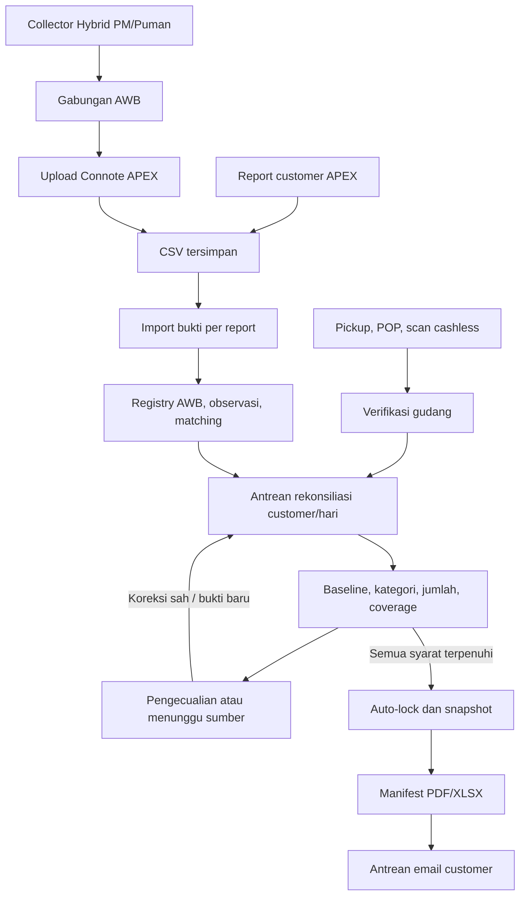

# Audit logika rekonsiliasi dan AWB cherry-picking saat ini

Tanggal audit: **13 November 2026**. Repositori: `S:/2026/dust`.

Audit ini membaca **working tree saat ini**, termasuk perubahan lokal yang belum dikomit, schema MySQL yang terhubung melalui Laravel Boost, query SELECT terbatas, konfigurasi nonrahasia, dan test yang sudah tersedia. Istilah **“diimplementasikan”** berarti ditemukan jalur kode yang dapat ditelusuri; bukan pernyataan bahwa versi tersebut sudah dipakai proses web/worker produksi. **Tidak ada test, collector, job operasional, migrasi, restart, build, deploy, commit, atau push yang dijalankan.** Satu-satunya file yang dibuat dalam audit ini adalah laporan ini. Credential, `.env`, dan token tidak dibuka.

Notasi rujukan `path:baris–baris` mengacu pada nomor baris working tree ketika audit dilakukan. Temuan database diberi kode **DB-01** dan seterusnya; query dan batas interpretasinya ada pada bagian *Unknowns & Missing Evidence*. Hasil beberapa SELECT adalah pengamatan berurutan, bukan snapshot transaksi tunggal.

## Executive Summary

1. **Rekonsiliasi bukan sekadar membandingkan angka.** Kode memeriksa baseline POP/gudang, atribusi customer/pickup, kategori, pembatalan, kesiapan report, barang pending, dan kelengkapan sumber. Angka sama dapat tetap membutuhkan pemeriksaan. Rujukan: `app/Actions/Pickup/ReconcileCustomerPickupDay.php:64–154`; `app/Actions/Pickup/QueryReconciliationWorkspace.php:75–107`.
2. **Penggabungan per customer dan hari operasional sudah diimplementasikan.** Beberapa buku diproses dalam satu bucket customer/hari; kepemilikan AWB tetap satu pickup. Hari operasional adalah 05.00 sampai sebelum 05.00 WIB berikutnya. Rujukan: `app/Actions/Pickup/ReconcileCustomerPickupDay.php:27–47,96–147`; `app/Actions/Pickup/PickupResultPeriod.php:10–26`.
3. **Customer dan pickup dapat dicocokkan otomatis** melalui kode/alias terdaftar, scan cashless, referensi persis, dan kode plus tanggal. Kesamaan jumlah atau kemiripan nama saja tidak menjadi bukti otomatis customer. Rujukan: `app/Actions/Reports/ResolveJneCustomerCodes.php:78–139`; `app/Actions/Reports/MatchJneShipments.php:64–167`; `app/Actions/Reports/SuggestJneCustomers.php:45–67`.
4. **Auto-lock dan snapshot immutable ada dalam kode, tetapi belum siap pada database terhubung.** Kolom `approval_snapshot` dan `post_lock_change` tidak ada, dan migrasinya tidak tercatat (DB-01). Auto-lock mengembalikan `PENDING_SCHEMA`; lock manual ditolak. Rujukan: `app/Actions/Pickup/ManageReconciliationWorkspace.php:101–106`; `database/migrations/2026_11_13_025019_add_approval_snapshot_to_pickup_customer_reconciliations.php:14–16`.
5. **Kelengkapan sumber merupakan hambatan yang terbukti.** Database tidak memiliki baris `jne_source_contracts`; 860 hasil pickup menyimpan `coverage.complete=false`, dua lainnya tidak memiliki field tersebut (DB-02/DB-06). Kedua jalur pembuktian kelengkapan membutuhkan kontrak. Rujukan: `app/Actions/Pickup/AssessPickupReportCoverage.php:20–72`; `app/Actions/Reports/QueryJneCollectionWindows.php:76–89`.
6. **Ada ketidakselarasan antara report Hybrid gabungan dan pembuktian otomatis.** Gabungan menyimpan `parameters.awbs`; pemeriksa kelengkapan otomatis menolak report dengan daftar itu. Report #1146 membuktikan bentuk data tersebut pada contoh nyata (DB-04). Rujukan: `app/Actions/Reports/CombineHybridReports.php:42–61`; `app/Actions/Pickup/AssessPickupReportCoverage.php:45–49`.
7. **SKII_ORI1, 7 Oktober: target 30 manual sudah terpenuhi, tetapi bukan tanpa masalah.** Ada 32 AWB terikat: 30 delivered dan dua cancelled, semuanya masih memiliki status atribusi `MATCHED`. Dua cancelled dikeluarkan dari hitungan confirmed tetapi tetap menambah alasan review; coverage juga false (DB-03/DB-04). Rujukan: `app/Actions/Pickup/ReconcilePickupProcessing.php:126–148`; `app/Actions/Pickup/ReconcileCustomerPickupDay.php:109–120`.
8. **Workspace V2 sudah mendukung pengecualian, rekomendasi berbukti, multi-select, preview, apply atomik, audit, dan hitung ulang otomatis.** Checkbox saja tidak mengubah database. Rujukan: `resources/js/components/reconciliation-investigation.tsx:162–227`; `app/Actions/Pickup/ManageReconciliationWorkspace.php:23–95`.
9. **Dua jalur koreksi masih hidup:** workspace customer/hari dan editor lama per buku/pending. Aturan kandidat dan kemampuan lintas harinya berbeda. Ini menambah beban memilih jalur yang benar. Rujukan: `app/Http/Controllers/ReconciliationWorkspaceController.php:38–109`; `app/Actions/Pickup/QueryPickupAwbCandidates.php:17–52`; `resources/js/components/reconciliation-workspace.tsx:1234–1267`.
10. **Otomatisasi membutuhkan flag, scheduler, dan consumer queue; uptime proses tidak dibuktikan audit ini.** Jadwal dan job tersedia, tetapi hasil database tidak membuktikan bahwa worker saat ini memuat working tree terbaru. Test otomatisasi tersedia dan dibaca, tidak dieksekusi ulang. Rujukan: `config/pickup.php:14–18`; `routes/console.php:7–10`; `app/Jobs/ReconcilePickupProcessingJob.php:14–58`; `tests/Feature/AutomaticReconciliationWorkspaceTest.php:20–68`.

## Current Architecture

Pengguna utama workspace adalah **admin/supervisor aktif** yang menangani pengecualian. Staff pickup menghasilkan bukti kunjungan, POP, dan scan; penerima handover menghasilkan baseline gudang. Hak koreksi workspace lebih sempit daripada hak menjalankan pickup/handover. Rujukan: `app/Http/Controllers/ReconciliationWorkspaceController.php:155–157`; `app/Actions/Pickup/FinalizePickup.php:19–83`; `app/Actions/Handover/VerifyItem.php:17–42`.



Diagram menggambarkan jalur kode, bukan konfirmasi layanan sedang berjalan. Penghubungnya: `app/Actions/Reports/ManageReportJobs.php:220–259,349–371`; `app/Actions/Reports/ProjectJneShipments.php:19–76`; `app/Actions/Pickup/ReconcileCustomerPickupDay.php:150–192`; `app/Actions/Pickup/DeliverPickupAwbManifest.php:24–40`.

| Lapisan | Penyimpanan utama | Peran dan bukti implementasi |
| --- | --- | --- |
| Bukti pickup | `pickup_tasks`, `pickup_visits`, `pickup_records`, revisi dan attachment | POP final dan revisi efektif; bukan angka yang boleh ditimpa oleh matching. `app/Actions/Pickup/FinalizePickup.php:33–83`; `app/Actions/Pickup/ReconcilePickupProcessing.php:101–115` |
| Gudang/handover | `handover_sessions`, `handover_items`, revisi | Membandingkan jumlah retail dengan POP dan mencatat revisi yang diverifikasi. `app/Actions/Handover/VerifyItem.php:29–42` |
| Scan cashless | `pickup_cashless_awbs`, batch/item entry | Bukti spesifik AWB/customer/pickup; juga menjadi syarat kesiapan handover. `app/Actions/Reports/MatchJneShipments.php:128–148`; `app/Actions/Handover/CashlessHandoverReadiness.php:16–41` |
| Koleksi report | `report_jobs`, event report, batch APEX | Mesin antrean database untuk Node collectors; terpisah dari PHP queue import. `app/Actions/Reports/ManageReportJobs.php:18–89,349–359` |
| Bukti dan registry | `jne_report_awbs`, `jne_shipments`, `jne_shipment_observations` | Bukti per report, satu identitas AWB global, observasi tracking. `app/Actions/Reports/ImportReportAwbs.php:19–89`; `app/Actions/Reports/ProjectJneShipments.php:24–55` |
| Aturan identitas/sumber | `jne_shipper_aliases`, `jne_customer_code_aliases`, `jne_source_contracts`, `jne_collection_windows` | Alias, scope account/tanggal, kontrak, pengesahan koleksi. `app/Actions/Reports/ResolveJneCustomers.php:19–62`; `app/Actions/Reports/ManageJneCollectionWindow.php:41–63` |
| Hasil kompilasi | `pickup_processing_reconciliations`, `pickup_customer_reconciliations`, event masing-masing | Hasil per buku dan agregat customer/hari beserta input version, alasan dan bukti. `app/Actions/Pickup/ReconcilePickupProcessing.php:133–157`; `app/Actions/Pickup/ReconcileCustomerPickupDay.php:155–172` |
| Keputusan operator | `pickup_awb_exclusions`, `pickup_pending_items`, `pickup_awb_review_events`, `jne_shipment_match_events` | Koreksi diaudit; pending memiliki jalur lintas hari sendiri. `app/Actions/Pickup/ReviewPickupAwbs.php:41–107` |
| Finalisasi dan pengiriman | snapshot approval, `pickup_awb_manifests`, items, deliveries dan attempts | Snapshot immutable dalam kode; manifest berversi dan pengiriman terpisah. `app/Actions/Pickup/ManageReconciliationWorkspace.php:149–162`; `app/Actions/Pickup/BuildPickupAwbManifest.php:20–61`; `app/Actions/Pickup/DeliverPickupAwbManifest.php:24–112` |

**Integritas yang terverifikasi pada schema terhubung (DB-01/DB-07):** unique AWB global; unique `(report_job_id, awb)`; satu observation per baris bukti; unique scan cashless AWB; satu hasil per pickup; satu grup per customer/tanggal; manifest unik per content hash/revisi; delivery unik per manifest/channel/recipient hash. Definisi kode terkait: `database/migrations/2026_10_24_150411_enforce_unique_awbs_on_jne_shipments.php:14–21`; `database/migrations/2026_10_28_075835_create_pickup_customer_reconciliations.php:11–40`; penulisan idempoten pada `app/Actions/Reports/ImportReportAwbs.php:87`; `app/Actions/Reports/ProjectJneShipments.php:27–42`; `app/Actions/Pickup/BuildPickupAwbManifest.php:40–44`; `app/Actions/Pickup/DeliverPickupAwbManifest.php:32–35`.

Konfigurasi aman yang dibaca adalah **default kode**, bukan nilai efektif `.env`: automation enabled=false, send enabled=false, auto_lock=true; evidence policies, category reconciliation, category markers, automatic retry, dan APEX pool masing-masing default=false. Pool APEX default 5, dibatasi 1–20. Nilai yang berbeda dapat diberikan lingkungan tanpa terlihat pada audit ini. Rujukan: `config/pickup.php:14–18`; `config/jne-reports.php:4–16`.

## Actual Reconciliation Flow

Seluruh tahap berikut memiliki implementasi. Aktivasi aktual tetap mengikuti batas bukti lingkungan pada laporan ini. **Urutan final dalam kode adalah hitung → lock → buat manifest → render → kirim**, bukan kirim terlebih dahulu lalu lock. Rujukan: `app/Actions/Pickup/ReconcileCustomerPickupDay.php:173–187`.

| Tahap | Trigger dan input | Proses, output, tabel, class/job/status | Kegagalan atau penundaan |
| --- | --- | --- | --- |
| 1. Pickup dibuat | Permintaan actor dan customer, jadwal, alamat, submission key | Transaksi `CreatePickupTask`; membuat `pickup_tasks` dan event; admin dapat menghasilkan tugas belum assigned, staff dapat self-assigned. Sinkron; observer menginvalidasi bucket terkait jika relevan. `app/Actions/Pickup/CreatePickupTask.php:16–61`; `app/Observers/PickupAutomationObserver.php:15–31` | Hak, customer/jadwal/input tidak sah, submission key dipakai untuk payload berbeda. `app/Actions/Pickup/CreatePickupTask.php:18–49` |
| 2. Eksekusi | Start dengan versi tugas, lalu hasil kunjungan | `StartPickup` membuat visit dan waktu mulai; `RecordPickupVisit` menyimpan outcome dan waktu, hasil tanpa paket menjadi `NO_PACKAGES`. Tabel tasks/visits/events; sinkron. `app/Actions/Pickup/StartPickup.php:12–28`; `app/Actions/Pickup/RecordPickupVisit.php:12–29` | Versi stale, assignment/hak/outcome tidak sah. Kunjungan bukan POP final. File yang sama: baris 14–26 |
| 3. POP final | Jumlah tiga kategori, signature/foto, kunjungan, daftar cashless dan submission key | `FinalizePickup` menyimpan record, attachment, receipt awal, scan cashless; task `PICKED_UP`. Jumlah cashless harus sama dengan AWB unik ketika capture dipakai. Observer → antrean reconciliation setelah commit. `app/Actions/Pickup/FinalizePickup.php:23–83`; `app/Providers/AppServiceProvider.php:43–44` | Versi stale, daftar scan berbeda dari POP final, jumlah/duplikat scan tidak sah, file gagal. File yang sama: baris 33–78 |
| 4. Handover diverifikasi | Sesi, item, jumlah gudang dan versi | `VerifyItem` menyimpan jumlah dan status perbandingan, revisi POP yang diverifikasi; sesi `IN_VERIFICATION`. `CloseSession` menutup sesi dan audit; tabel handover. `app/Actions/Handover/VerifyItem.php:19–42`; `app/Actions/Handover/CloseSession.php:14–33` | Cashless belum berhasil/approved atau jumlah scan tak sesuai; POP berubah; discrepancy tanpa catatan; sesi stale. `app/Actions/Handover/CashlessHandoverReadiness.php:16–41`; `app/Actions/Handover/CloseSession.php:23–30` |
| 5. Koleksi Hybrid/APEX | Profil jatuh tempo, permintaan/rentang admin | `QueueScheduledJneReports` membuat jobs; Node claim report_jobs. Hybrid manual/cashless → `SOURCE_SAVED`; gabungan → `WAITING_APEX`; Node APEX menghasilkan CSV → `COMPLETED`. `app/Actions/Reports/QueueScheduledJneReports.php:17–100`; `app/Actions/Reports/ManageReportJobs.php:18–89,178–259`; `app/Actions/Reports/CombineHybridReports.php:12–61` | Sesi/network/form/history/file, child gagal; retry yang aman atau `NEEDS_ATTENTION`. `app/Actions/Reports/ReportRetryPolicy.php:90–136` |
| 6. Import AWB | CSV tersimpan, checksum dan enqueue import | `ImportJneReportAwbs` default PHP queue → `ImportReportAwbs`, lalu `ProjectJneShipments`. Upsert bukti per report/AWB; registry/observasi; `IMPORTED` lalu `PROJECTED`. `app/Actions/Reports/ManageReportJobs.php:349–359`; `app/Jobs/ImportJneReportAwbs.php:27–45`; `app/Actions/Reports/ImportReportAwbs.php:19–89` | CSV/checksum/header/storage/DB; timeout worker; import atau projection `FAILED`. CSV dapat dipakai ulang tanpa koleksi ulang. `app/Jobs/ImportJneReportAwbs.php:31–62` |
| 7. Customer attribution | Bukti baru, mapping run, rekalkulasi | `MatchJneShipments` menggabungkan riwayat bukti lalu `ResolveJneCustomers/ResolveJneCustomerCodes`; simpan customer status/metode/kandidat dan match event jika berubah. `app/Actions/Reports/MatchJneShipments.php:42–100,277–294,330–335` | Alias/kode bertentangan, customer nonaktif, hanya kandidat, bukti review berubah; tidak memilih customer dari jumlah. File yang sama: baris 71–93,209–231 |
| 8. Category matching | Projection, sync, reevaluation | `ResolveJneCategories`: kontrak, origin Hybrid, prefix, report customer APEX, scan → kategori/status/evidence; `jne_shipments`, match event `CATEGORY`. `app/Actions/Reports/ResolveJneCategories.php:56–134` | Flag mati, tanpa marker, bukti silang kategori, keputusan review ditentang. File yang sama: baris 18–31,116–124 |
| 9. Quantity reconciliation | Observer, import setelah commit, scheduler, atau admin recheck | Queue `reconciliation`, `ReconcilePickupProcessingJob` → per buku lalu `ReconcileCustomerPickupDay`; expected/confirmed/shortfall/excess tersimpan dan diaudit. `app/Actions/Pickup/ReconcilePickupProcessing.php:24–28,133–157`; `app/Actions/Pickup/ReconcileCustomerPickupDay.php:64–164` | Baseline belum final, pending, source unready, unconfirmed, excess, coverage belum lengkap. File yang sama: baris 79–154 |
| 10. Penandaan cocok | Tahap 7–9 | `MATCHED` customer, pickup, kategori terpisah dari state agregat. Hasil per buku dapat `DONE` meski coverage false; grup customer/hari saat ini menurunkannya ke `WAITING_DATA`. `app/Actions/Reports/MatchJneShipments.php:240–294`; `app/Actions/Pickup/ReconcilePickupProcessing.php:144–150`; `app/Actions/Pickup/ReconcileCustomerPickupDay.php:150–154` | Label “Cocok” satu dimensi tidak menjamin eligible lock |
| 11. Exception | Evaluasi dan pembacaan workspace | Alasan/evidence hasil dipersistenkan; daftar discrepancy UI diturunkan oleh `QueryReconciliationWorkspace`, bukan seluruhnya objek antrean mandiri. Jenis identity/category/cancelled/source/missing/excess/post-lock. `app/Actions/Pickup/ReconcileCustomerPickupDay.php:155–163`; `app/Actions/Pickup/QueryReconciliationWorkspace.php:125–154` | Waiting sumber normal dibedakan dari source failure; alasan generik dapat menduplikasi konteks kasus. File query: baris 117–151 |
| 12. Cherry-picking | Admin memilih AWB dan tindakan | Frontend selection lokal → preview → apply; transaksi `ManageReconciliationWorkspace` → `ReviewPickupAwbs` → `ReviewJneExceptions`; event/exclusion/attribution berubah, POP/gudang tetap. `resources/js/components/reconciliation-investigation.tsx:173–227`; `app/Actions/Pickup/ManageReconciliationWorkspace.php:23–95`; `app/Actions/Pickup/ReviewPickupAwbs.php:41–107` | Hak, versi/hash stale, ownership, category, source, tanggal, cashless claim, lock atau delivery tak pasti |
| 13. Evaluasi ulang | Apply valid, bukti baru, perubahan POP/gudang/aturan, jadwal due | Apply memanggil rekonsiliasi satu kali setelah batch; import/rule change mengantrekan; hasil memperbarui evaluated input version dan next evaluation +5 menit. `app/Actions/Pickup/ManageReconciliationWorkspace.php:81–87`; `app/Actions/Reports/ProjectJneShipments.php:59–74`; `app/Observers/PickupAutomationObserver.php:15–31`; `app/Actions/Pickup/ReconcilePickupProcessing.php:157` | Tidak ada consumer/flag, backlog, unique lock tertahan, error atau source completeness tak dapat dibuktikan |
| 14. Dokumen dan email | Grup DONE serta approval, atau cabang kompatibilitas auto_lock=false | `BuildPickupAwbManifest` membuat versi/idempotency hash → queue documents `RenderPickupAwbManifestJob` → READY → queue deliveries. Pengiriman diperiksa ulang sebelum SMTP. `app/Actions/Pickup/ReconcileCustomerPickupDay.php:183–192`; `app/Actions/Pickup/BuildPickupAwbManifest.php:20–61`; `app/Actions/Pickup/RenderPickupAwbManifest.php:20–60`; `app/Actions/Pickup/DeliverPickupAwbManifest.php:24–111` | Renderer/Node/storage gagal; preferensi/SMTP tidak siap; dirty group/post-lock conflict; hasil kirim UNKNOWN menahan resend |
| 15. Lock/finalisasi | Setelah kalkulasi memenuhi syarat, sebelum manifest | `ManageReconciliationWorkspace::lock(automatic:true)` mengunci row, memverifikasi input/sumber, menyimpan approval dan audit `AUTO_LOCK`. Manual tersedia sebagai endpoint sekunder; reopening resmi diaudit. `app/Actions/Pickup/ReconcileCustomerPickupDay.php:173–175`; `app/Actions/Pickup/ManageReconciliationWorkspace.php:101–165` | Database terhubung belum memiliki kolom snapshot (DB-01); bukti belum lengkap; revisi stale; delivery SENDING/UNKNOWN |

**Bukti pickup dan rekapan AWB adalah pengiriman berbeda.** Receipt dibuat pada finalisasi POP; `SendPickupReceipt` memiliki pemeriksaan recipient/SMTP/status provider sendiri. Rekapan AWB mengikuti manifest rekonsiliasi. Tidak boleh menyimpulkan kedua email otomatis terkirim hanya karena pickup final. Rujukan: `app/Actions/Pickup/FinalizePickup.php:81`; `app/Actions/Pickup/SendPickupReceipt.php:16–43`; `app/Actions/Pickup/DeliverPickupAwbManifest.php:24–40`.

## Matching Rules

### Prioritas aktual: gabungan bukti, bukan fallback bebas konflik

| Bukti/aturan | Perilaku aktual | Cocok otomatis atau menjadi pengecualian | Rujukan |
| --- | --- | --- | --- |
| Nama pengirim | Normalisasi alias nama persis yang aktif; filter scope account/tanggal; customer aktif | Satu pemilik → MATCHED; beberapa → AMBIGUOUS; tanpa alias → UNMATCHED. Nama nonidentifying tidak dipakai sebagai identitas | `app/Actions/Reports/ResolveJneCustomers.php:19–49`; `app/Actions/Reports/JneEvidenceScope.php:10–27` |
| Kolom kode sumber | Hanya kolom yang ditetapkan kontrak aktif/verified; kode dinormalisasi tanpa mengubahnya menjadi integer | Exact master/alias verified satu customer; bukti berbeda pemilik → CONFLICT | `app/Actions/Reports/ResolveJneCustomerCodes.php:23–41,78–88,173–188` |
| Kode awal shipper | Token awal dimulai angka; exact master/alias didahulukan | Akhiran satu huruf seperti 864C dapat fallback ke 864 **hanya ketika token lengkap tidak terdaftar dalam master/alias yang diperiksa**. Tidak menghapus seluruh huruf sembarang; 00/01 tetap string berbeda | `app/Actions/Reports/ResolveJneCustomerCodes.php:43–57,78–109` |
| Konflik nama versus kode | Tidak memilih salah satu dengan mengabaikan bukti lawan | Kode berbeda dari alias nama atau alias nama ambigu → CONFLICT | `app/Actions/Reports/ResolveJneCustomers.php:51–61` |
| Semua report untuk AWB sama | Menggabungkan keputusan dari riwayat sumber; bukan hanya shipper terakhir | Beberapa customer verified sepanjang riwayat → CONFLICT; satu customer verified dapat menguatkan identitas; kemiripan hanya CANDIDATE | `app/Actions/Reports/MatchJneShipments.php:42–100` |
| JNE account / shared account | Membatasi alias berscope dan pencarian referensi; **bukan pengganti kode customer** pada resolver ini | Account bersama saja tidak menentukan customer. Satu account tidak membuktikan semua AWB milik customer yang sedang dibuka | `app/Actions/Reports/ResolveJneCustomers.php:17–67`; `app/Actions/Reports/JneEvidenceScope.php:12–27`; `tests/Feature/ReconciliationWorkspaceTest.php:248–255` |
| Dropship/nonidentifying shipper | Jalur yang ditemukan menggunakan daftar nama nonidentifying dan alias/kode/scan independen; tidak ada inferensi “nama penerima = customer” dalam resolver ini | Tetap UNMATCHED/CANDIDATE bila tidak ada identitas sah lain; nama mirip bukan otorisasi otomatis | `app/Actions/Reports/SuggestJneCustomers.php:25–38,45–67`; `app/Actions/Reports/ResolveJneCustomers.php:34–35` |
| Scan cashless / Sertim | AWB scan mempunyai customer dan pickup spesifik | Menghasilkan metode SERTIM; customer/reference berbeda atau claim tidak valid menjadi CONFLICT, bukan mengalahkan bukti lawan secara diam-diam | `app/Actions/Reports/MatchJneShipments.php:128–167,242–247` |
| Referensi/HO | Cari `PickupProcessingRecord.external_reference` dan `PickupTask.reference` persis, scoped customer, bukti final | Satu pickup → MATCHED; beberapa → AMBIGUOUS; sumber dan scan menunjuk berbeda → CONFLICT. Nama penerima tidak menjadi tie-breaker | `app/Actions/Reports/MatchJneShipments.php:103–167,240–247` |
| Kode + tanggal | Prefix terdaftar pada report completed/imported, atau kolom verified dengan `pickup_date_column=TGL_ENTRY` dan automatic_reconciliation | Operational date tunggal; satu pickup harus sudah verified gudang. Beberapa pickup menjadi kandidat bucket; tanggal sumber berlawanan → CONFLICT | `app/Actions/Reports/MatchJnePickupDates.php:20–72` |
| Existing attribution | Pertahankan pemilik buku terdahulu ketika bukti baru berbeda, tetapi tandai ambigu/conflict; FIFO sebelumnya dapat dipertahankan | Mencegah pemindahan otomatis antarbuku. Pemilik lama tidak berarti bukti selalu valid | `app/Actions/Reports/MatchJneShipments.php:233–275` |
| Manual override | REVIEW memakai hash keputusan; MANUAL dipertahankan kecuali konflik tertentu | REVIEW yang hash-nya berubah → CONFLICT meski pointer dipertahankan. MANUAL tidak ditimpa otomatis | `app/Actions/Reports/MatchJneShipments.php:209–231`; `app/Actions/Reports/ReviewJneExceptions.php:63–84` |
| Guard alokasi | Target locked/DONE/review-open, exclusion, pending lama, beda tanggal membatasi assignment baru | Gagal memenuhi guard → UNMATCHED tanpa memaksa alokasi | `app/Actions/Reports/MatchJneShipments.php:174–199,258–268`; `app/Actions/Pickup/PickupAwbEligibility.php:49–61` |

**UNKNOWN bukan sinonim semua AWB belum cocok.** Tracking mengenal `UNKNOWN`; customer/pickup memakai `UNMATCHED`, `CANDIDATE`, `AMBIGUOUS`, `CONFLICT`, `MATCHED`. Category resolver menghasilkan MATCHED/UNMATCHED/CONFLICT; data belum dikonfigurasi dapat mempunyai penanda lama seperti UNCONFIGURED. `REVIEW`/`MANUAL` juga dipakai sebagai *method*, bukan selalu nilai status attribution. Rujukan: `app/Models/JneShipment.php:23–30`; `app/Actions/Reports/ResolveJneCategories.php:116–130`; `app/Actions/Reports/MatchJneShipments.php:209–240`.

### Pseudocode ringkas dari implementasi aktual

```text
untuk setiap AWB dalam sumber yang diproses:
    history = seluruh jne_report_awbs untuk AWB itu, urut id
    decisions = gabungkan exact shipper alias + registered code untuk tiap sumber
    bila pemilik verified bertentangan -> customer CONFLICT
    bila satu pemilik verified -> customer MATCHED
    bila belum cocok -> nama/kode mirip hanya menjadi CANDIDATE

    bila ada claim scan:
        bila claim bertentangan dengan customer/bukti -> CONFLICT
        selain itu sertakan pickup claim sebagai SERTIM
    sertakan pickup dari referensi persis yang scoped ke customer
    bila belum ada pickup dan customer MATCHED:
        gunakan CUSTOMER_CODE_DATE bila bukti tanggal memenuhi syarat

    bila keputusan terdahulu REVIEW:
        hash sama -> pertahankan
        hash berubah -> pertahankan pointer, tandai CONFLICT, berhenti
    bila keputusan terdahulu MANUAL:
        pertahankan; tandai konflik jika bukti terlarang bertentangan; berhenti
    bila alokasi FIFO lama masih dalam kandidat customer/hari -> pertahankan owner
    1 kandidat -> MATCHED; >1 -> AMBIGUOUS; 0 -> UNMATCHED
    bila owner lama berbeda -> pertahankan owner lama dengan ambiguity/conflict
    bila assignment baru melanggar lock/exclusion/tanggal/pending -> jangan assign
    simpan atribut dan audit hanya jika keputusan berubah
```

Rujukan pseudocode: `app/Actions/Reports/MatchJneShipments.php:42–167,174–294`; resolver kode/nama: `app/Actions/Reports/ResolveJneCustomers.php:17–67`; tanggal: `app/Actions/Reports/MatchJnePickupDates.php:20–72`. Ini tidak menambahkan aturan berdasar jumlah.

**Kategori diuji terpisah dari identitas.** Prefix numerik 0101/0166 → manual; CM/TG → cashless ketika markers aktif. Origin Hybrid manual/cashless, scan claim, mapping kontrak, dan report customer APEX mode P → CSS/Orion juga menjadi bukti. Beberapa kategori sah yang bertentangan menjadi CONFLICT; report APEX customer tidak selalu menimpa bukti manual lama. Rujukan: `app/Actions/Reports/ResolveJneCategories.php:70–118`.

**Catatan audit CATEGORY:** contoh AWB `010150080519926` memiliki 302 event CATEGORY historis (DB-08). Working tree sekarang sudah reload state dengan row lock, membandingkan evidence dengan pengurutan key object JSON, dan melewatkan no-op identik. Bukti baru yang berubah tetap dapat menghasilkan audit meski nilai kategori tidak berubah. Tidak ada penghapusan audit lama dalam alur ini. Akar historis seluruh 302 event tidak dapat dipastikan hanya dari kode terbaru. Rujukan: `app/Actions/Reports/ResolveJneCategories.php:41–50,126–159`; `tests/Feature/JneCategoryEvidenceReplayTest.php:13–82`.

## Cherry-Picking Logic

### Dua pintu masuk yang masih tersedia

**Workspace V2** berorientasi customer/hari, data kandidat 30 per halaman, exception-first. **Editor lama** berorientasi buku, menyediakan pending lintas hari dan rekomendasi kemiripan; keduanya berujung pada action review yang diaudit. Tidak tepat menjelaskan aturan kandidat keduanya sebagai satu algoritma. Rujukan: `app/Http/Controllers/ReconciliationWorkspaceController.php:38–109`; `app/Actions/Pickup/QueryPickupAwbCandidates.php:17–52`; `resources/js/components/reconciliation-workspace.tsx:1234–1267`; `app/Actions/Pickup/ReviewPickupAwbs.php:25–107`.

| Pertanyaan | Jawaban berdasarkan kode Workspace V2 |
| --- | --- |
| 1. Kandidat berasal dari mana? | `jne_shipments` dan latestSource report. Mode included/exceptions memakai scope grup; candidates/suggested mengambil latestSource dalam hari operasional pilihan. `app/Http/Controllers/ReconciliationWorkspaceController.php:59–78` |
| 2. Hanya customer sama? | Tidak untuk mode candidates. Suggested dibatasi bukti customer terverifikasi, scan grup, atau referensi pickup persis; bukan seluruh daftar random. File controller: baris 64–78 |
| 3. Bisa customer lain? | Ya, kandidat dapat ditemukan. ADD hanya dapat diterapkan jika AWB belum dimiliki buku lain dan seluruh guard sah; perubahan customer explicit ditampilkan before/after. `app/Actions/Pickup/ManageReconciliationWorkspace.php:47–74` |
| 4. Unknown ikut? | Shipment dengan identitas belum terpetakan dapat muncul pada candidates bila latestSource/tanggal/filter sesuai. Suggested memerlukan bukti penghubung sehingga tidak otomatis memuat semua unknown. `app/Http/Controllers/ReconciliationWorkspaceController.php:64–78` |
| 5. Lintas tanggal? | Dapat **diinvestigasi** dengan filter date; ADD/CONFIRM biasa tetap ditolak jika bukan hari bucket target. Lintas hari harus melalui pending tercatat pada jalur buku. Controller baris 60–64; `app/Actions/Pickup/ManageReconciliationWorkspace.php:57–58`; `app/Actions/Pickup/ReviewPickupAwbs.php:50–61` |
| 6. Filter apa? | q pada AWB atau shipper; account, kategori, source, latest report, match_status, tanggal, mode. q **tidak mencari penerima** walaupun tabel diurutkan penerima. `app/Http/Controllers/ReconciliationWorkspaceController.php:41–44,84–97` |
| 7. Urutan? | Suggested: scan grup dahulu, referensi persis berikutnya, lalu customer terverifikasi; selanjutnya nama penerima tidak kosong A–Z, AWB, id. Mode lain memakai urutan penerima/AWB/id. Ranking tidak memakai kemiripan jumlah. Controller baris 79–97 |
| 8–10. Pilih langsung mengubah attribution/jumlah? | Tidak. Checkbox mengubah state `selected` lokal, tidak POST. Preview juga tidak menulis attribution. Apply yang sah mengubah ownership/decision dan confirmed; jumlah POP/handover tetap. `resources/js/components/reconciliation-investigation.tsx:173–227`; `app/Actions/Pickup/ManageReconciliationWorkspace.php:69–94` |
| 11. Konfirmasi? | Alasan minimal lima karakter, target buku, preview hash, dialog before/after dan konflik, lalu apply. `resources/js/components/reconciliation-investigation.tsx:180–219,705–809`; `app/Http/Controllers/ReconciliationWorkspaceController.php:149–152` |
| 12. Multi-select? | Ya, maksimum 100 id distinct/request, dapat tersimpan lokal melintasi pagination/filter selama komponen tidak di-remount. Tidak berarti select-all seluruh database. `resources/js/components/reconciliation-investigation.tsx:140–146,173–178,240–246,458–479`; controller baris 151–152 |
| 13. Konflik customer? | Customer berbeda dapat dikoreksi eksplisit oleh admin bila unowned dan semua guard lolos; pemilik buku lain/claim Sertim lain tidak dapat ditimpa dari target. Beda mapped customer sendiri bukan unconditional block dalam preview. `app/Actions/Pickup/ManageReconciliationWorkspace.php:47–74` |
| 14. Duplikat? | Unique AWB registry dan scan; request distinct id, row locks, ownership check, revision/version/hash. Semua baris divalidasi sebelum batch diterapkan; error menggulung transaksi. DB-07; `app/Http/Controllers/ReconciliationWorkspaceController.php:151–152`; `app/Actions/Pickup/ManageReconciliationWorkspace.php:25–42,76–95` |
| 15. Undo? | Sebelum apply, deselect/batalkan preview. Setelah apply tidak ada undo universal satu klik: koreksi berlawanan harus sah, menggunakan versi terbaru dan audit; locked snapshot perlu REOPEN resmi. `resources/js/components/reconciliation-investigation.tsx:173–178,673,734–739`; `app/Actions/Pickup/ManageReconciliationWorkspace.php:132–136`; `app/Actions/Pickup/ReviewPickupAwbs.php:33–38,67–75` |
| 16. Audit? | Match event, review event dengan actor/alasan/before-after, exclusion, snapshot grup/event. Evidence dan history dipaginasi. `app/Actions/Pickup/ReviewPickupAwbs.php:44–45,69–78,100–101`; `app/Http/Controllers/ReconciliationWorkspaceController.php:112–121` |
| 17. Siapa? | Admin supervisor aktif; pembacaan workspace dan mutation memeriksa hak, action juga mengunci/revalidasi actor. `app/Http/Controllers/ReconciliationWorkspaceController.php:155–157`; `app/Actions/Pickup/ManageReconciliationWorkspace.php:168–170` |
| 18. Dapat diotomatisasi? | Untuk exact identity/date/scan/reference dan bucket unambiguous: sudah ada matching/FIFO/group-binding otomatis. Untuk typo hanya kandidat, cross-customer disputed, cancelled, sumber tak lengkap dan bukti kontradiktif: tidak ada dasar aman untuk mengotomatisasi hanya karena jumlah pas. `app/Actions/Reports/MatchJneShipments.php:128–167`; `app/Actions/Pickup/AllocatePickupAwbBuckets.php:44–91`; `app/Actions/Pickup/ReconcileCustomerPickupDay.php:109–147` |

**Tindakan aktual:** ADD menambah AWB unowned; CONFIRM mengesahkan AWB yang sudah dimiliki target; REMOVE melepas ke unowned dan menyimpan exclusion target. Default action UI adalah CONFIRM pada exceptions dan ADD pada mode awal lainnya. Ini berarti sebuah exception unowned mungkin membutuhkan perubahan action ke ADD; cancelled tidak bisa diselesaikan dengan CONFIRM. Rujukan: `resources/js/components/reconciliation-investigation.tsx:143–147`; `app/Actions/Pickup/ManageReconciliationWorkspace.php:47–67`; `app/Actions/Pickup/ReviewPickupAwbs.php:64–75`.

**Setelah apply:** semua baris diterapkan dalam transaksi, review-open anggota diakhiri, satu rekonsiliasi grup berjalan. Auto-lock dapat menyusul tanpa approval baru bila eligible dan schema siap. Namun copy UI yang menjanjikan auto-lock tidak membuktikan schema/coverage lingkungan sudah siap. Rujukan: `app/Actions/Pickup/ManageReconciliationWorkspace.php:81–94,103–106`; `app/Actions/Pickup/ReconcileCustomerPickupDay.php:173–187`.

### Endpoint dan komponen

Semua route berikut berada dalam grup auth; controller menambah pemeriksaan admin. Base `/hasil-pickup/{task}/reconciliation/`: GET `workspace`, GET `awbs`, GET `awbs/{shipment}`, POST `preview`, POST `apply`, POST `lock`. Legacy: GET `/hasil-pickup/{task}/automation/candidates`, POST `/hasil-pickup/{task}/automation/review`, POST `/hasil-pickup/{task}/automation/recheck`; bulk POST `/rekonsiliasi-resi/validate`. Rujukan: `routes/web.php:53,99–114`.

Frontend utama: `resources/js/components/reconciliation-workspace.tsx:113–180`; tabel/filter/multiselect/dialog: `resources/js/components/reconciliation-investigation.tsx:115–269,705–824`. Klik nomor AWB membuka **detail shipment**; tombol “Bukti pencocokan” membuka sheet atribusi yang terpisah. Detail penerima/pengirim/status ada di `resources/js/components/jne-shipment-detail-sheet.tsx:52–104`; evidence/history sekunder di `resources/js/components/reconciliation-awb-evidence.tsx:142–219`. Ini adalah kode terbaru yang ditemukan, bukan hasil observasi browser produksi.

## Quantity Calculation

### Sumber kebenaran dan formula

Untuk kategori `c ∈ {manual_hybrid, cashless_hybrid, css_orion}` dan anggota buku `i` pada customer/hari yang sama:

```text
POP[c]      = Σ effective finalized POP_i[c], atau null bila ada POP belum final
Gudang[c]   = Σ effective handover_i[c], atau null bila ada bukti belum tersedia
baseline    = setiap anggota punya POP final dan handover VERIFIED,
              handover tidak needsReview, dan POP_i[c] = Gudang_i[c] semua kategori
Expected[c] = Gudang[c] jika baseline sah; selain itu null

Confirmed   = AWB registry unik dalam scope yang lulus seluruh syarat:
              customer matched dan sesuai bucket, kategori matched,
              source READY, tracking bukan CANCELLED,
              ownership/tanggal/pending sah; atau pool aman sesuai aturan grup
Matched[c]  = jumlah Confirmed berkategori c
Missing[c]  = max(0, Expected[c] - Matched[c]) bila expected diketahui
Excess[c]   = max(0, Matched[c] - Expected[c]) bila expected diketahui
Unconfirmed = jumlah seluruh scope - jumlah Confirmed
JumlahPas   = baseline sah AND total Expected > 0
              AND Matched[c] = Expected[c] untuk setiap kategori
```

Formula berasal dari `app/Actions/Pickup/ReconcileCustomerPickupDay.php:64–85,109–134`; versi per buku dari `app/Actions/Pickup/ReconcilePickupProcessing.php:103–148`. Pending lintas hari hanya sah jika ada item PROCESSED yang mengikat shipment dan processing_date operasional: `app/Actions/Pickup/PickupAwbEligibility.php:27–61`.

**Expected bukan otomatis POP mentah:** POP dan gudang wajib sama per kategori/revisi terlebih dahulu, baru gudang efektif menjadi expected. `successful_quantity` catatan processing atau kolom QTY CSV bukan jumlah AWB confirmed; satu canonical AWB dihitung satu, bukan jumlah koli. Rujukan: `app/Actions/Pickup/ReconcileCustomerPickupDay.php:72–85,124–127`; `app/Actions/Pickup/ReconcilePickupProcessing.php:126–138`; test QTY berbeda tetap 17 AWB: `tests/Feature/PickupCodeDateMatchingTest.php:28–30,50–55`.

**Observed berbeda dari matched.** Workspace menghitung semua row scope per kategori sebagai observed, termasuk yang belum sah. Bila tak ada observasi dan coverage belum proven, nilainya null, bukan nol pasti. Metric unmatched hanya customer UNMATCHED; pending_review lebih luas, mencakup pickup/kategori/cancelled/source. Rujukan: `app/Actions/Pickup/QueryReconciliationWorkspace.php:97–113,160–165`.

### Dampak praktis

- **Total sama lintas kategori tidak cukup.** Kekurangan manual tidak ditutup kelebihan Orion. Setiap kategori dibandingkan sendiri. `app/Actions/Pickup/ReconcileCustomerPickupDay.php:123–134`; `tests/Feature/CustomerPickupDayReconciliationTest.php:72–84`.
- **Jumlah sama tidak membuktikan set AWB fisik yang sama.** POP manual/Orion pada baseline berisi count, bukan daftar nomor wajib. Bila semua kandidat sudah punya identitas/tanggal/kategori sah dan jumlah pas, sistem dapat menganggap konsisten dan mengikat pool. Cashless mempunyai scan AWB sebagai bukti lebih spesifik. Tidak ditemukan perbandingan daftar expected-manual AWB dari POP terhadap daftar actual. `app/Actions/Pickup/FinalizePickup.php:33–69`; `app/Actions/Pickup/ReconcileCustomerPickupDay.php:109–147`; `app/Actions/Reports/MatchJneShipments.php:128–148`.
- **Attribution memengaruhi hitungan.** Search daftar pengiriman dapat menemukan semua nomor tetapi rekonsiliasi mengecualikan yang belum sah customer/pickup/category/source. `app/Actions/Pickup/ReconcilePickupProcessing.php:78–100,126–131`.
- **AWB cancelled yang MATCHED tetap memblokir.** MATCHED menerangkan hubungan, bukan keabsahan shipment. Tidak dihitung confirmed; masih ada dalam scope dan menjadi alasan review. `app/Actions/Pickup/ReconcileCustomerPickupDay.php:100–120`; `app/Actions/Pickup/QueryReconciliationWorkspace.php:97–99,131`.
- **FIFO tersedia tetapi dibatasi bukti.** Eligible pool sudah verified customer/day/category/source, unowned dan bukan cancelled/claim. Kapasitas tersisa dikurangi AWB owned dan pending; tugas diurut waktu pickup/id. Pending lama, lock, review dan gudang tidak sah menghentikan feeding. `app/Actions/Pickup/AllocatePickupAwbBuckets.php:33–91`.
- **Bukti terlambat dapat mengubah kalkulasi terkini.** Setelah lock, snapshot approval tetap; konflik material dipisahkan menjadi post-lock change. `app/Actions/Pickup/ReconcileCustomerPickupDay.php:200–233`.

## Source Completeness

### Definisi yang benar-benar dipakai

“Semua AWB yang ditemukan cocok” adalah pernyataan tentang **anggota yang terlihat**. “Sumber lengkap” adalah pernyataan tentang **cakupan koleksi**, termasuk kemungkinan AWB yang belum pernah masuk. Kode sengaja tidak menyamakan keduanya. Rujukan: `app/Actions/Pickup/AssessPickupReportCoverage.php:25–72`; `app/Actions/Pickup/QueryReconciliationWorkspace.php:91–107`.

Ada dua jalur:

| Jalur | Syarat bukti | Kapan invalid kembali? |
| --- | --- | --- |
| `ADMIN_ATTESTATION` | Window COMPLETE, fitur attestation aktif, kontrak aktif verified, report yang dipilih siap dan mewakili requirements, POP final, cutoff tidak di masa depan, hash bukti dan audit tersimpan | Kontrak dinonaktifkan; observasi baru pada AWB atau scope sumber; POP/Sertim berubah; metadata/status report berubah. `app/Actions/Reports/ManageJneCollectionWindow.php:23–63`; `app/Actions/Reports/QueryJneCollectionWindows.php:19–89` |
| `AUTOMATIC_VERIFIED_CONTRACT` | Evidence policies dan category reconciliation aktif; kontrak verified automatic=true, mode complete_date_report, kolom kode dan requirements tersedia. Setiap source/account/tanggal wajib punya **report id terbaru** COMPLETED/IMPORTED/PROJECTED, checksum, bukan parameters.awbs subset; kontrak sumbernya juga complete. Semua AWB matched yang terikat harus terwakili report terpilih | Report terbaru belum siap/gagal, requirement/kontrak tidak memenuhi syarat, atau AWB tak tercakup. `app/Actions/Pickup/AssessPickupReportCoverage.php:24–69` |

Kegagalan kedua jalur berakhir `AWAITING_EVIDENCE` dengan pesan umum cakupan belum terbukti. Tidak ada timer yang mengubah “belum terbukti” menjadi COMPLETE hanya karena sudah menunggu lama. **Dapat menunggu tanpa batas** apabila prasyarat tak pernah tersedia. Rujukan: `app/Actions/Pickup/AssessPickupReportCoverage.php:28–72`.

**Download berhasil belum cukup:** COMPLETED hanya status penarikan; import/projection masih dapat belum selesai atau gagal. `ReportJob::workflowStage()` baru READY jika completed+imported+projected; coverage menambah kontrak, periode dan cakupan. Rujukan: `app/Models/ReportJob.php:73–85`; `app/Actions/Pickup/AssessPickupReportCoverage.php:45–64`.

**Deteksi report belum masuk** dilakukan dengan mencocokkan requirement `source:report_type[:account]` terhadap rentang date_from/date_thru. Tidak ditemukan ledger global “semua source harus selesai tanggal X” yang berdiri sendiri; kontrak/window dan report_jobs menjadi acuannya. Tanpa requirements, panel dapat UNKNOWN. Rujukan: `app/Actions/Pickup/AssessPickupReportCoverage.php:30–60`; `app/Actions/Pickup/QueryReconciliationWorkspace.php:191–240`.

### Batas tanggal dan kelemahan pembuktian

1. Matching memakai tanggal operasional 05.00 WIB. Coverage otomatis memakai gabungan **tanggal kalender entry JNE lokal** dan tanggal operasional POP. Paket pukul 02.00 besok dapat menuntut report dua tanggal kalender. `app/Actions/Pickup/PickupResultPeriod.php:19–26`; `app/Actions/Pickup/AssessPickupReportCoverage.php:24–26,44–46`.
2. Latest report dipilih berdasarkan id, **bukan latest successful**. Report baru yang masih berjalan/gagal dapat menggagalkan coverage walaupun report terdahulu siap. Panel UI menyimpan id sukses dan id terbaru, tetapi hasil final mengikuti assessor. `app/Actions/Pickup/AssessPickupReportCoverage.php:45–49`; `app/Actions/Pickup/QueryReconciliationWorkspace.php:202–238`.
3. Report Hybrid gabungan selalu menulis daftar `parameters.awbs` hasil koleksi. Assessor menolak daftar nonkosong tersebut sebagai subset; child Hybrid berhenti SOURCE_SAVED, bukan COMPLETED/IMPORTED/PROJECTED. Karena itu jalur Hybrid ini tidak otomatis memenuhi complete_date_report hanya dengan memberi label kontrak pada parent/child. Ini ketidakselarasan representasi cakupan, bukan bukti AWB hilang. `app/Actions/Reports/CombineHybridReports.php:28–61`; `app/Actions/Reports/ManageReportJobs.php:248–252`; `app/Actions/Pickup/AssessPickupReportCoverage.php:47–54`.
4. Loop assessor mencoba semua kontrak active/verified hingga satu kumpulan requirements membuktikan coverage; tidak terlihat pemilihan policy khusus customer pada loop tersebut. Ketepatan requirements, account scope dan klaim complete_date_report sangat bergantung pada governance konfigurasi. Bukan bukti bahwa report sumber benar-benar mengandung seluruh dunia data. `app/Actions/Pickup/AssessPickupReportCoverage.php:27–69`.
5. Attestation menggunakan high-water scope sumber/account; observasi baru dapat menginvalidasi window walaupun AWB baru belum terbukti berkaitan dengan customer ini. Cutoff disimpan, sedangkan pemeriksaan freshness pada query terutama high-water dan hash. `app/Actions/Reports/ManageJneCollectionWindow.php:53–58`; `app/Actions/Reports/QueryJneCollectionWindows.php:50–85`.

Pemicu reevaluasi tersedia pada import/projection setelah commit, perubahan model aturan/baseline melalui observer, apply koreksi, scheduler periodik, serta recheck manual. Pemicu ini **menghitung ulang bukti**, tidak otomatis menghasilkan kontrak/coverage yang belum ada. Rujukan: `app/Actions/Reports/ProjectJneShipments.php:59–74`; `app/Providers/AppServiceProvider.php:43–44`; `app/Observers/PickupAutomationObserver.php:15–31`; `app/Actions/Pickup/ManageReconciliationWorkspace.php:81–87`; `routes/console.php:9–10`.

### Kasus nyata: SKII_ORI1, 2026-10-07

SELECT baca-saja menemukan customer **548 / kode 601**, pickup **752**, referensi `JNE/133/20261007180231`, satu buku. POP: manual30, cashless0, Orion0. Hasil tersimpan terakhir 12 November 2026 16:47:53 UTC, status REVIEW, input_version=evaluated_input_version=116 (DB-03).

| Bukti pada database terhubung | Nilai |
| --- | --- |
| Expected / received / confirmed manual | 30 / 30 / 30 |
| Shortfall / excess manual | 0 / 0 |
| AWB registry terikat | 32; seluruh customer/pickup/category berstatus MATCHED |
| Tracking AWB terikat | 30 DELIVERED + 2 CANCELLED |
| Dua cancelled | `010150077838926`, `010150077846926` |
| Pengirim pada bukti contoh | `601 LOLIETAGALLERY`; master menunjuk SKII_ORI1 |
| Latest report contoh | #1146 hybrid/combined tanggal 7 Oktober; completed/imported/projected; checksum ada |
| Report #1146 | 764 AWB; parameters.awbs berisi 764 nomor |
| Coverage tersimpan | false / AWAITING_EVIDENCE |
| Collection window pickup752 | Tidak ada |
| Kontrak sumber seluruh database | Tidak ada baris |

**Penjelasan yang terbukti:** dua cancelled tetap berada dalam scope, tetapi tidak lulus confirmed; selisih scope32 − confirmed30 menghasilkan alasan “2 resi belum terkonfirmasi…”. Selain itu tidak ada kontrak/window untuk proof coverage; report #1146 juga berbentuk subset bagi assessor. Jadi contoh ini mempunyai **dua hambatan independen**, bukan sekadar lupa memberi status Cocok pada 30 AWB. Dasar: DB-02–DB-04; `app/Actions/Pickup/ReconcilePickupProcessing.php:126–148`; `app/Actions/Pickup/ReconcileCustomerPickupDay.php:109–120`; `app/Actions/Pickup/AssessPickupReportCoverage.php:20–72`.

Audit tidak mengeluarkan cancelled, mengubah POP, mengesahkan sumber, atau menjalankan validasi. Menentukan perlakuan cancelled adalah keputusan bisnis sebelum implementasi.

## Status & Locking

| Lapisan | State/transisi yang ditemukan | Arti dan bukti |
| --- | --- | --- |
| Hasil per buku | AWAITING_VERIFICATION, WAITING_DATA, PARTIAL, REVIEW, DONE | Reasons tidak kosong mengalahkan state lainnya; baseline tidak valid → awaiting; jumlah pas → DONE; ada confirmed tapi kurang → PARTIAL; tidak ada → waiting. Coverage disimpan terpisah pada level ini. `app/Actions/Pickup/ReconcilePickupProcessing.php:144–157` |
| Hasil customer/hari | State di atas; DONE diturunkan ke WAITING_DATA bila coverage anggota belum lengkap | Review/pending/identitas/source dan semua kategori harus sah. `app/Actions/Pickup/ReconcileCustomerPickupDay.php:87–154` |
| Tampilan workspace | OPEN, IN_REVIEW, WAITING_SOURCE, PROCESSING_FAILED, VERIFIED, LOCKED, LOCKED_REVIEW | Ini state turunan, bukan kolom yang sama dengan group.status. Verified=tanpa blocker; approval snapshot menentukan LOCKED; fingerprint material/post-lock menentukan LOCKED_REVIEW. `app/Actions/Pickup/QueryReconciliationWorkspace.php:75–124,160–166` |
| Koleksi | UNCONFIGURED, OPEN, COMPLETE, REVIEW; assessor AWAITING_EVIDENCE | Window COMPLETE bisa menjadi REVIEW karena freshness/hash; automatic COMPLETE merupakan hasil proof assessor. `app/Actions/Reports/QueryJneCollectionWindows.php:29–34,76–89`; `app/Actions/Pickup/AssessPickupReportCoverage.php:69–72` |
| Dokumen | PENDING → RENDERING → READY; FAILED; REVIEW; SUPERSEDED | Terpisah dari hasil rekonsiliasi; jumlah pas tidak menjamin PDF berhasil. `app/Actions/Pickup/RenderPickupAwbManifest.php:20–60`; `app/Actions/Pickup/BuildPickupAwbManifest.php:40–61` |
| Pengiriman | READY / AWAITING_CONFIGURATION → SENDING → ACCEPTED atau UNKNOWN; CANCELLED/FAILED | ACCEPTED berarti provider menerima, bukan bukti customer membaca; UNKNOWN menahan resend. `app/Actions/Pickup/DeliverPickupAwbManifest.php:24–40,60–111` |

**Lock bukan konsep UI saja dalam kode:** transaksi mengunci customer, group, task, hasil dan AWB; memeriksa revision, kelayakan, source token, delivery uncertainty; menyimpan snapshot+audit+timestamp atomik. Repeated automatic lock mengembalikan ALREADY_LOCKED. **Namun database terhubung belum mempunyai storage approval tersebut**, sehingga implementasi tidak dapat dinyatakan aktif (DB-01). Rujukan: `app/Actions/Pickup/ManageReconciliationWorkspace.php:101–165`.

**Operator tidak wajib menyetujui record fully verified pada jalur baru:** group DONE memanggil lock otomatis; koreksi sah juga menghitung ulang dan memanggil jalur yang sama. Primary UI menawarkan rekomendasi/status sumber/snapshot, bukan tombol lock manual. Rujukan: `app/Actions/Pickup/ReconcileCustomerPickupDay.php:173–187`; `app/Actions/Pickup/ManageReconciliationWorkspace.php:81–87`; `resources/js/components/reconciliation-workspace.tsx:308–322`.

**Batas “final”:** live registry, observasi, kalkulasi dan group revision masih dapat diperbarui background job setelah lock. Yang immutable adalah **approval snapshot**; perubahan material memunculkan POST_LOCK, menahan dokumen/pengiriman belum pasti, dan tidak menimpa daftar approval. Perubahan tracking biasa selain cancelled, metadata source, dan versi teknis tidak semuanya merupakan konflik material. Jika material kembali sesuai dan coverage lengkap, POST_LOCK_RESOLVED dapat dipulihkan otomatis tanpa snapshot baru. Rujukan: `app/Actions/Pickup/ReconcileCustomerPickupDay.php:200–233`; `app/Actions/Pickup/QueryReconciliationWorkspace.php:261–279`.

**Reopen resmi** memerlukan admin aktif, alasan, revision terkini, dan tidak ada delivery SENDING/UNKNOWN; approval lama dicatat dalam event REOPEN, kemudian grup/anggota dibuka review dan input_version dinaikkan. POP/gudang tidak diubah. Legacy UNLOCK tidak boleh melewati approval snapshot. Rujukan: `app/Actions/Pickup/ManageReconciliationWorkspace.php:127–136`; `app/Actions/Pickup/ReviewPickupAwbs.php:33–38,100–107`.

**Perbedaan historis harus ditahan sebagai temuan, bukan diinterpretasi sebagai sukses auto-lock.** Database menyimpan 310 grup DONE walaupun seluruh 860 coverage hasil yang ada bernilai false dan schema approval belum tersedia (DB-01/DB-05/DB-06). Kode grup saat ini memerlukan coverage untuk DONE; angka tersimpan ini tidak membuktikan bahwa working tree terbaru telah menghitung ulang semua grup. Rujukan pembanding: `app/Actions/Pickup/ReconcileCustomerPickupDay.php:150–187`.

## Background Jobs

### Urutan dan kebijakan yang ditemukan

| Komponen | Trigger / queue | Retry, dedupe, locking, dan penanganan gagal |
| --- | --- | --- |
| Jadwal koleksi | `jne-reports:queue-due` setiap menit; profil enabled/due; kemudian report_jobs, bukan Laravel job collector | Transaksi profil; existing active/queued/import-inflight menahan siklus; kegagalan final lama tidak selalu menahan siklus berikutnya; policy backoff siklus terpisah. `routes/console.php:8`; `app/Actions/Reports/QueueScheduledJneReports.php:17–100` |
| Hybrid Node | Service poll per source; `runHybridReportJob` | Slot/source menserialkan satu sumber; PM dan Puman dapat berjalan bersamaan. Session/service lock dan claim API; hasil source digabung setelah semua child SOURCE_SAVED. `workers/jne-report/src/hybrid-service.mjs:141–144,304–339`; `workers/jne-report/src/hybrid-jobs.mjs:4–84`; `app/Actions/Reports/CombineHybridReports.php:14–61` |
| APEX Node/pool | report_jobs QUEUED/WAITING_APEX/retry due | Pool proses dan slot server; concurrency default5 max20, account/source guard serta mode report P serialization. Source cooldown dapat menurunkan concurrency efektif; jumlah browser bukan jaminan throughput. `workers/jne-report/src/apex-pool.mjs:9–18,36–48`; `app/Models/ReportJob.php:34–45`; `app/Actions/Reports/ManageReportJobs.php:24–89`; `app/Actions/Reports/ReportRetryPolicy.php:36–50` |
| Retry koleksi terpusat | Status RETRY_WAIT + retry_available_at; claim hanya mengambil yang due | Maks3 percobaan termasuk awal; 30s+jitter0–15, lalu120s+jitter0–30; Retry-After dapat menunda lebih jauh. Transient allowlist + HTTP408/425/429/500/502/503/504; unknown/permanent/unsafe→NEEDS_ATTENTION. Tidak sleep untuk menahan job retry; worker polling/wait remote sendiri tetap mempunyai wait. `app/Actions/Reports/ReportRetryPolicy.php:12–18,90–136`; `app/Actions/Reports/ManageReportJobs.php:48–89` |
| Keselamatan retry APEX | Checkpoint submission/History | Hanya not_submitted atau History tersimpan yang aman; uncertain tidak mengirim Process baru. Failure key idempoten, budget bersama, cooldown setelah failure/429 mencegah storm. Recovery lease lewat claim dan jalur recover. `app/Actions/Reports/ReportRetryPolicy.php:54–85,92–125`; `app/Actions/Reports/ManageReportJobs.php:18–21,403–420` |
| Import + projection | `ImportJneReportAwbs`, queue default karena tak menetapkan onQueue | tries1, timeout60. Import/projection error ditandai, bukan memakai budget tiga retry collector. Checksum+upsert, row locks, observation unique, timestamp/tie-report-id. `app/Jobs/ImportJneReportAwbs.php:18–62`; `app/Actions/Reports/ImportReportAwbs.php:19–89`; `app/Actions/Reports/ProjectJneShipments.php:21–57` |
| Customer sync | `QueueJneCustomerMappings` membuat mapping run; `SyncJneCustomerMappings`, queue default | tries1 timeout60, checkpoint last_id/upper_id, chunk200; transaksi mapping run; lanjut dispatch sampai selesai. MANUAL dilewati; category reevaluation ikut berjalan. `app/Actions/Reports/QueueJneCustomerMappings.php:12–19`; `app/Jobs/SyncJneCustomerMappings.php:19–65` |
| Invalidation baseline/rule | Observer model saved/deleted → `QueuePickupReconciliations` | Flag enabled wajib; finalized books; input_version naik bila invalidate, grouping customer/day, dispatch afterCommit. Perubahan kontrak/alias tanpa task memicu historical scan. `app/Providers/AppServiceProvider.php:43–44`; `app/Observers/PickupAutomationObserver.php:15–37`; `app/Actions/Pickup/QueuePickupReconciliations.php:13–36` |
| Historical/bulk fan-out | `QueueHistoricalPickupReconciliationsJob`, `QueueBulkPickupReconciliationsJob`, queue default | Historical tries3/timeout60/backoff15,60; ShouldBeUniqueUntilProcessing TTL60 berdasarkan hash argumen; chunk200 dengan continuation. Bulk tries3/timeout60, meneruskan chunk200, dedupe pekerjaan akhir pada job reconciliation. `app/Jobs/QueueHistoricalPickupReconciliationsJob.php:12–58`; `app/Jobs/QueueBulkPickupReconciliationsJob.php:13–29` |
| Kalkulasi | `ReconcilePickupProcessingJob`, queue reconciliation | ShouldBeUnique key customer/day, uniqueFor0; tries4 timeout60/backoff15,60,180. Row locks customer/group/AWB memberi serialisasi DB; failed menyimpan last_error dan due+5menit. `app/Jobs/ReconcilePickupProcessingJob.php:14–58`; `app/Actions/Pickup/ReconcileCustomerPickupDay.php:38–62` |
| Scheduled recalculation | pickups:queue-automation setiap menit; recover setiap5menit | Flag enabled, pilih dirty/due maksimal200 berurutan next_evaluation/evaluated/id; scheduled check tidak menambah input version. Recovery render stale→FAILED, send stale→UNKNOWN. `routes/console.php:9–10`; `app/Console/Commands/QueuePickupAutomation.php:24–49` |
| Render | queue documents, RenderPickupAwbManifestJob | tries4 timeout75 uniqueFor180, backoff30,120,300; render_attempts maksimum4; status update bersyarat agar REVIEW tak dikembalikan READY oleh worker terlambat. `app/Jobs/RenderPickupAwbManifestJob.php:17–45`; `app/Actions/Pickup/RenderPickupAwbManifest.php:20–60` |
| Delivery | queue deliveries, DeliverPickupAwbManifestJob | tries1 timeout60 uniqueFor180; manifest/channel/recipient unique. Reconcile sebelum send; validasi input, file checksum, preferensi; SMTP outcome uncertain tidak resend otomatis. `app/Jobs/DeliverPickupAwbManifestJob.php:17–38`; `app/Actions/Pickup/DeliverPickupAwbManifest.php:24–111` |

Retry penarikan, retry PHP job, rekalkulasi periodik, dan siklus profil baru adalah **mekanisme berbeda**. Maks3 koleksi tidak berarti hasil rekonsiliasi hanya boleh dihitung tiga kali; tries4 reconciliation bukan empat submit APEX. Rujukan: `app/Actions/Reports/ReportRetryPolicy.php:12,104–136`; `app/Jobs/ReconcilePickupProcessingJob.php:18–48`; `app/Actions/Reports/QueueScheduledJneReports.php:75–94`.

### Data sudah tersedia tetapi hasil belum diperbarui: kondisi yang mungkin

| Kondisi | Bukti dan batas kesimpulan |
| --- | --- |
| CSV ada, import/projection masih QUEUED/FAILED | Collection completed ≠ READY; import tries1 sehingga bukan semua kegagalan dipulihkan retry collector. `app/Models/ReportJob.php:73–85`; `app/Jobs/ImportJneReportAwbs.php:18–62` |
| Flag automation mati | Observer, fan-out dan scheduler action berhenti. Nilai efektif tidak dibaca audit ini. `app/Actions/Pickup/QueuePickupReconciliations.php:15–16`; `app/Jobs/QueueHistoricalPickupReconciliationsJob.php:45–46`; `app/Console/Commands/QueuePickupAutomation.php:26–29` |
| Consumer queue default tidak berjalan | Import dan fan-out tidak sampai ke reconciliation meskipun consumer reconciliation hidup. Queue assignments pada tabel di atas; launcher memang mencantumkan default. `workers/jne-report/start-local.ps1:42–45` |
| Worker lama atau schema tertinggal | Daemon tidak otomatis memuat file baru; audit ini tidak memeriksa PID/versi. Schema approval faktual belum siap. `app/Actions/Pickup/ManageReconciliationWorkspace.php:103–106`; DB-01. Tidak ada klaim worker tertentu mati |
| Coverage tidak mungkin proven | Tidak ada kontrak, subset-only, requirement tidak terwakili, terbaru gagal; hitung ulang berkali-kali tetap menunggu. `app/Actions/Pickup/AssessPickupReportCoverage.php:27–72` |
| Fresh source mengubah bukti override | Identity hash seluruh decision berubah → review conflict; latestSource saja diperbarui menurut observed timestamp, sedangkan matching melihat seluruh history. `app/Actions/Reports/MatchJneShipments.php:57–100,209–219`; `app/Actions/Reports/ReviewJneExceptions.php:82–84`; `app/Actions/Reports/ProjectJneShipments.php:38–49` |
| Mapping/category sync bukan pemicu langsung semua result | Sync dan ReevaluateJneAwbs tidak terlihat memanggil queue reconciliation sendiri; observer aturan/historical atau scheduler menjadi jaring berikutnya. Jangan mengasumsikan update registry = group sudah dihitung. `app/Jobs/SyncJneCustomerMappings.php:28–58`; `app/Actions/Reports/ReevaluateJneAwbs.php:12–22`; `app/Providers/AppServiceProvider.php:43–44`; `routes/console.php:9–10` |
| Cache unique lock/backlog/exception | Unique job menahan duplikat, serialisasi customer dapat menunggu; tidak ada latency/lock trace diambil. Potensi, bukan bottleneck terukur. `app/Jobs/ReconcilePickupProcessingJob.php:14–48`; `app/Actions/Pickup/ReconcileCustomerPickupDay.php:38–62` |

## UI/UX Complexity

Review ini menghitung **jalur kontrol dari kode**, bukan stopwatch atau replay browser produksi. Task utama: admin menemukan AWB disputed, memeriksa bukti, memperbaiki attribution atau mengeluarkan yang tidak relevan, lalu sistem melanjutkan. Bukti desain mengacu skill UI/UX Pro Max tentang bulk action dan konfirmasi, serta [Web Interface Guidelines](https://raw.githubusercontent.com/vercel-labs/web-interface-guidelines/main/command.md) tentang form, focus, state dan disclosure. Temuan operasional di bawah tetap didasarkan kode repositori.

### Jumlah interaksi praktis dengan asumsi eksplisit

Hitungan **tidak memasukkan ketikan**, scroll, menunggu network atau jumlah pagination yang tidak diketahui. Klik memfokuskan kolom dihitung terpisah agar tidak ada angka universal palsu.

| Skenario mulai dari workspace terbuka | Interaksi kontrol | Modal/halaman |
| --- | --- | --- |
| Mencari 1 AWB di daftar kandidat | Klik Rekomendasi AWB (1); pilih mode candidates bila perlu (minimal1 perubahan kontrol); fokus q (1), ketik, Terapkan filter (1). Jika sudah di daftar yang benar: fokus+submit =2 klik, atau1 fokus+Enter | Tidak perlu halaman baru; tetap workspace. Rujukan `resources/js/components/reconciliation-workspace.tsx:178–180,308–322`; `resources/js/components/reconciliation-investigation.tsx:262–397` |
| Memilih 1 AWB | Checkbox1; belum ada mutation | Tanpa modal. Rujukan investigation:173–178,236–247 |
| Menyelesaikan exception yang eligible, sudah terlihat dan target/action benar | Pilih1 + fokus alasan1 + Tinjau pilihan1 + Terapkan1 =4 klik dan mengetik alasan. Tanpa menghitung fokus alasan:3 aktivasi aksi | Satu dialog preview, di atas workspace. Rujukan investigation:180–227,705–809 |
| ADD/REMOVE atau target buku perlu diubah | Tambah interaksi pemilihan action/target; native select mouse dapat perlu buka dan pilih, keyboard berbeda. Tidak diberi total tetap | Tetap workspace+preview. Rujukan investigation:694–711 |
| Perlu melihat bukti sebelum koreksi | Klik AWB membuka detail1; tutup1. “Bukti pencocokan” merupakan pilihan sheet lain, bukan wajib membuka keduanya | Satu sheet tambahan pada satu waktu; opsional tautan report dapat membuka halaman report. Rujukan investigation:516–566,811–824; `resources/js/components/reconciliation-awb-evidence.tsx:142–180` |
| Validasi ulang eksplisit | Dari Ringkasan: klik Antrekan validasi ulang1. Dari tab lain tambahkan pindah Ringkasan; refresh hasil adalah langkah lanjutan bila dibutuhkan | Tidak wajib modal/halaman baru. Rujukan `resources/js/components/reconciliation-workspace.tsx:244,460–478` |
| Koreksi selesai dan seluruh bukti verified | Tidak perlu klik approval/lock lagi pada jalur automatic; schema/coverage tetap wajib | Rujukan `app/Actions/Pickup/ManageReconciliationWorkspace.php:81–94`; `app/Actions/Pickup/ReconcileCustomerPickupDay.php:173–187` |
| Sudah locked / milik pickup lain / pending lintas hari | Bukan jalur4klik: perlu reopen resmi atau koreksi asal atau editor pending sesuai kasus; jumlah tidak bisa dipastikan tanpa keadaan asal | Dialog reopen/editor tambahan. Rujukan `resources/js/components/reconciliation-workspace.tsx:1074–1137,1203–1267`; `app/Actions/Pickup/ManageReconciliationWorkspace.php:48–67,132–136` |

### Yang sudah membantu dan hambatan yang masih terlihat

- **Sudah baik:** explicit apply filter, bukan query setiap huruf; pagination30; multi-select100; exception-first; audit/detail sekunder; primary AWB drawer menampilkan shipment; indikator loading/error; reason invalid difokuskan; mobile checkbox target min44px. Rujukan: `resources/js/components/reconciliation-investigation.tsx:162–184,235–269,397,516–566,811–824`; `app/Http/Controllers/ReconciliationWorkspaceController.php:93–97`.
- `resources/js/components/reconciliation-investigation.tsx:130–155` — filter, tab/page/selection disimpan lokal. Reload/remount dapat menghilangkan konteks; bukan deep-link investigation lengkap. `resources/js/components/reconciliation-workspace.tsx:602–608` memakai key berdasarkan task/category/mode yang dapat mereset selection. Dampaknya perlu dipastikan lewat uji pengguna sebelum mengubah perilaku.
- `app/Http/Controllers/ReconciliationWorkspaceController.php:84–86` — q hanya AWB/pengirim, sehingga operator yang mengetahui penerima harus menelusuri urutan/filter lain. Penerima A–Z membantu, tetapi bukan recipient search.
- `resources/js/components/reconciliation-investigation.tsx:143–147,694–711` — default target buku pertama dan action mengikuti mode awal. Dalam bucket multibuku, operator masih harus mengetahui ownership buku; auto-grouping belum menghapus seluruh keputusan per buku.
- `app/Actions/Pickup/QueryReconciliationWorkspace.php:125–151` — discrepancy bertipe spesifik dapat disertai alasan generik REVIEW/SOURCE_INCOMPLETE; satu akar masalah dapat menghasilkan beberapa konteks yang perlu dibaca. Tidak diukur berapa sering operator benar-benar melihat duplikasi.
- `resources/js/components/reconciliation-workspace.tsx:325–341` — pesan “sistem mengevaluasi ulang saat bukti baru tersedia” belum menjelaskan bahwa kontrak/schema dapat belum ada dan tidak sembuh dengan menunggu report yang sama. Panel sumber ada, tetapi pengguna perlu menemukannya.
- `resources/js/components/reconciliation-workspace.tsx:1234–1267` — pending/koreksi buku masih membuka editor lama di dialog. Operator perlu memahami kapan memakai dua jalur berbeda.

Langkah yang berpotensi dihilangkan adalah peninjauan ulang AWB yang sudah fully verified, klik recheck setelah koreksi sah, dan approval ulang setelah syarat lengkap. Jalurnya sudah tersedia; hambatan aktivasi dan coverage harus diselesaikan sebelum menjanjikan pengurangan klik. Sebaliknya preview koreksi ownership dan pemeriksaan konflik merupakan guard yang memiliki tujuan, bukan sekadar dekorasi UI. Rujukan: `app/Http/Controllers/ReconciliationWorkspaceController.php:68–82`; `app/Actions/Pickup/ManageReconciliationWorkspace.php:76–94`.

## Root Cause Analysis

Frekuensi di bawah hanya angka yang diambil dari database atau kondisi deterministik kode. Tidak ada estimasi persentase populasi dari satu contoh.

| Kelompok | Temuan dan bukti | Dampak / frekuensi yang dapat dibuktikan | Risiko dan kebutuhan schema |
| --- | --- | --- | --- |
| A. Business rule terlalu kompleks | Baseline, ownership, pending, cancel, source-ready, kategori dan completeness adalah guard berbeda; nilai MATCHED per AWB tidak sama dengan group eligible. `app/Actions/Pickup/ReconcileCustomerPickupDay.php:64–154`; `app/Actions/Pickup/QueryReconciliationWorkspace.php:75–107` | SKII: 30 valid pas,2 cancelled menghalangi (DB-03). Kompleksitas sebagian melindungi integritas; jangan menghapus semua guard | Tinggi bila disederhanakan menjadi jumlah saja. Penjelasan/UI dan sebagian policy dapat tanpa schema; perubahan definisi bukti perlu keputusan bisnis |
| B. Automatic matching kurang optimal | REVIEW hash memuat seluruh decision; bukti baru bisa memicu conflict meski operator pernah benar. Suggested tidak memakai external_reference processing seluas matcher, hanya task references. `app/Actions/Reports/MatchJneShipments.php:103–122,209–219`; `app/Actions/Reports/ReviewJneExceptions.php:82–84`; `app/Http/Controllers/ReconciliationWorkspaceController.php:73–82` | Potensi review berulang/hasil rekomendasi lebih sempit; frekuensi tidak diukur. Existing FIFO sudah mengatasi multibuku tertentu | Sedang–tinggi. Normalisasi evidence/ranking kemungkinan tanpa schema, tetapi perlu menjaga audit/version dan bukti konflik |
| C. Source completeness tidak jelas | Kontrak0; Hybrid subset ditolak automatic coverage; latest incomplete menggantikan bukti sukses untuk assessor. `app/Actions/Pickup/AssessPickupReportCoverage.php:27–64`; `app/Actions/Reports/CombineHybridReports.php:55–61`; DB-02/04/06 | 860 hasil menyimpan false,2 missing. Ini **status tersimpan**, bukan klaim semua memerlukan hanya satu perbaikan | Tinggi, hambatan auto-lock/dokumen. Kontrak dapat memakai tabel existing; membedakan manifest full collection vs subset mungkin perlu perubahan model/field setelah desain disepakati |
| D. Identitas/account kurang akurat | Alias persis, customer aktif, scope account/tanggal; shared account sendiri tidak menentukan identitas; exact suffix registry mengalahkan fallback. `app/Actions/Reports/ResolveJneCustomers.php:19–61`; `app/Actions/Reports/ResolveJneCustomerCodes.php:78–109`; `app/Actions/Reports/JneEvidenceScope.php:12–27` | Variasi pengirim/alias bertentangan dapat menciptakan candidate/conflict. Pada SKII kode601 **sudah berhasil**; bukan akar kasus itu. Tidak ada persentase salah mapping dihitung | Tinggi bila account dipaksa jadi customer. Perbaikan verified master/alias umumnya dapat pada schema existing; tidak dilakukan audit |
| E. Interaksi UI terlalu banyak | Dua editor; search tidak mencakup penerima; default action/target masih per buku; preview dan alasan wajib. `resources/js/components/reconciliation-investigation.tsx:143–147,705–809`; `resources/js/components/reconciliation-workspace.tsx:1234–1267`; `app/Http/Controllers/ReconciliationWorkspaceController.php:84–86` | Jalur eligible minimal3 aktivasi aksi ditambah input/fokus; konflik membutuhkan langkah asal. Tidak ada metrik waktu pengguna | Sedang. Mayoritas penyederhanaan presentasi tanpa schema; jangan membuang konfirmasi untuk perubahan ownership |
| F. Background reconciliation tidak otomatis berjalan | Ada flag gate, queue default→reconciliation→documents→deliveries, scheduler; import/mapping tries1; reader workspace tidak menjalankan kalkulasi. `config/pickup.php:16`; `app/Jobs/ImportJneReportAwbs.php:18–62`; `app/Jobs/SyncJneCustomerMappings.php:19–65`; `app/Actions/Pickup/QueryReconciliationWorkspace.php:54–75` | Potensi stale meski data registry ada. Evaluasi tersimpan membuktikan pernah diproses, tidak membuktikan worker hidup sekarang | Tinggi untuk ketepatan waktu. Biasanya konfigurasi/operasional, bukan schema; runtime perlu audit lanjutan terotorisasi |
| G. Status/locking tidak konsisten | Per-buku DONE tidak menuntut coverage, grup menuntut; snapshot migration belum diterapkan; historical310DONE. `app/Actions/Pickup/ReconcilePickupProcessing.php:144–150`; `app/Actions/Pickup/ReconcileCustomerPickupDay.php:150–187`; `app/Actions/Pickup/ManageReconciliationWorkspace.php:103–106`; DB-01/05 | Istilah selesai/terkunci berpotensi bermakna berbeda. Sample test lama juga mengharapkan lock tanpa contract/coverage | Tinggi. Snapshot **memerlukan migrasi existing** yang belum diterapkan; penyelarasan state/test mungkin kode saja. Tidak ada migrasi dijalankan |
| H. Keterbatasan data sumber | Manual/Orion POP berupa jumlah; latest entry memandu tanggal, tidak ada identitas fisik expected-manual per AWB pada baseline. Count sama hanya konsistensi bukti yang tersedia. `app/Actions/Pickup/FinalizePickup.php:64–69`; `app/Actions/Pickup/ReconcileCustomerPickupDay.php:109–147` | Tidak dapat membuktikan seluruh paket manual fisik tepat hanya dari30=30; scan cashless memberi bukti lebih kuat. Frekuensi kekurangan identitas fisik tidak diukur | Tinggi bila diartikan jaminan absolut. Capture baru mungkin butuh storage/UI; jangan menambahkannya sebelum target bukti bisnis diputuskan |

## Automation Opportunities

Bagian ini adalah **opsi keputusan**, bukan implementasi atau izin mengubah sistem.

| Peluang | Kemampuan existing yang dapat dipakai | Batas aman / prasyarat |
| --- | --- | --- |
| Hilangkan review untuk exact identity yang sah | Code/alias, scan, referensi, op-date matching sudah ada. `app/Actions/Reports/MatchJneShipments.php:128–167`; `app/Actions/Reports/MatchJnePickupDates.php:20–72` | Jangan menjadikan typo similarity atau account bersama sebagai bukti verified |
| Atasi pembagian multibuku otomatis | FIFO dan agregat customer/hari sudah ada. `app/Actions/Pickup/AllocatePickupAwbBuckets.php:33–91`; `app/Actions/Pickup/ReconcileCustomerPickupDay.php:109–147` | Pending lama, claim ownership, kategori dan baseline tetap dilindungi |
| Otomatis lanjut setelah koreksi | Apply sudah recalculate dan auto-lock bila eligible. `app/Actions/Pickup/ManageReconciliationWorkspace.php:81–94`; `app/Actions/Pickup/ReconcileCustomerPickupDay.php:173–187` | Schema snapshot dan coverage belum siap pada DB audit |
| Coverage full Hybrid yang dapat dibuktikan | Child checksum/date/source dan manifest gabungan sudah tersimpan. `app/Actions/Reports/CombineHybridReports.php:19–61` | Definisikan kapan child benar-benar lengkap, beda complete collection vs upload subset; jangan sekadar menghapus pemeriksaan parameters.awbs |
| Waiting sumber tanpa spam operator | Workspace sudah membedakan WAITING_SOURCE dan PROCESSING_FAILED serta mengurangi discrepancy waiting. `app/Actions/Pickup/QueryReconciliationWorkspace.php:117–151,160` | Bedakan “report belum datang” dari “policy belum dikonfigurasi”; keduanya perlu tindak lanjut berbeda |
| Tindakan cancel yang lebih jelas | Tracking CANCELLED sudah dikenal dan ditolak confirmed. `app/Actions/Pickup/ReconcileCustomerPickupDay.php:115–120` | Tentukan apakah cancelled bukti void/nonpaket, pengganti AWB, atau masalah bisnis; tidak aman auto-remove semua cancelled |
| Kurangi review replay | CATEGORY no-op dan row lock sudah ada di working tree. `app/Actions/Reports/ResolveJneCategories.php:41–50,126–159` | Periksa penerapan versi dan efek identity hash sebelum menambah mekanisme kedua |
| Gunakan retry existing | ReportRetryPolicy sudah mengatur budget/delay/cooldown/History. `app/Actions/Reports/ReportRetryPolicy.php:90–136` | Retry koleksi bukan solusi schema, identity, coverage atau renderer; jangan gandakan lapisan retry |

## Unknowns & Missing Evidence

### Batas lingkungan dan verifikasi

- Koneksi Boost berhasil membaca MySQL database `dust` lokal. Ini bukan bukti bahwa aplikasi remote pengguna memakai DB/working tree yang identik. Tidak ada akses credential atau token, pembukaan config cache penuh, atau pembacaan `.env`.
- Nilai efektif feature flags, deployment SHA, konfigurasi cache/locks/queue, PID daemon, umur proses, kesehatan scheduler, endpoint Hybrid/APEX, serta backlog real-time **belum diverifikasi**. Default konfigurasi hanya bukti kode: `config/pickup.php:9–18`; `config/jne-reports.php:4–23`.
- Tidak menjalankan UI browser yang dapat mengantrekan/mengubah operasional. Hitungan interaksi diturunkan dari kontrol kode, bukan hasil uji perangkat. Screen terbaru produksi bisa berbeda dari `resources/js/components/reconciliation-workspace.tsx:113–180`.
- Schema membuktikan snapshot belum tersedia di koneksi ini; tidak berarti semua lingkungan belum migrasi. Auto-lock kode mempunyai fallback PENDING_SCHEMA yang menahan lock: `app/Actions/Pickup/ManageReconciliationWorkspace.php:103–106`.
- Tidak mengklaim test lulus pada audit ini. Test dengan fake storage/queue dan DB terisolasi tidak membuktikan real source schema maupun scheduler/worker hidup. Contoh suite concurrency bahkan membuat database acak dan migrasi; sengaja tidak dijalankan: `tests/Feature/AutomaticReconciliationConcurrencyTest.php:15–35,84–94`.
- Kecepatan query, lock wait, memory, ukuran queue dan tingkat error seluruh populasi tidak diukur. Frekuensi pada Root Cause hanya data terbatas yang disebutkan, bukan estimasi sistemwide.

### Register bukti SELECT/schema

Tidak ada raw `parameters`, token, credential user, isi email, atau konfigurasi rahasia disalin. Timestamp tabel dibaca apa adanya; query contoh menggunakan batas UTC yang setara hari operasional WIB 7 Oktober (`6 Oktober22:00Z` sampai sebelum `7 Oktober22:00Z`), sesuai `app/Actions/Pickup/PickupResultPeriod.php:10–26`.

| ID | Pembacaan aman dan hasil |
| --- | --- |
| DB-01 | Boost schema detail `pickup_customer_reconciliations`: tidak ada approval_snapshot/post_lock_change. `SELECT migration,batch FROM migrations WHERE migration LIKE '%approval_snapshot%'` →0 baris. Kode migrasi: `database/migrations/2026_11_13_025019_add_approval_snapshot_to_pickup_customer_reconciliations.php:14–16` |
| DB-02 | `SELECT id,source,report_type,revision,active_key,verified_at` dan whitelist JSON definition automatic_reconciliation/collection_mode/customer_code_column/collection_requirements dari `jne_source_contracts` →0 baris. Tidak membaca credential; kebutuhan kontrak pada `app/Actions/Pickup/AssessPickupReportCoverage.php:27–35` |
| DB-03 | Customer name LIKE SKII atau customer_code601 →548/SKII_ORI1 aktif. Join tasks, proof, reconciliation customer548 dalam batas op-date →task752; POP30/0/0; reconciliation REVIEW revision3, input/evaluated116, confirmed30, alasan2unconfirmed, coveragefalse. Grup679 tanggal7Okt REVIEW revision59, pickup_count1, locked_at null. Kalkulasi: `app/Actions/Pickup/ReconcileCustomerPickupDay.php:109–154` |
| DB-04 | Registry join latestSource/report untuk task752 atau customer548/op-date →32 AWB; grouped tracking →30DELIVERED+2CANCELLED; seluruh attribution/category MATCHED. `report_jobs id1146` whitelist status/tanggal/count/checksum-boolean/JSON_LENGTH(parameters.awbs) →completed/imported/projected,764source/unique/imported/subset. `jne_collection_windows WHERE pickup_task_id=752` →0baris. Interpretasi: `app/Models/ReportJob.php:73–85`; `app/Actions/Pickup/AssessPickupReportCoverage.php:45–64` |
| DB-05 | `SELECT status,COUNT(*),MIN(evaluated_at),MAX(evaluated_at) FROM pickup_customer_reconciliations GROUP BY status` →DONE310, REVIEW173, PARTIAL123, WAITING_DATA165, AWAITING_VERIFICATION3; total774 customer/hari. Waktu evaluasi seluruh hasil ini 12Nov16:45:03–16:49:18UTC. Ini stored states, bukan status liveness. State kode: `app/Actions/Pickup/ReconcileCustomerPickupDay.php:150–164` |
| DB-06 | `SELECT COALESCE(JSON_UNQUOTE(JSON_EXTRACT(evidence,'$.coverage.complete')),'missing'),COUNT(*) FROM pickup_processing_reconciliations GROUP BY 1` →false860, missing2. Total862 hasil buku; tidak disamakan denominator774grup. Coverage kode: `app/Actions/Pickup/ReconcilePickupProcessing.php:144–157` |
| DB-07 | SELECT read-only `information_schema.STATISTICS`, schema current database, tabel terkait dan NON_UNIQUE=0 →integritas unique yang dicatat pada Current Architecture. Tidak melakukan ALTER. Definisi tambahan: `database/migrations/2026_10_24_150411_enforce_unique_awbs_on_jne_shipments.php:14–21`; `database/migrations/2026_10_28_075835_create_pickup_customer_reconciliations.php:26–40` |
| DB-08 | `SELECT COUNT(*),MIN(created_at),MAX(created_at) FROM jne_shipment_match_events WHERE jne_shipment_id=(SELECT id FROM jne_shipments WHERE awb='010150080519926') AND method='CATEGORY'` →302; 27Okt08:02:23 sampai5Nov04:36:32UTC. Tidak menghapus/menulis event. No-op kode terbaru: `app/Actions/Reports/ResolveJneCategories.php:126–159` |

### Cakupan test existing yang dibaca

| Risiko | Test existing dan bukti assertion/fixture | Keterbatasan |
| --- | --- | --- |
| Auto matching/lock tanpa operator, source unknown, correction→lock | `tests/Feature/AutomaticReconciliationWorkspaceTest.php:20–112` | Memakai flags/contract sintetik, fake Queue/Storage dan pemanggilan job; tidak membuktikan aktivasi lingkungan |
| Immutable snapshot, replay import, late conflict/resolution, stale/atomic failure | `tests/Feature/AutomaticReconciliationWorkspaceTest.php:116–220`; `tests/Feature/ReconciliationWorkspaceTest.php:121–185,346–379` | Dibaca; tidak dieksekusi audit ini |
| Auth, cross-customer candidate/owner conflict, preview batch atomic, duplicate/stale | `tests/Feature/ReconciliationWorkspaceTest.php:187–309` | Bukti desain guard dan assertion, bukan hasil runtime saat ini |
| Pagination/recipient sort dan rekomendasi berbukti | `tests/Feature/ReconciliationWorkspaceTest.php:59–85,311–329`; `tests/Feature/AutomaticReconciliationWorkspaceTest.php:222–248` | Nama penerima sort bukan fitur recipient search |
| Concurrent MySQL group/lock + CATEGORY replay | `tests/Feature/AutomaticReconciliationConcurrencyTest.php:15–83` | Membutuhkan DB tes acak/dua process; tidak dijalankan |
| JSON key order, stale/partial category models, rollback audit | `tests/Feature/JneCategoryEvidenceReplayTest.php:13–82` | Melindungi working tree baru, bukan bukti hilangnya302audit historis |
| Customer/day, category mismatch,05boundary, pending, new member | `tests/Feature/CustomerPickupDayReconciliationTest.php:43–164` | Dibaca; klaim umum konsistensi tetap mengikuti source eligibility |
| Source evidence/coverage independently of quantity | `tests/Feature/JneConfiguredReconciliationTest.php:54–112`; `tests/Feature/JneSourceEvidenceTest.php:22–57` | Kontrak/report buatan, berbeda dari tabel kontrak kosong di koneksi audit |
| Scheduler fairness, unique queue, import→reconcile | `tests/Feature/PickupReconciliationQueueTest.php:18–78` | Tidak menguji uptime daemon nyata |
| Retry max3, Retry-After, idempotency, concurrency, unsafe checkpoint, attention | `tests/Feature/ReportRetryPolicyTest.php:37–240` | Collector retry berbeda dari import/reconcile job policy |

**Ketidakselarasan test yang perlu diputuskan:** `tests/Feature/PickupCodeDateMatchingTest.php:37–61` secara eksplisit menghapus kontrak, mengharapkan coveragefalse tetapi DONE/locked dan satu manifest. Jalur grup terbaru menurunkan DONE ke WAITING_DATA tanpa coverage dan menahan manifest (`app/Actions/Pickup/ReconcileCustomerPickupDay.php:150–187`). Ini bukti assertion historis yang berbeda dari kebijakan terbaru; audit tidak menyatakan test tersebut lulus/gagal tanpa menjalankannya. Nama test “locks” tidak boleh dipakai sendiri sebagai bukti bahwa auto-lock tanpa coverage masih benar. Fixture lain justru membuat kontrak sintetik lengkap: `tests/Fixtures/pickup-automation.php:25–27`.

## Relevant Files

Daftar navigasi berikut melengkapi rujukan inline; angka adalah baris awal lokasi relevan, bukan seluruh isi file harus dibaca ulang.

| Area | Path dan baris |
| --- | --- |
| Pembuatan/eksekusi/POP | `app/Actions/Pickup/CreatePickupTask.php:16`; `app/Actions/Pickup/StartPickup.php:12`; `app/Actions/Pickup/RecordPickupVisit.php:12`; `app/Actions/Pickup/FinalizePickup.php:19` |
| Gudang/cashless lock | `app/Actions/Handover/VerifyItem.php:17`; `app/Actions/Handover/CloseSession.php:14`; `app/Actions/Handover/CashlessHandoverReadiness.php:16` |
| Definisi waktu | `app/Actions/Pickup/PickupResultPeriod.php:10`; `app/Actions/Pickup/PickupAwbEligibility.php:12` |
| Identitas | `app/Actions/Reports/ResolveJneCustomers.php:17`; `app/Actions/Reports/ResolveJneCustomerCodes.php:21`; `app/Actions/Reports/JneEvidenceScope.php:10`; `app/Actions/Reports/SuggestJneCustomers.php:14` |
| Pickup matching | `app/Actions/Reports/MatchJneShipments.php:42`; `app/Actions/Reports/MatchJnePickupDates.php:18`; `app/Actions/Pickup/AllocatePickupAwbBuckets.php:21` |
| Kategori/audit | `app/Actions/Reports/ResolveJneCategories.php:29`; `app/Actions/Reports/ReviewJneExceptions.php:21` |
| Collector/control | `app/Actions/Reports/ManageReportJobs.php:18`; `app/Actions/Reports/CombineHybridReports.php:12`; `app/Actions/Reports/QueueScheduledJneReports.php:17`; `app/Actions/Reports/ReportRetryPolicy.php:12` |
| Node workers | `workers/jne-report/src/worker.mjs:27`; `workers/jne-report/src/hybrid-service.mjs:141`; `workers/jne-report/src/hybrid-jobs.mjs:4`; `workers/jne-report/src/apex-pool.mjs:9` |
| Import/projection/mapping | `app/Actions/Reports/ImportReportAwbs.php:17`; `app/Actions/Reports/ProjectJneShipments.php:19`; `app/Jobs/ImportJneReportAwbs.php:27`; `app/Jobs/SyncJneCustomerMappings.php:28` |
| Coverage | `app/Actions/Pickup/AssessPickupReportCoverage.php:18`; `app/Actions/Reports/QueryJneCollectionWindows.php:27`; `app/Actions/Reports/ManageJneCollectionWindow.php:20` |
| Kalkulasi | `app/Actions/Pickup/ReconcilePickupProcessing.php:24`; `app/Actions/Pickup/ReconcileCustomerPickupDay.php:27` |
| Queue/schedule | `app/Actions/Pickup/QueuePickupReconciliations.php:13`; `app/Jobs/ReconcilePickupProcessingJob.php:14`; `app/Jobs/QueueHistoricalPickupReconciliationsJob.php:12`; `app/Console/Commands/QueuePickupAutomation.php:24`; `routes/console.php:7` |
| Observer | `app/Observers/PickupAutomationObserver.php:15`; `app/Providers/AppServiceProvider.php:43` |
| Workspace/read-write | `app/Actions/Pickup/QueryReconciliationWorkspace.php:54`; `app/Actions/Pickup/ManageReconciliationWorkspace.php:23`; `app/Http/Controllers/ReconciliationWorkspaceController.php:21`; `routes/web.php:99` |
| Legacy/pending | `app/Actions/Pickup/QueryPickupAwbCandidates.php:17`; `app/Actions/Pickup/ReviewPickupAwbs.php:25`; `app/Http/Controllers/PickupAutomationController.php:87` |
| UI | `resources/js/components/reconciliation-workspace.tsx:113`; `resources/js/components/reconciliation-investigation.tsx:115`; `resources/js/components/reconciliation-awb-evidence.tsx:33`; `resources/js/components/jne-shipment-detail-sheet.tsx:52` |
| Dokumen/email | `app/Actions/Pickup/BuildPickupAwbManifest.php:20`; `app/Actions/Pickup/RenderPickupAwbManifest.php:20`; `app/Actions/Pickup/DeliverPickupAwbManifest.php:24`; `app/Actions/Pickup/SendPickupReceipt.php:16` |
| Schema finalisasi | `database/migrations/2026_10_28_075835_create_pickup_customer_reconciliations.php:11`; `database/migrations/2026_11_13_025019_add_approval_snapshot_to_pickup_customer_reconciliations.php:14` |

## Recommended Next Decisions

1. **Tentukan satu definisi “selesai”.** Bedakan jumlah konsisten per buku, customer/hari fully verified, snapshot terkunci, dokumen siap, dan email diterima provider. Jangan memakai DONE historis sebagai sinonim seluruh tahap selesai. Keputusan ini menyelaraskan `app/Actions/Pickup/ReconcilePickupProcessing.php:144–150`, `app/Actions/Pickup/ReconcileCustomerPickupDay.php:150–187`, serta assertion lama `tests/Feature/PickupCodeDateMatchingTest.php:37–61`.
2. **Putuskan bukti full collection Hybrid yang sah.** Apakah kelengkapan dua child per server/tanggal+checksum+manifest cukup, bagaimana pagination/error upstream dibuktikan tuntas, dan bagaimana membedakan koleksi penuh dari subset tracking? Ini harus mendahului perubahan guard `app/Actions/Pickup/AssessPickupReportCoverage.php:45–54` terhadap output `app/Actions/Reports/CombineHybridReports.php:55–61`.
3. **Putuskan policy cancelled dan AWB pengganti.** Pada SKII ada30valid+2cancelled. Apakah cancelled nonfisik boleh dikeluarkan otomatis dengan audit bila replacement terbukti, atau tetap exception? Bukti saat ini belum menyatakan replacement relation; jangan mengurangi POP supaya terlihat pas. Guard sekarang: `app/Actions/Pickup/ReconcileCustomerPickupDay.php:109–120`.
4. **Tentukan penerapan schema snapshot sebagai pekerjaan terpisah yang memerlukan izin.** Migrasi sudah ada, tetapi belum diterapkan di DB terhubung; audit ini tidak menjalankannya. Lock guard: `app/Actions/Pickup/ManageReconciliationWorkspace.php:103–106`; DB-01.
5. **Tentukan apakah daily customer bucket menjadi satu pintu koreksi utama**, sementara pilihan buku hanya detail audit/pending. Saat ini group view dan legacy editor masih bercampur. Rujukan: `resources/js/components/reconciliation-workspace.tsx:602–608,1234–1267`; `app/Actions/Pickup/QueryPickupAwbCandidates.php:17–52`.
6. **Tentukan toleransi terhadap bukti baru yang tidak mengubah identitas material.** REVIEW hash saat ini sensitif pada decision lengkap. Bedakan tambahan observasi yang menguatkan keputusan dari bukti customer/day/ownership yang berlawanan; tetap pertahankan audit. Rujukan: `app/Actions/Reports/MatchJneShipments.php:209–219`; `app/Actions/Reports/ReviewJneExceptions.php:82–84`.
7. **Pisahkan pemeriksaan aktivasi/runtime dari desain algoritma.** Verifikasi nilai flag aman, versi proses, consumer default/reconciliation/documents/deliveries, scheduler, migrasi dan source requirements sebelum menambah worker atau retry baru. Definisi yang perlu dibandingkan: `config/pickup.php:14–18`; `routes/console.php:8–10`; `workers/jne-report/start-local.ps1:42–45`.
8. **Tetapkan kriteria penerimaan setelah keputusan bisnis disepakati:** record verified tanpa operator; source unknown tetap pending; correction valid otomatis lanjut; cancelled/replacement tertangani eksplisit; replay idempoten; concurrent lock tunggal; snapshot tak berubah; late conflict terpisah; dokumen/email terlindungi. Test existing yang relevan sudah dipetakan pada laporan ini; eksekusi/perubahan test menjadi pekerjaan berikutnya, bukan bagian audit baca-saja ini.

**Status pekerjaan: audit selesai; tidak ada implementasi atau perubahan operasional dilakukan.**
