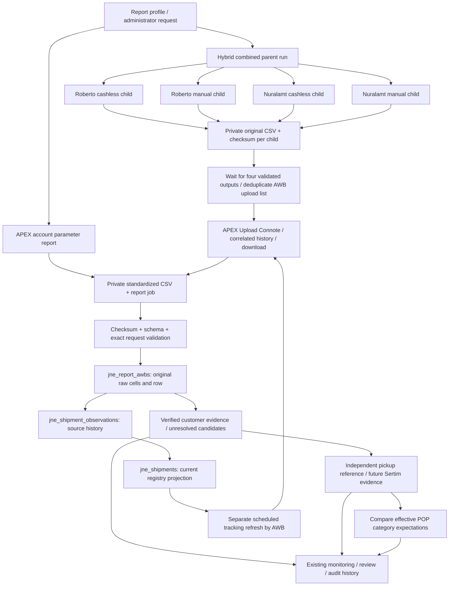

# Data flow and evidence boundaries

Current tables are retained. Raw CSV and `raw_data` are evidence, report rows/observations preserve each import, and the registry is a derived current view. Customer and pickup decisions belong to separate status fields/events. A tracking snapshot is an observation at a stated time; it is not a real-time feed.

M2 adds a unique `jne_shipments.awb` constraint. The old account/AWB index remains useful for account filtering, but account no longer participates in registry identity. `customer_account` on the registry is the latest observed account; every original account remains on its `jne_report_awbs` source. The upgrade first checks normalized duplicate AWBs and refuses to merge/delete them; only after that guard does it normalize the derived registry identifier and add uniqueness. Original source cells are untouched. Rollback removes the new constraint and does not recreate duplicate shipments.

Hybrid outputs may finish at different times. The parent waits; saved children survive another child's failure. Safe local import/projection replay reuses stored data. Unknown external Process outcomes remain attention states and are not blindly resubmitted. Multi-batch APEX intermediate recovery is not currently durable and remains an explicit limitation.

The Sertim-to-registry and category-reconciliation parts are target boundaries, not a claim of completed implementation. Business gates are listed in `business-rules.md`.

## Sertim API contract (M4)

Extend the existing authenticated web API under `/api/v1/pickup-tasks/{task}/cashless-awbs`:

- GET: existing task-view policy; paginated evidence, audit events, current matching outcome and capability flags. No access through a guessed task ID outside the policy.
- GET `/{evidence}/history`: complete paginated audit history restricted to evidence belonging to the authorized task; no silent truncation of the historical ledger.
- POST: one `awb` string and UUID `submission_key`; only the assigned executing operator before POP finalization and first handover closure. A duplicate active AWB claim is rejected. Never changes POP quantities.
- POST `/corrections`: an active Admin, required nonblank `reason`, UUID `submission_key`, optional `evidence_id`, required `expected_version` for existing evidence, and replacement `awb` (null revokes an existing claim). Omitting evidence ID adds late evidence explicitly. Same request/key/actor can replay without another event; a reused key with a different payload or actor is a conflict.
- JSON requests require existing session/CSRF protections. Invalid input returns 422; unauthorized changes 403; stale evidence or idempotency-key conflicts 409; a claim belonging to another task is not corrected through this task. Active AWB uniqueness is enforced in MySQL as well as validation.
- Current claims are a projection. Original AWB and append-only events preserve prior values, owner/pickup, actor/time/reason and before/after derived match/reconciliation snapshots. Revocation clears the active claim without deleting history. Re-evaluation and correction are transactional; no external JNE call occurs.
- Mobile exposure requires the existing mobile execution token scope; it must not broaden pickup/handover role permissions. The initial web workflow and backend are implemented first; mobile UI support must be explicitly verified before claiming it.

Existing Laravel feature tests are the executable contract. No Postman workspace, external publication, additional service or test dependency is introduced for these internal endpoints.

M4 storage: `pickup_cashless_awbs` holds the current claim, immutable original AWB and optimistic version. `pickup_cashless_awb_events` is the append-only decision ledger with original/replacement inputs, actor, reason, request hash/key and derived outcome snapshots. The current claim is deliberately materialized for uniqueness and efficient joins; events preserve history. Revocation makes the current AWB null instead of deleting either table's evidence. `handover_sessions.sertim_closed_at` records the first close independently of later reopen/current closure fields. Upgrade backfills it from original close events, including reopened sessions.
