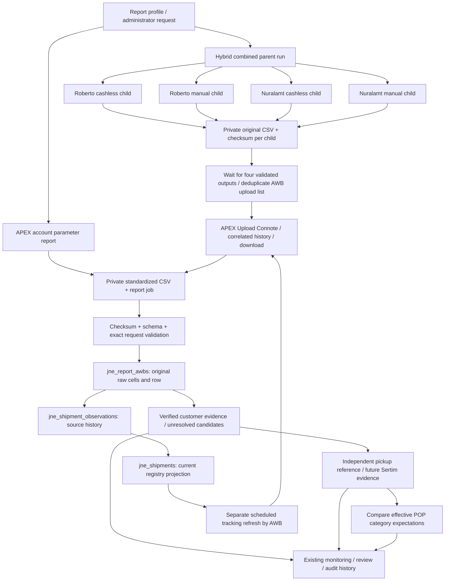

# Data flow and evidence boundaries

Current tables are retained. Raw CSV and `raw_data` are evidence, report rows/observations preserve each import, and the registry is a derived current view. Customer and pickup decisions belong to separate status fields/events. A tracking snapshot is an observation at a stated time; it is not a real-time feed.

Hybrid outputs may finish at different times. The parent waits; saved children survive another child's failure. Safe local import/projection replay reuses stored data. Unknown external Process outcomes remain attention states and are not blindly resubmitted. Multi-batch APEX intermediate recovery is not currently durable and remains an explicit limitation.

The Sertim-to-registry and category-reconciliation parts are target boundaries, not a claim of completed implementation. Business gates are listed in `business-rules.md`.
