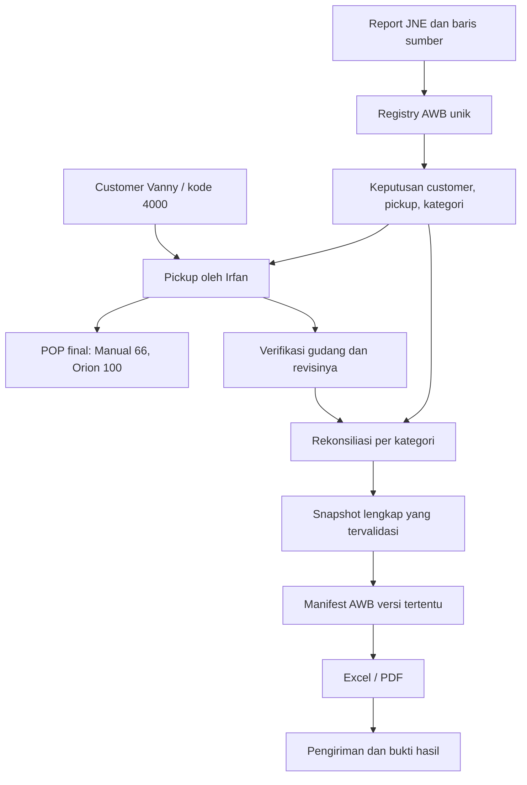
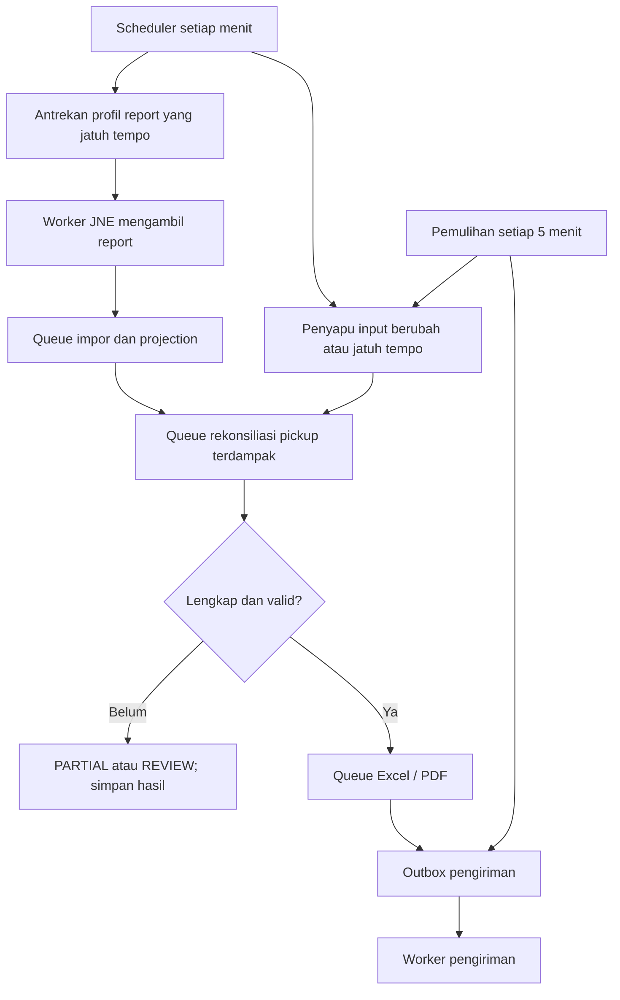

# Rancangan otomatisasi pemrosesan pickup dan pengiriman resi

Tanggal: 26 Oktober 2026. Status: rancangan untuk implementasi berikutnya; belum mengaktifkan pencocokan baru atau pengiriman eksternal.

## 1. Hasil akhir dan keputusan yang sudah dikonfirmasi

Irfan mengambil paket customer Vanny berkode 4000. Gudang memverifikasi 66 Manual dan 100 Orion. Iqbal menginput paket ke JNE. Sistem menarik report, mengenali customer, menghubungkan resi ke pickup asal, menghitung hasil per kategori, dan mengirim daftar resi setelah lengkap. Iqbal tidak perlu mengetik ulang total ke web.

**Satuan hitung yang dikonfirmasi pengguna: jumlah resi/AWB unik.** Angka 66 Manual + 100 Orion berarti 166 AWB, bukan penjumlahan `QTY` atau jumlah koli fisik. `QTY` tetap disimpan sebagai metadata report. Satu AWB dengan `QTY = 3` tetap berkontribusi satu pada perhitungan ini.

| Keputusan | Aturan rancangan |
|---|---|
| Identitas customer | Kode customer yang terbaca dari sumber terverifikasi; alias aktif yang terdaftar tetap didukung |
| Hubungan otomatis normal | Customer terkonfirmasi + tanggal paket yang sesuai + tepat satu pickup yang memenuhi syarat |
| Target perhitungan | Jumlah per kategori pada verifikasi gudang yang sudah sah dan sesuai revisi POP |
| Lengkap | Semua kategori tepat sama, tanpa konflik, dengan sumber yang memenuhi kontrak kelengkapan |
| Pengiriman | Satu paket dokumen berisi daftar AWB milik pickup tersebut, setelah lolos pemeriksaan kesiapan |
| Format | Excel `.xlsx` dan/atau PDF; dipisahkan dari mesin hubungan dan perhitungan |
| Kanal pengiriman | Belum dipilih; tidak menghalangi pembangunan mesin hubungan/perhitungan |
| Pengecualian | Iqbal/Admin menangani kasus ambigu, bukan memasukkan ulang total rutin |

Rancangan ini menambah kebijakan baru `CUSTOMER_CODE_DATE`. Dokumen `matching-rules.md` dan `business-rules.md` sebelumnya tetap menjelaskan perilaku/gates yang sudah diimplementasikan. Pernyataan lama bahwa tanggal hanya konteks tidak menggambarkan target baru ini: setelah kode terverifikasi dan syarat keunikan terpenuhi, tanggal akan menjadi bagian aturan hubungan otomatis. Perubahan itu belum diterapkan oleh dokumen ini.

## 2. Fondasi yang dipakai dan celah implementasi

| Bagian | Sudah tersedia | Pekerjaan berikutnya |
|---|---|---|
| Penarikan | Profil terjadwal, worker Hybrid/APEX, file sumber dan checksum, impor serta projection | Verifikasi report nyata mencakup Manual dan Orion serta kolom yang diperlukan |
| Identitas | `ResolveJneCustomers`, kode/alias melalui kontrak sumber, audit bukti | Aktivasi kontrak sumber yang benar; jangan menganggap `ID_ACCOUNT` sebagai kode Retail |
| Pickup | `MatchJneShipments`: referensi tepat dan Sertim, perlindungan keputusan manual | Tambah aturan kode + tanggal + satu pickup |
| Kategori | `ResolveJneCategories`, kategori dan konflik berbasis bukti | Kontrak nyata Manual/Cashless/Orion; jangan memakai prefix AWB saja sebagai bukti final |
| Perhitungan | `BuildJnePickupReconciliation`, kategori dan pemeriksaan kelengkapan | Gunakan baseline gudang yang disahkan; sambungkan ke monitor pemrosesan |
| Monitor pemrosesan | `QueryPackageProcessing` mencatat deklarasi Admin; `confirmed_quantity` saat ini null | Tampilkan hitungan eksternal dari rekonsiliasi, terpisah dari deklarasi manual |
| Dokumen/pengiriman | `SendPickupReceipt` untuk bukti pickup | Manifest daftar AWB, Excel/PDF, outbox pengiriman dan riwayat khusus |
| Simulasi | `JnePickupSimulationSeeder`: 14 kasus, 15 pickup, 16 report, 3.590 AWB unik | Tambah contoh Vanny 66 Manual + 100 Orion, unit AWB, revisi, dan pengiriman |

Temuan pemeriksaan lokal: belum ada kontrak sumber aktif/terverifikasi pada saat rancangan ditulis. Terdapat report dengan `QTY > 1`; keputusan menghitung AWB di atas menghindari perubahan arti jumlah pickup. Prefix pada dashboard (`JneAwbSource`) adalah pengelompokan asal untuk analisis, bukan sertifikasi kategori pemrosesan.

## 3. Relasi domain



- Satu customer memiliki banyak pickup, termasuk pada tanggal yang sama.
- Satu AWB memiliki satu baris registry dan banyak observasi report. Hitungan berasal dari registry, bukan jumlah baris seluruh report.
- Satu AWB memiliki paling banyak satu hubungan pickup aktif. ID yang dipertahankan ketika konflik bukan bukti hubungan terkonfirmasi.
- Customer, pickup, kategori, status proses, kelengkapan sumber, dan status pengiriman adalah keadaan terpisah.
- Iqbal sebagai operator input hanya dapat dicatat apabila sumber menyediakan identitas operator yang dapat diverifikasi. Kehadiran resi membuktikan hasil input, bukan otomatis siapa pengetiknya.

## 4. Kontrak bukti sumber sebelum aktivasi

Ambil contoh report nyata Manual dan Orion yang dapat dilacak ke pickup yang diketahui. Petakan melalui mekanisme kontrak sumber yang sudah tersedia:

| Bukti | Syarat |
|---|---|
| AWB | Nomor utuh, disimpan sebagai teks; nol di depan tidak hilang |
| Kode customer | Kolom/pemetaan yang terbukti menunjuk customer Retail, termasuk cakupan alias |
| Kategori | Nilai kolom atau asal proses yang terverifikasi untuk Manual, Cashless, dan CSS/Orion |
| Tanggal bisnis | Arti tanggal: tanggal pickup/paket atau tanggal entry; zona waktu dan batas kalender jelas |
| Referensi pickup/batch | Jika tersedia, untuk kasus beberapa pickup atau input terlambat |
| Pembatalan/validitas | Penanganan void/cancel dan bukti yang saling bertentangan |
| Cakupan report | Sumber, account, kategori, periode, kelengkapan halaman/batch dan proses unduh yang berhasil |

Jangan menganggap header `CUSTOMER_CODE` atau `SIM_CATEGORY` dalam CSV seeder sudah ada pada report produksi. Jangan menganggap kolom Hybrid asli otomatis bertahan pada keluaran APEX. Jika bukti kode/kategori hilang saat pengayaan APEX, pertahankan melalui provenance/join AWB dari sumber asli dengan checksum dan revisi yang dapat ditelusuri.

`TGL_ENTRY` sudah diimpor, tetapi artinya sebagai tanggal pencocokan bisnis tetap harus dibuktikan. Zona waktu mengikuti kontrak/config sumber, bukan zona waktu mesin worker.

## 5. Algoritma hubungan resi ke pickup

Urutan pemeriksaan berikut berlaku setelah customer dan kategori diperiksa. Bukti kuat tetap diuji terhadap konflik; urutan ini bukan izin menimpa bukti yang bertentangan.

1. Pertahankan keputusan manual/review yang sah. Bukti baru yang bertentangan menghasilkan pemeriksaan ulang sesuai mekanisme yang sudah ada.
2. Periksa bukti AWB Sertim dan referensi pickup/batch yang tepat. Keduanya harus konsisten dengan customer dan satu sama lain. Referensi kuat dapat mendukung pickup asal untuk paket yang diinput hari berikutnya.
3. Jika belum ada hubungan kuat, evaluasi `CUSTOMER_CODE_DATE` hanya ketika customer terkonfirmasi, sumber dan tanggal valid, serta kebijakan ini telah diaktifkan.
4. Tentukan tanggal pickup dari waktu pickup aktual pada POP final. Gunakan tanggal bisnis report yang telah disahkan. Tanggal unduh/impor tidak digunakan.
5. Cari seluruh pickup yang sah untuk customer dan tanggal tersebut. Sertakan pickup yang sudah lengkap dalam pemeriksaan keunikan; jangan membuat pickup berikutnya menjadi kandidat tunggal dengan membuang pickup yang kapasitasnya sudah terpenuhi.
6. Tepat satu pickup, POP final, verifikasi gudang sah dan sesuai revisi: hubungkan dan catat metode `CUSTOMER_CODE_DATE` beserta kode, tanggal, zona waktu, policy/contract revision, sumber dan candidate set.
7. Tidak ada pickup: `AWAITING_PICKUP`; evaluasi ulang ketika POP/verifikasi yang sesuai tersedia.
8. Lebih dari satu pickup: `AMBIGUOUS_PICKUP`; jangan membagi berdasarkan kapasitas, urutan AWB, staff, atau FIFO.
9. Kode, kategori, tanggal, pembatalan atau hubungan bertentangan: `REVIEW`; jangan menetapkan otomatis agar total terlihat cocok.

**Input terlambat:** bila tanggal report benar-benar berarti tanggal entry, entry besok tidak otomatis sama dengan pickup kemarin. Gunakan referensi/batch/bukti AWB yang kuat. Tanpa bukti itu, tampilkan kandidat untuk pemeriksaan; jangan mengambil pickup kemarin hanya karena tersisa 10 paket.

Perubahan alias, referensi, customer, tanggal, kategori atau baseline memicu evaluasi ulang terhadap pickup lama dan pickup baru. Perbaikan harus dapat mengurangi hitungan sebelumnya; bukan hanya menambah.

## 6. Baseline dan perhitungan otomatis

Tiga angka tetap terlihat terpisah: POP final, hasil verifikasi gudang, dan AWB hasil report. Gunakan nilai efektif beserta revisi, bukan nilai awal yang sudah dikoreksi.

- Verifikasi gudang belum tersedia: `AWAITING_VERIFICATION`.
- Ada selisih POP/gudang atau baseline berubah: `REVIEW`, sampai penyelesaian/koreksi yang berwenang disimpan dengan alasan.
- Penyelesaian yang sah menetapkan target gudang efektif tanpa menulis ulang POP asli atau sejarah penerimaan.
- Verifikasi yang sah dan tidak bermasalah: target per kategori berasal dari hasil gudang.

Untuk setiap kategori `c`:

```text
expected[c] = jumlah AWB yang diharapkan menurut verifikasi gudang efektif
confirmed[c] = COUNT(DISTINCT AWB) yang valid, customer MATCHED,
               pickup MATCHED, pemilik pickup sesuai,
               kategori MATCHED = c, dan termasuk dalam cakupan bukti
shortfall[c] = max(expected[c] - confirmed[c], 0)
excess[c] = max(confirmed[c] - expected[c], 0)
```

`QTY` tidak ikut rumus. AWB dengan customer/pickup/kategori belum pasti atau void tidak menjadi confirmed. Kebijakan validitas sumber menentukan efek cancel; source yang belum dapat memastikan efeknya menghasilkan review.

Contoh Vanny:

| Manual | Orion | Keadaan |
|---:|---:|---|
| 0/66 | 0/100 | Menunggu data |
| 60/66 | 100/100 | Sebagian; menunggu bukti 6 Manual |
| 66/66 | 100/100 | Cocok hitungan; evaluasi kesiapan selesai |
| 67/66 | 99/100 | Perlu diperiksa walaupun total 166 |
| 66/66 | 100/100 + resi belum terklasifikasi | Perlu diperiksa |

Kategori ketiga tetap dievaluasi: target Cashless 0 berarti tidak boleh ada Cashless yang salah masuk. Pickup kosong dengan seluruh target 0 tidak otomatis menghasilkan manifest/pengiriman.

Status bisnis yang ditampilkan:

| Status | Arti |
|---|---|
| `AWAITING_VERIFICATION` | Belum ada baseline gudang yang sah |
| `WAITING_DATA` | Belum ada AWB terkonfirmasi untuk target positif |
| `PARTIAL` | Ada AWB terkonfirmasi tetapi masih kurang |
| `COUNTS_MATCHED` | Semua hitungan sesuai; pemeriksaan kelengkapan sumber masih berjalan |
| `REVIEW` | Ambigu, konflik, berlebih, baseline berubah atau bukti tidak sah |
| `DONE` | Semua kategori sesuai dan pemeriksaan kesiapan lolos |

Ini status pemrosesan turunan. Jangan mengganti status siklus pickup `PICKED_UP` dengan `DONE`, atau menyamakan `DONE` dengan pengiriman paket ke penerima akhir.

## 7. Kesiapan selesai tanpa input total oleh Iqbal

`DONE` membutuhkan semua kondisi berikut:

1. POP final dan baseline gudang sah, konsisten dengan revisi saat evaluasi.
2. Seluruh kategori tepat sama dengan target dan target total positif.
3. Tidak ada konflik, kandidat relevan yang belum terselesaikan, resi tidak terklasifikasi, kelebihan, atau pemetaan ke beberapa pickup dalam cakupan customer/periode/proses tersebut.
4. Sumber wajib Manual/Orion yang ditetapkan kontrak sudah selesai diambil, diimpor, diproyeksikan, dan cakupannya terbukti lengkap.
5. Snapshot sumber, kontrak, pemetaan, baseline dan himpunan AWB masih sama ketika pekerjaan finalisasi dijalankan.

Pemeriksaan normal harus dilakukan mesin. Jangan mengganti input total Iqbal dengan kewajiban menekan tombol selesai pada setiap pickup.

Namun, implementasi saat ini memakai pengesahan koleksi oleh Admin pada `ManageJneCollectionWindow`, bukan pemeriksaan otomatis. Tambahkan evaluasi kelengkapan otomatis berdasarkan kontrak sumber yang telah diverifikasi dan bukti run lengkap. Catat `method = AUTOMATIC_VERIFIED_CONTRACT` serta policy revision; jangan memalsukan tanda tangan Admin atau memakai `updated_by` seolah-olah Admin menjalankan pekerjaan sistem. Pengesahan Admin yang ada tetap jalur pengecualian.

Report berstatus selesai, waktu tunggu habis, dua tarikan dengan angka sama, atau Sertim ditutup bukan bukti tunggal kelengkapan. Jika sumber tidak mendukung pembuktian kelengkapan, hitungan boleh `COUNTS_MATCHED`, tetapi finalisasi/pengiriman otomatis ditahan dengan alasan yang jelas.

Setelah bukti baru masuk, status boleh turun dari `DONE` ke `REVIEW`. Riwayat dan file yang pernah terkirim tetap disimpan; hentikan pengiriman versi baru sampai masalah selesai.

## 8. Manifest Excel/PDF dan pengiriman

Saat `DONE`, buat snapshot manifest dari himpunan AWB yang persis dipakai pada rekonsiliasi. Excel dan PDF harus dihasilkan dari manifest yang sama, bukan query langsung yang bisa berubah saat render.

Isi manifest: customer/kode, referensi pickup, tanggal pickup, kategori, nomor AWB sebagai teks, nama penerima dan kolom operasional yang memang diperlukan, jumlah per kategori, revision dan waktu pembuatan. Nomor kontak pribadi/internal tidak otomatis dimasukkan. Simpan daftar item, versi template dan checksum artefak.

Nama contoh: `resi-vanny-4000-PU001-v1.xlsx` dan `resi-vanny-4000-PU001-v1.pdf`. Excel harus benar-benar XLSX, bukan CSV dengan ekstensi yang diganti. Perlakukan sel data pengguna sebagai teks untuk menghindari formula spreadsheet, dan escape keluaran PDF.

Pengiriman memerlukan preferensi customer yang sah: kanal, tujuan, format, dan pengaktifan pengiriman otomatis. Customer tanpa tujuan/provider tetap dapat mencapai `DONE`; dokumennya berstatus `READY`, pengiriman `AWAITING_CONFIGURATION`. Kanal dapat diputuskan setelah mesin utama selesai.

Keadaan pengiriman:

```text
NOT_READY -> READY -> QUEUED -> SENDING -> ACCEPTED -> DELIVERED
                   -> AWAITING_CONFIGURATION
                             -> FAILED
                             -> UNKNOWN
```

- `ACCEPTED` berarti provider menerima; `DELIVERED` hanya bila tersedia bukti penerimaan yang sesuai. SMTP accepted bukan bukti diterima customer.
- Satu outbox unik untuk manifest + kanal + tujuan yang sudah dinormalisasi. Worker/retry tidak membuat pengiriman baru untuk item yang sama.
- Simpan attempt, idempotency key, provider message ID, checksum, timestamp, error yang aman dan status.
- Timeout setelah kemungkinan diterima provider menghasilkan `UNKNOWN`. Periksa provider menggunakan ID/kunci bila didukung; jangan langsung mengirim ulang.
- Retry kegagalan yang dipastikan belum diterima mengikuti kontrak provider. Batas retry/backoff ditetapkan ketika provider dipilih. Jangan menjanjikan exactly-once jika provider tidak mendukung idempotency/rekonsiliasi.
- Cek ulang revision dan preferensi customer sebelum mengirim. Revision tidak lagi berlaku: batalkan item yang belum dikirim dan evaluasi ulang.
- Perubahan setelah manifest terkirim menghasilkan kasus koreksi. File lama tetap utuh. Kirim versi pengganti dengan label koreksi dan audit melalui kewenangan yang ditentukan; jangan mengirim otomatis berulang karena refresh tracking.

## 9. Penyimpanan dan transaksi yang diusulkan

Gunakan tabel sumber, registry AWB, bukti pickup/gudang, alias, source contracts dan match events yang sudah ada. Tambahan berikut adalah rancangan migrasi, belum dibuat:

| Tabel | Isi/kunci penting |
|---|---|
| `pickup_processing_reconciliations` | Satu current projection per pickup; unique `pickup_task_id`, revision, unit `AWB`, baseline revisions, counts/status, coverage/evidence hash, policy revision |
| `pickup_processing_reconciliation_events` | Snapshot evaluasi/perubahan append-only; unique `(pickup_task_id, revision)`, sebab, actor sistem/manusia, before/after dan referensi bukti |
| `pickup_awb_manifests` | Snapshot ekspor; unique `(pickup_task_id, content_hash, template_version)`, revision, baseline/evidence, status, file paths/checksums |
| `pickup_awb_manifest_items` | Daftar AWB dan nilai yang dibekukan; unique `(manifest_id, awb)`, kategori, sumber/bukti yang digunakan |
| `pickup_awb_deliveries` | Durable outbox; unique `(manifest_id, channel, recipient_hash)`, reconciliation/preference revision, status, lease/idempotency dan provider ID |
| `pickup_awb_delivery_attempts` | Riwayat append-only setiap percobaan, hasil provider dan waktu |
| `customer_awb_delivery_preferences` | Tujuan/kanal/format, auto-send enablement, revision dan pencatat perubahan; tidak memakai kontak staff sebagai tujuan |

Tambahkan indeks pada pasangan customer/tanggal pickup dan filter status kerja sesuai query nyata. Penyimpanan file privat; unduhan harus melewati otorisasi yang memeriksa manifest milik pickup/customer tersebut.

Dalam transaksi: kunci pickup/rekonsiliasi, baca revisi sumber, hitung hasil, tulis projection + event, dan tulis outbox pembuatan manifest bila baru siap. Constraint database menjadi pengaman duplikasi, bukan hanya unique job.

Setelah commit: enqueue pekerjaan. Renderer dan provider berada di luar transaksi database. Worker memegang lease dan memverifikasi revision sebelum side effect. Worker mati setelah commit tetapi sebelum enqueue dipulihkan dengan penyapu outbox terjadwal. Kunci queue mengurangi pekerjaan paralel; transaksi/constraint tetap menjaga konsistensi.

Pisahkan dua hash. `evidence_hash` rekonsiliasi mencakup sorted AWB set, keputusan customer/pickup/kategori/validitas, revisi baseline, kontrak/coverage dan kebijakan untuk audit serta pemeriksaan kelayakan. `content_hash` manifest mencakup customer/pickup, target efektif dan seluruh nilai item yang benar-benar diekspor; tidak mencakup waktu impor, report ID tambahan atau metadata polling yang tidak mengubah isi.

Tarikan identik atau perubahan metadata tracking yang tidak mengubah isi ekspor memakai manifest yang sama. Evaluasi sumber baru tetap disimpan pada rekonsiliasi; jangan menciptakan manifest/pengiriman baru hanya karena evidence hash audit berubah. Outbox memeriksa reconciliation revision terbaru yang mengesahkan isi tersebut sebelum mengirim. Jika isi/kelayakan berubah dan ada dokumen yang sudah terkirim, gunakan jalur koreksi yang diaudit pada bagian 8.

## 10. Titik integrasi aplikasi

| Komponen | Rencana perubahan |
|---|---|
| `ImportJneReportAwbs` / `ProjectJneShipments` | Setelah impor/projection berhasil dan commit, jadwalkan evaluasi pickup yang terpengaruh; kegagalan impor tidak memicu kirim |
| `MatchJneShipments` | Tambah metode kode/tanggal dengan audit dan perlindungan konflik yang sama; tidak membuat matcher kedua yang bersaing |
| `ResolveJneCategories` | Tetap sumber keputusan kategori; jalankan sebelum perhitungan akhir |
| `BuildJnePickupReconciliation` | Refactor perhitungan bersama ke satu mesin; bedakan baseline POP dan gudang; hindari dua rumus berbeda |
| `QueryPackageProcessing` | Baca projection eksternal untuk `confirmed_quantity`; deklarasi Admin tidak diubah menjadi konfirmasi eksternal |
| Koreksi POP/gudang, Sertim, alias, kontrak dan review | Invalidate dan enqueue pickup lama/baru yang terdampak setelah commit |
| Scheduler | Gunakan profil tarikan yang ada dan tambahkan penyapu evaluasi/outbox; tidak membuat profil operasional duplikat |
| Pengiriman | Pipeline manifest/outbox khusus daftar AWB; `SendPickupReceipt` tetap bukti pickup |

Nama action/job yang diusulkan: `ReconcilePickupProcessing`, `ReconcilePickupProcessingJob`, `BuildPickupAwbManifest`, `RenderPickupAwbManifest`, `DeliverPickupAwbManifest`. Nama final mengikuti sibling code saat implementasi.

Perhatian nama field: `manual_quantity` pada monitor saat ini berarti keberhasilan yang dideklarasikan manual oleh Admin, bukan jumlah kategori Manual Hybrid. Pertahankan kompatibilitas field lama dan beri label yang jelas ketika menambahkan hitungan eksternal.

### 10.1. Scheduler, queue dan interval validasi

Scheduler menentukan kapan pekerjaan masuk antrean; queue worker yang terus berjalan mengeksekusinya. Perhitungan berat, render dokumen dan panggilan provider tidak dijalankan di proses scheduler atau request halaman.

Penjadwalan yang sudah ada di `routes/console.php`: `jne-reports:queue-due` dipanggil setiap menit dengan `withoutOverlapping(10)`. Ini memeriksa profil yang jatuh tempo, bukan berarti setiap report ditarik sekali per menit. Worker penarikan JNE yang ada tetap bertugas mengambil report; Laravel queue menangani impor, rekonsiliasi, dokumen dan pengiriman.

| Pekerjaan | Pemicu/jadwal rancangan | Yang dikerjakan |
|---|---|---|
| Antrekan tarikan report | Scheduler setiap menit, memakai command/profil existing | Antrekan profil yang jatuh tempo; usulan interval profil 5 menit hanya jika disetujui kebijakan sumber, kapasitas dan batas JNE |
| Rekonsiliasi utama | Segera setelah impor/projection atau koreksi berhasil commit | Tandai input berubah dan antrekan `ReconcilePickupProcessingJob` untuk pickup/customer-periode yang terdampak |
| Penyapu rekonsiliasi | Setiap 1 menit | Antrekan input yang berubah, pekerjaan yang terlewat, atau pickup yang sudah jatuh tempo untuk diperiksa; query dibatasi dan diproses per chunk |
| Pemulihan antrean | Setiap 5 menit | Pulihkan lease kedaluwarsa, evaluasi/outbox yang belum terantre, serta kegagalan sementara yang memang sudah boleh dicoba kembali |
| Pembuatan Excel/PDF | Setelah transisi ke DONE yang valid | Worker dokumen memproses manifest yang belum tersedia |
| Antrekan pengiriman | Setelah dokumen siap, ditambah penyapu setiap 1 menit | Ambil outbox READY yang konfigurasi/tujuan/revisinya sah; jangan mengambil hasil UNKNOWN untuk blind retry |

Nama command tambahan yang diusulkan: `pickups:queue-reconciliation`, `pickups:recover-reconciliation`, dan `pickups:queue-awb-deliveries`. Command ini belum dibuat/didaftarkan; jadwal produksi belum diubah oleh rancangan.



**Contoh waktu, bukan jaminan SLA:** 10.00 report menghasilkan 60 Manual + 100 Orion, worker menghitung PARTIAL. Tarikan berikutnya selesai diimpor 10.05 dengan tambahan 6 Manual; rekonsiliasi langsung diantrekan setelah commit. Jika hasil lengkap dan seluruh bukti sah, worker menetapkan DONE dan mengantrekan dokumen/pengiriman. Tidak perlu menunggu satu putaran 5 menit lagi setelah impor; waktu selesai tetap dipengaruhi durasi tarikan, panjang antrean dan ketersediaan worker.

Memeriksa database setiap menit tidak menghasilkan data JNE yang lebih baru dari tarikan terakhir. Pickup yang hasilnya belum cocok bukan job gagal: simpan PARTIAL/REVIEW dan tunggu bukti/koreksi berikutnya. Jangan melakukan polling JNE dari setiap job validasi pickup.

Aturan pelaksanaan:

- Gunakan backend queue persisten yang tersedia; job tidak memakai koneksi `sync` untuk alur produksi ini. Infrastruktur scheduler dan proses worker harus sama-sama dikelola agar aktif dan pulih setelah restart.
- Pisahkan antrean/pool `reconciliation`, `documents` dan `deliveries`, dengan worker tersedia bagi masing-masing. Pembuatan PDF atau provider lambat tidak boleh menahan validasi semua pickup. Pertahankan konsumsi antrean impor existing.
- `withoutOverlapping` membatasi command scheduler. Pada banyak server gunakan `onOneServer` dengan cache pusat yang mendukung lock, atau satu pemilik scheduler. Lock per pickup pada worker mencegah evaluasi ganda; transaksi dan unique constraint tetap pengaman akhirnya.
- Simpan `input_version`, `evaluated_input_version`, `last_evaluated_at`, `next_evaluation_at` dan error pekerjaan. Event baru menaikkan versi input secara durable. Jika perubahan masuk saat job unik sedang berjalan dan dispatch tambahan tergabung/ditolak lock, pickup tetap ditandai belum dievaluasi; penyapu akan mengantrekannya lagi. Jangan menandai bersih menggunakan versi input yang belum dihitung.
- Pickup DONE hanya diperiksa ulang bila input relevan berubah. Pickup yang menunggu tanpa data baru dapat memiliki `next_evaluation_at` lebih jauh; scheduler tidak perlu menghitung ulang semua riwayat setiap menit.
- Setiap job memeriksa versi dan membaca keadaan terbaru, lalu mengunci dan memverifikasi ulang sebelum commit. Perhitungan identik tidak membuat event revision, manifest atau kiriman tambahan.
- Kegagalan database/storage/worker sementara memakai retry dengan backoff progresif dan batas percobaan. Kegagalan permanen atau hasil ambigu bisnis masuk pemeriksaan, bukan retry tanpa batas. Timeout job harus lebih kecil daripada `retry_after`/visibility timeout dengan margin agar dua worker tidak memproses reservasi yang sama bersamaan.
- Retry pengiriman mengikuti bagian 8. Pemulihan antrean tidak mengubah UNKNOWN menjadi READY, tidak mengirim ulang manifest yang sudah diterima provider, dan tidak memaksakan status DONE.
- Pantau heartbeat scheduler/worker, umur job tertua, tarikan terakhir yang berhasil, waktu evaluasi terakhir, alasan PARTIAL/REVIEW, failed jobs dan hasil pengiriman. Bedakan data sumber belum datang dari pekerjaan lokal yang berhenti.

Acceptance tambahan: report baru memicu validasi tanpa menunggu sweep; scheduler yang sempat berhenti pulih tanpa kehilangan pekerjaan; perubahan saat lock job aktif tetap dievaluasi; dua worker tidak menggandakan hasil; ketidakcocokan jumlah tidak memenuhi failed jobs; worker dokumen/provider lambat tidak menghentikan antrean validasi.

## 11. Kontrak aplikasi/API yang direncanakan

Tidak ada penulisan total otomatis melalui endpoint deklarasi manual `POST /api/v1/pickup-tasks/{task}/processing`. Endpoint itu tetap menunjukkan sumber manual. Penghitungan otomatis berjalan melalui pekerjaan internal berdasarkan bukti.

Untuk tahap pertama, perluas read model di detail/quick detail pickup yang sudah ada dengan `reconciliation` dan `awb_delivery`; additive, tanpa mengubah struktur field lama. Tambahkan endpoint berikut bila daftar manifest/riwayat membutuhkan pagination sendiri:

| Operasi yang diusulkan | Hak dan efek |
|---|---|
| `GET /api/v1/pickup-tasks/{task}/awb-manifests` | Existing task-view policy; manifest dan riwayat terpaginasikan, tanpa mengirim |
| `GET /api/v1/pickup-tasks/{task}/awb-manifests/{manifest}/files/{format}` | Cek task-view + kepemilikan manifest, format XLSX/PDF yang tersedia; stream privat |
| `POST /api/v1/pickup-tasks/{task}/awb-manifests/{manifest}/delivery-retry` | Active Admin, reason, UUID submission key dan expected delivery version; hanya kegagalan yang aman diulang |

Read model contoh, seluruh nilai di sini merupakan ilustrasi target:

```json
{
  "reconciliation": {
    "revision": 1,
    "unit": "AWB",
    "status": "DONE",
    "categories": {
      "manual_hybrid": { "expected": 66, "confirmed": 66 },
      "cashless_hybrid": { "expected": 0, "confirmed": 0 },
      "css_orion": { "expected": 100, "confirmed": 100 }
    },
    "coverage_status": "COMPLETE",
    "reasons": []
  },
  "awb_delivery": {
    "manifest_revision": 1,
    "status": "AWAITING_CONFIGURATION",
    "available_formats": ["xlsx", "pdf"]
  }
}
```

Gunakan auth/session/token scope yang sudah berlaku, CSRF untuk request web, validasi Form Request dan Wayfinder di frontend. `401` untuk belum login; `403` untuk operasi yang dilarang pada task yang sah diakses; data task/manifest di luar scope tidak dibocorkan (`404`). Retry yang diterima `202` dan hanya memasukkan outbox; stale revision/key-payload mismatch/hasil provider `UNKNOWN` menghasilkan `409`; format/payload tidak valid `422`. Replay key dengan payload sama mengembalikan operasi sebelumnya tanpa side effect baru. Kegagalan provider dicatat sebagai status pengiriman, bukan mengubah `DONE` pemrosesan.

Kontrak executable mengikuti feature tests Laravel yang sudah menjadi sumber pengujian internal proyek. Tidak perlu membuat workspace Postman, publikasi API atau folder baru untuk tahap rancangan ini. Saat provider dipilih, discovery kontrak API/provider dan pengujian simulasi kegagalannya menjadi bagian pekerjaan integrasi.

## 12. Rencana eksekusi berurutan

| Tahap | Pekerjaan konkret | Selesai jika |
|---|---|---|
| A — Bukti sumber | Telusuri contoh Vanny yang diketahui, header kode/kategori/tanggal, jalur Manual/Orion dan coverage; catat kontrak terverifikasi | AWB/customer/kategori/tanggal dapat dijelaskan dari sumber asli; unit hitung AWB tetap |
| B — Hubungan | Tambah `CUSTOMER_CODE_DATE`, kandidat pickup, batas zona waktu, proteksi multi-pickup/delayed input dan audit/replay | Kasus customer/tanggal tunggal otomatis terkait; kasus tidak pasti tidak dipaksakan |
| C — Perhitungan | Migrasi projection/events, baseline gudang, mesin kategori bersama, coverage otomatis dan invalidation | Vanny 66/66 + 100/100 menjadi DONE; kekurangan/kelebihan/konflik terlihat benar |
| D — Tampilan operasional | Tambahkan hasil eksternal dan alasan status pada halaman pemrosesan/detail yang ada; pertahankan deklarasi manual | Iqbal melihat hasil otomatis dan hanya menangani pengecualian; baseline/sumber mudah ditelusuri |
| E — Dokumen | Manifest snapshot, item unik, renderer Excel/PDF privat dari data yang sama | Dua format memiliki daftar AWB/jumlah/versi yang identik dan nol di depan tetap utuh |
| F — Pengiriman | Preferensi customer, provider adapter, outbox/attempts/lease/idempotency, retry dan hasil UNKNOWN | Satu manifest diproses tanpa pengiriman berulang karena replay; hasil provider terpisah dari DONE |
| G — UAT dan aktivasi | Jalankan simulasi, replay read-only untuk membandingkan, aktifkan customer terbatas lalu perluas | Hasil diverifikasi operator; fallback/review dan observabilitas berfungsi |

Mulai B–C dengan fixtures terverifikasi tanpa menunggu pilihan provider. Tahap A harus lolos sebelum memakai hasilnya untuk customer nyata. Pemilihan library XLSX/PDF dan dependency tambahan dilakukan pada E dengan persetujuan dependency sesuai aturan proyek, bukan dipasang saat merancang.

Aktivasi fitur dibuat terpisah untuk hubungan, hitungan, pembuatan dokumen dan pengiriman. Menonaktifkan pengiriman menghentikan side effect berikutnya sambil mempertahankan bukti/history. Matikan jalur otomatis baru tanpa menghapus data atau menimpa keputusan manual saat rollback.

## 13. Matriks simulasi dan acceptance

Perluas seeder yang sudah ada dengan skenario di bawah. Jangan mengisi hasil akhir/match status secara langsung untuk membuat demo terlihat berhasil; jalankan importer, matcher, rekonsiliasi dan outbox yang sebenarnya. Pengujian provider memakai lingkungan palsu/simulasi, bukan mengirim ke customer nyata.

| Kasus | Hasil yang wajib |
|---|---|
| Vanny 66 Manual + 100 Orion, lengkap | 166 AWB terkonfirmasi, DONE setelah coverage sah; satu manifest |
| Manual 60/66, Orion 100/100 | PARTIAL, kurang 6 Manual, tanpa kirim |
| Manual 67, Orion 99 | REVIEW meski total 166 |
| `QTY = 3` pada satu resi | Tetap satu kontribusi hitungan AWB |
| Tarik ulang report identik / observasi lintas report | Tidak menggandakan AWB, manifest atau pengiriman |
| Satu customer satu pickup tanggal sama | Hubungan metode kode/tanggal otomatis |
| Customer sama, dua pickup satu tanggal | Ambigu tanpa referensi kuat, tidak dibagi berdasar sisa target |
| Referensi kuat atau Sertim berlawanan dengan aturan tanggal | Konflik/review; tidak diam-diam ditimpa |
| Impor besok, tanggal bisnis tetap hari pickup | Mengisi pickup asal |
| Entry besok dan tidak ada referensi kuat | Tidak ditebak ke pickup kemarin |
| Batas hari zona waktu sumber | Kandidat ditentukan oleh kalender sumber secara konsisten |
| Kode tidak dikenal, tanggal/kategori hilang | WAITING/REVIEW dengan alasan, bukan DONE |
| Target Cashless 0 tetapi ada Cashless | REVIEW; kategori nol tetap diperiksa |
| Belum verifikasi atau selisih POP/gudang belum diselesaikan | Tidak DONE dan tidak kirim |
| Koreksi verifikasi/POP/alias/Sertim/kontrak setelah cocok | Rehitung kedua sisi yang terdampak; revision lama tidak dikirim |
| Resi tambahan datang setelah selesai | Rehitung; REVIEW bila berlebih/konflik; file terkirim tetap ada |
| Report gagal atau cakupan sumber belum lengkap | Tidak kirim; tidak menyatakan paket hilang hanya karena waktu |
| Dua worker paralel / worker mati setelah commit | Satu current revision/outbox logis; pekerjaan dapat dipulihkan |
| XLSX dan PDF | AWB/category/count/version sama, nomor diperlakukan sebagai teks |
| Kanal/tujuan belum tersedia | Pemrosesan boleh DONE, dokumen READY, pengiriman menunggu konfigurasi |
| Provider pasti gagal sebelum menerima | Retry terbatas dan tercatat |
| Provider mungkin menerima lalu timeout | UNKNOWN, tanpa blind retry |
| Ganti tujuan atau data setelah queued | Periksa revision; jangan kirim snapshot yang tidak lagi sah |
| Akses file/riwayat customer lain | Ditolak tanpa membocorkan data |

Definition of done implementasi: acceptance di atas lulus; satuan AWB dan contoh Vanny teruji; field monitor tidak lagi menyamakan deklarasi manual dengan bukti JNE; hasil pemrosesan serta pengiriman terpisah; dokumen/file/attempt dapat ditelusuri; tidak ada kewajiban input ulang jumlah pada alur normal.

## 14. Keputusan tersisa dan batas rancangan

Tidak diperlukan keputusan tambahan tentang satuan: pengguna sudah memilih AWB. Yang belum ditentukan adalah kanal pengiriman, tujuan customer yang sah, preferensi satu/dua format, serta kontrak data nyata dan bukti coverage Manual/Orion. Semua bagian inti dapat dibangun dengan fixtures; pengiriman customer nyata menunggu konfigurasi kanal/tujuan dan aktivasi.

Dokumen ini tidak mengubah source contracts, scheduler, database, fitur pengiriman, atau izin pengguna. Tidak ada pengiriman pesan dilakukan. Rancangan ini menjadi acuan eksekusi; logika dan migrasi dibuat pada tahap implementasi berikutnya.

## 15. Halaman monitoring pemrosesan dan selisih

Referensi pengguna: screenshot Pickup History dan Pickup Dashboard yang diberikan pada 26 Oktober 2026. Tabel menjadi area kerja utama, ringkasan membantu menemukan pickup yang perlu ditindaklanjuti. Kembangkan halaman Hasil Pickup/Pemrosesan yang sudah ada agar operator memiliki satu tempat kerja yang konsisten.

### Pengguna dan tugas utama

- Iqbal/staff operasional memeriksa pickup mana yang belum lengkap, kategorinya apa, dan berapa kekurangannya tanpa mengetik ulang total.
- Supervisor memeriksa konflik, selisih POP/gudang, data terlambat serta kegagalan worker/pengiriman, lalu membuka bukti untuk menyelesaikannya.
- Satu baris utama adalah satu pickup. Dua pickup customer yang sama pada tanggal yang sama tetap dua baris dengan referensi berbeda.
- Informasi pertama yang dibutuhkan: customer/kode, referensi dan tanggal pickup, staff pickup, perbandingan tiap kategori, alasan pengecualian, status pemrosesan serta pengiriman.

### Susunan halaman

1. Judul `Monitoring Pemrosesan Pickup` dengan status pembaruan dan aksi `Muat ulang` yang hanya menyegarkan tampilan. Status worker/data sumber tersedia lewat indikator yang ringkas.
2. Filter utama: tanggal pickup, customer/kode, staff, status pemrosesan dan status pengiriman. Pilihan `Hari ini` serta `Tunggakan` membuat pickup kemarin yang belum selesai tetap mudah ditemukan.
3. Ringkasan ringkas dan dapat diklik untuk memfilter: `Perlu diperiksa`, `Menunggu data`, `Selesai / belum terkirim`. Tampilkan unitnya sebagai jumlah pickup. Rincian jumlah AWB/kategori muncul dalam konteks yang sama, bukan kartu KPI yang tidak berkaitan.
4. Tabel pickup dengan pagination server, pengurutan pengecualian, dan aksi per baris. Pencarian/filter/sort/halaman tersimpan pada URL.
5. Drawer detail ketika membuka pickup; tampilkan bukti dan riwayat di sana. Grafik tren seperti referensi dashboard bersifat sekunder dan tidak mendahului tabel pekerjaan yang belum selesai.

Setiap ringkasan mengikuti filter/cohort yang sama dengan tabel. Jika menampilkan persentase, beri denominator jelas, misalnya `8 dari 20 pickup selesai`; jangan mencampur persentase jumlah pickup dengan jumlah customer atau AWB.

### Kolom tabel dan arti angka

| Kolom | Isi |
|---|---|
| Pickup | Referensi dan tanggal pickup aktual; waktu pengambilan/source timezone dapat dibuka di detail |
| Customer | Nama dan kode customer terkonfirmasi |
| Staff | Staff pickup; operator input JNE hanya ditampilkan jika ada bukti sumber |
| Manual | `AWB cocok / target gudang` |
| Cashless | `AWB cocok / target gudang` |
| Orion | `AWB cocok / target gudang` |
| Selisih pemrosesan | Kekurangan/kelebihan per kategori, bukan hanya satu selisih total bersih |
| Proses | Menunggu verifikasi, menunggu data, sebagian, cocok hitungan, perlu diperiksa, selesai |
| Pengiriman | Belum siap, siap, menunggu konfigurasi, antre, diproses, diterima provider, terkirim, gagal atau belum pasti |
| Aksi | `Lihat detail`, `Unduh Excel/PDF` jika tersedia, serta aksi review/retry yang diizinkan |

Label `terbaca / target gudang` harus terlihat, tidak hanya tooltip. Contoh ilustrasi berikut mengasumsikan bukti sumber/baseline sah dan kategori Cashless bertarget nol:

| Pickup / customer | Manual | Orion | Selisih | Proses | Pengiriman |
|---|---:|---:|---|---|---|
| PU001 / Vanny 4000 | 66/66 | 100/100 | Cocok | Selesai | Siap |
| PU002 / Toko B | 40/50 | 20/20 | Kurang 10 Manual | Sebagian | Belum siap |
| PU003 / Toko C | 12/10 | 0/0 | Lebih 2 Manual | Perlu diperiksa | Belum siap |

Target `0/0` berarti tidak ada AWB yang diharapkan pada kategori itu. Baseline yang belum diverifikasi ditampilkan `—`/`Belum diverifikasi`, bukan `0`, dan tidak dianggap cocok. Selisih `+5 Manual` dan `-5 Orion` tetap dua pengecualian meskipun selisih total nol.

Pisahkan selisih fisik `POP vs gudang` dari selisih pemrosesan `gudang vs report`. Selisih fisik yang belum selesai menjadi alasan status pemeriksaan yang terlihat di baris. Detail memperlihatkan tiga baseline per kategori; operator tidak perlu menebak perbandingan mana yang sedang dipakai.

### Detail, pembaruan dan pemulihan

Drawer menampilkan perbandingan POP/gudang/AWB, daftar resi terkonfirmasi, resi kandidat/konflik yang relevan, metode hubungan, file sumber, revisi, waktu impor/evaluasi terakhir, status cakupan report, manifest serta hasil pengiriman. Catatan dan audit berada dalam disclosure. Hak review, koreksi dan retry tetap mengikuti backend.

Frontend membaca status dari backend dan memperbarui data secara berkala saat halaman aktif. Queue/scheduler tetap bekerja ketika halaman ditutup. Pembaruan mempertahankan filter, pagination, pilihan dan fokus; jangan menyusun ulang baris yang sedang dipakai operator secara mengejutkan. Tampilkan `Tarikan terakhir berhasil` dan `Evaluasi terakhir` sebagai dua waktu berbeda. Data lama tetap terlihat dengan statusnya bila refresh gagal.

`Sebagian` menjelaskan kekurangan bukti, `Perlu diperiksa` menjelaskan konflik/selisih, dan indikator kegagalan sumber/worker menjelaskan proses teknis berhenti. Kegagalan kirim tidak mengubah status pemrosesan selesai. Hasil provider yang belum pasti memberi aksi pemeriksaan, bukan tombol kirim ulang bebas.

Desktop menggunakan tabel kompak dengan angka sejajar. Mobile memprioritaskan customer/ref, status, perbandingan kategori dan aksi detail dalam baris/blok ringkas tanpa mengecilkan teks atau memaksa seluruh tabel desktop. Status memakai teks dan indikator, tidak bergantung pada warna. Kontrol berlabel, fokus keyboard terlihat, touch target memadai, loading/empty/error memiliki jalur pemulihan, dan pembaruan status diumumkan secara kontekstual tanpa membacakan setiap perubahan angka.

Gunakan komponen yang sudah tersedia: `Table`, `Badge`, `Sheet`, `Button`, `DropdownMenu` dan `Skeleton`; perluas `package-processing-monitoring.tsx` serta drawer terkait. Terapkan task-first operational UI dari AGENTS.md dan [Web Interface Guidelines](https://raw.githubusercontent.com/vercel-labs/web-interface-guidelines/main/command.md). Halaman pada bagian ini masih rancangan, belum dibangun.
