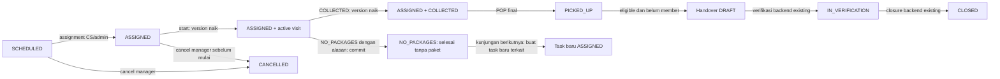
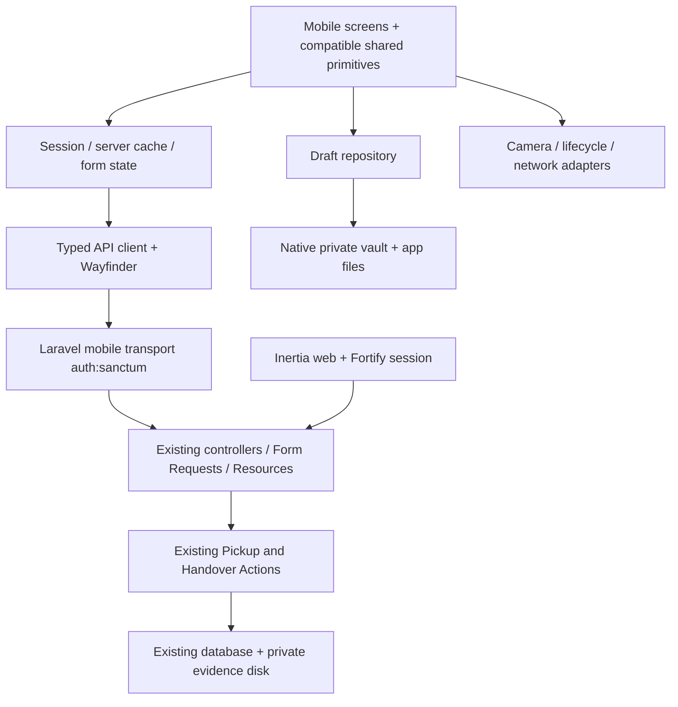

# Technical Design — Retail Pickup Mobile V1

Status: **Baseline disetujui untuk implementasi V1; M2–M4 engineering gates PASS, M5/pilot belum selesai**. Audit awal: 13 Oktober 2026; verifikasi implementasi: 14 Oktober 2026. Bahasa: Indonesia. Platform: Android-first, Capacitor + React + TypeScript, APK internal.

**Aturan Handover terbaru:** persetujuan owner17 Oktober2026 pada Handover V2 menggantikan izin verify/close Pickup Staff dan pembatasan platform historis. Hanya role penerima aktif retail_staff/admin_supervisor yang boleh verify/close, melalui web maupun mobile; pembuat session tidak otomatis berwenang. Lihat [Handover V2](HANDOVER_V2.md) untuk audit, kontrak, evidence dan keputusan yang tetap terbuka. Bagian audit/OD-09 lama di bawah disimpan sebagai riwayat, bukan kebijakan akses Handover terkini.

Gate 0 subset M1, eksekusi M2–M5, kebijakan draft OD-04/OD-05 dan revocation OD-03 **APPROVED** oleh user. Record keputusan dan bukti implementasi terdapat pada [Implementation Plan §13](IMPLEMENTATION_PLAN.md#13-otorisasi-mobile-m2m5-dan-od-04od-05); §10 di sana menyimpan review historis sebelum approval. Bagian audit §1–2 di desain ini adalah baseline sebelum implementasi, bukan klaim bahwa Sanctum/native masih belum terpasang sekarang. Keputusan fleet, support owner/SLA, performance, HTTPS pilot, signing dan distribusi tetap OPEN.

## 1. Dasar desain dan batas audit

PRD yang benar-benar ditemukan adalah [`../PRD_MOBILE_V1.md`](../PRD_MOBILE_V1.md). Path input `docs/mobile/PRD_MOBILE_V1.md` tidak tersedia; PRD tidak dipindahkan. Versi1.2 memuat NO_PACKAGES/pickup manual serta verifikasi/penutupan Handover mobile yang disetujui owner pada14 Oktober2026. Addendum §16 menggantikan aturan retry audit awal; §18 memperluas allowlist verify/close. Dokumen pendamping: [`IMPLEMENTATION_PLAN.md`](IMPLEMENTATION_PLAN.md).

Audit membaca routes, bootstrap, controllers, requests, actions, models, resources, frontend, migrasi, dan test existing. `php artisan route:list --path=api --except-vendor --json`, `composer show --direct`, PHP CLI, manifest dan lockfile JS digunakan untuk konfirmasi. `.ai/rules` tidak ditemukan; tidak ada aturan path tersebut yang dapat dibaca. Workspace ini tidak memiliki metadata `.git`, sehingga audit tidak menyatakan branch atau commit tertentu. Dokumen lama `docs/m1-technical-design.md` digunakan sebagai konteks, tetapi fakta implementasi di bawah berasal dari kode saat audit.

Tidak ada dependency dipasang, migrasi dijalankan, transaksi bisnis dibuat, test ditulis, atau APK dibangun pada tahap ini. Test existing dibaca sebagai spesifikasi regresi; **belum dijalankan**, sehingga audit bukan sertifikasi bahwa seluruh suite lulus. Database runtime, konfigurasi SMTP produksi, inventaris perangkat, dan toolchain Android belum diverifikasi. Jangan menyimpulkan kondisi produksi dari default konfigurasi.

| Komponen          | Fakta yang ditemukan                                                                                                                                |
| ----------------- | --------------------------------------------------------------------------------------------------------------------------------------------------- |
| PHP / Laravel     | CLI PHP 8.5.10; `laravel/framework` 13.35.0                                                                                                         |
| Auth web          | `laravel/fortify` 1.41.0, guard `web`, session; reset password dan email verification aktif, registration/2FA/passkeys tidak aktif pada konfigurasi |
| Sanctum           | Tidak tercantum pada direct dependencies; `User` belum memakai `HasApiTokens`; belum ada migration personal access tokens                           |
| Inertia           | PHP 3.5.1; `@inertiajs/react` lockfile 3.9.1                                                                                                        |
| React / TS / Vite | Lockfile React dan React DOM 19.3.0, TS 5.9.3, Vite 8.3.4; `vite-plus` manifest 0.3.0                                                               |
| UI                | Tailwind lockfile 4.3.3; primitives Radix/shadcn lokal                                                                                              |
| Typed routes      | Wayfinder PHP 0.1.21, plugin Vite dan generated routes existing                                                                                     |
| Native            | Capacitor, secure storage, Android project, dan mobile bootstrap belum ditemukan                                                                    |
| Tests             | Pest 5.3.1; `phpunit.xml` SQLite in-memory; test concurrency membuat database MySQL tersendiri                                                      |

Seluruh perubahan yang disebut sebagai **usulan** adalah pekerjaan masa depan setelah review. Business rules, role Laravel, snapshot customer, audit events, locking dan lifecycle existing tetap authoritative. Tidak membangun backend operasional kedua.

## 2. Temuan implementasi yang menentukan desain

| Area              | Evidence kode                                                                                            | Konsekuensi desain                                                                                                                                                                                         |
| ----------------- | -------------------------------------------------------------------------------------------------------- | ---------------------------------------------------------------------------------------------------------------------------------------------------------------------------------------------------------- |
| API existing      | `routes/web.php`, `bootstrap/app.php`: `/api/v1/*` berada di group `web` + `auth`                        | Prefix API tidak berarti bearer-ready. Mutation web membutuhkan CSRF; jangan menonaktifkan CSRF global                                                                                                     |
| Login/logout      | `FortifyServiceProvider`, `OperationalLoginResponse`, `OperationalLogoutResponse`                        | JSON login existing hanya memberi data user; bukan personal token                                                                                                                                          |
| Akun aktif        | `EnsureActiveUser` di middleware web; action membaca ulang dan mengunci actor                            | Middleware aktif harus dipasang juga pada API mobile, setelah authentication                                                                                                                               |
| Role              | `User::PICKUP_ROLES` = pickup, retail, admin; `canManagePickup` = CS/admin                               | Primary user mobile pickup; dukungan role lainnya perlu keputusan, bukan menganggap semua account boleh masuk                                                                                              |
| Task view         | `PickupTaskPolicy::view`                                                                                 | Owner, manager, kandidat takeover, atau operator untuk task yang sudah memiliki handover item boleh view. Jangan mengganti dengan aturan owner-only                                                        |
| Kandidat takeover | `PickupTask::eligibleFor`, `PickupTaskController::index`                                                 | `ASSIGNED`, belum mulai, assignee bukan null dan bukan diri sendiri. Bukan pool task belum ditugaskan                                                                                                      |
| Detail kandidat   | Variabel lokal `$full` di `PickupTaskResource::toArray()`                                                | Non-owner kandidat sebelum handover mendapat projection terbatas; contact/notes/visits/proof dapat tidak ada                                                                                               |
| Execution         | `StartPickup`, `RecordPickupVisit`                                                                       | Start dan outcome menaikkan version; status task tetap `ASSIGNED`. `IN_PROGRESS` hanya label tampilan web                                                                                                  |
| Retry/cancel      | `ChangeTaskLifecycle`                                                                                    | Owner operator boleh retry setelah `NO_PACKAGES`; cancel hanya CS/admin. Retry mengosongkan execution timestamp, mempertahankan visit lama                                                                 |
| POP               | `FinalizePickupRequest`, `FinalizePickup`, migration pickup records                                      | Signature wajib; foto opsional; total harus positif; satu record per task, UUID key unik; lock dan rollback file tersedia                                                                                  |
| Handover          | `CreateSession`, `AmendSession`, `HandoverController`                                                    | Kandidat dan session lintas petugas; amend mengganti seluruh daftar. Tidak ada pembatasan amend hanya creator                                                                                              |
| Hak verifikasi    | `VerifyItem`, `CloseSession`: `canExecutePickup()`                                                       | **GAP PRD/kode:** Pickup Staff juga lolos verifikasi/close existing. Perlu keputusan OD-09; jangan menyatakan backend sudah Retail-only                                                                    |
| Private evidence  | `ProofOfPickupController::attachment`, `PickupRecordResource`                                            | Local disk, policy view, 404, private/no-store; URL resource sekarang menunjuk route web `api.evidence`                                                                                                    |
| Receipt           | `ProofOfPickupController::store`, `SendPickupReceipt`, `PickupRecord::receipt`                           | POP commit terpisah dari hasil pengiriman; email dapat dicoba sinkron setelah commit; latest receipt berdasarkan proof revision                                                                            |
| Recovery key      | Resource POP dan handover tidak mengekspos submission key                                                | Task GET dapat membuktikan POP ada, tetapi belum menghubungkan attempt tertentu; handover create timeout perlu lookup key                                                                                  |
| Draft web         | `pages/pickup-wizard.tsx` memakai state/ref dan File                                                     | Wizard existing bukan penyimpanan draft persisten untuk restart native                                                                                                                                     |
| Urutan visit      | `PickupTaskResource` memakai `visits->last()`, sementara relasi `visits()` tidak memberi order eksplisit | Jangan menganggap urutan collection dijamin database. Mobile memilih current visit dari ID terbesar; review ordering serializer/query diperlukan sebelum acceptance retry, tanpa mengubah aturan lifecycle |

### 2.1 Lifecycle yang dipertahankan



Handover adalah lifecycle session, tidak mengubah task menjadi status baru. `CLOSED` dapat tetap mengandung `DISCREPANCY`. Mobile tidak memberi input verifikasi, koreksi, reopen atau closure. NO_PACKAGES adalah task terminal terpisah dari pickup berhasil menurut perubahan kebijakan owner (§16), tanpa POP/receipt/physical handover. Tidak ada auto-submit ketika reconnect atau asumsi POP final berarti receipt terkirim.

## 3. Arsitektur usulan

### 3.1 Bootstrap dan batas modul

Bundle mobile adalah SPA React biasa dengan `createRoot`, tanpa `createInertiaApp`, Inertia page props, `Head`, `Link`, `router`, cookie login, atau runtime `useHttp`. Asset HTML/JS/CSS dibundel lokal ke APK. API hanya HTTPS ke Laravel existing. `resources/js/app.tsx`, page shell dan Vite web tetap melayani Inertia.

Usulan lokasi, **belum dibuat**:

```text
resources/mobile/
  index.html
  src/main.tsx, app.tsx, styles.css
  src/navigation/                 # route screen dan Android back
  src/features/auth/              # Login, Account
  src/features/tasks/             # Mine, Available, Detail
  src/features/execution/         # start/outcome/retry
  src/features/proof/             # wizard, review, read-only POP
  src/features/handover/          # list/candidates/editor/detail
  src/features/history/
  src/api/                       # transport, typed DTO, error normalizer
  src/state/                     # session, workspace cache, request state
  src/drafts/                    # schema, repository, recovery, cleanup
  src/platform/                  # camera, network, lifecycle, secure vault
vite.mobile.config.ts            # build standalone, tanpa Laravel/Inertia plugins
tsconfig.mobile.json             # alias dan typecheck mobile/shared
capacitor.config.ts              # webDir resources/mobile/dist
android/                        # generated native project, nanti setelah persetujuan
```

Struktur dan dependency baru memerlukan review OD-10 sesuai AGENTS; membuat dokumen ini tidak berarti menyetujui penambahan base folder `android/`. Usulan memakai root manifest/lockfile existing untuk menghindari versi React ganda. Mobile dist tidak masuk manifest Vite web. Build mobile memiliki React/Tailwind plugin sendiri; asset/font lokal agar shell bisa dibuka tanpa jaringan. Tidak memuat remote Laravel page sebagai `server.url` pada release APK.



### 3.2 UI, API, state, draft

UI hanya memformat data, menghitung preview total, mengumpulkan input dan menampilkan capability server; keputusan eligibility final tetap backend. API client menerima route descriptor Wayfinder, DTO dan file; mengurus bearer, timeout, multipart, errors dan pembatalan request. Business action tidak ditulis ulang dalam TypeScript.

State dipisah: session di Context, cache server di memory dengan key `{environment,userId,resource,filters,page}`, form/wizard di reducer, dan draft persisted melalui repository. React Context/reducer cukup untuk V1; tidak memerlukan Redux, Axios atau query-library baru. Mutasi tidak optimistic: tampilkan hasil server dan refresh detail/list. Abort saat logout/account switch; response dari session generation lama diabaikan. Cache dan object URL dibersihkan ketika account berganti.

Navigation lokal dengan route state/history di origin APK; detail address menyimpan task ID, bukan seluruh objek. Android back kembali step/screen, meminta konfirmasi bila membuang input yang belum tersimpan. Draft disimpan ketika field berubah, bukan bergantung hanya pada event app pause.

### 3.3 Reuse yang layak

| File existing                                                                            | Keputusan                                                                                                                                                                         |
| ---------------------------------------------------------------------------------------- | --------------------------------------------------------------------------------------------------------------------------------------------------------------------------------- |
| `components/ui/button.tsx`, input, label, badge, card, dialog, select, skeleton, spinner | Reuse setelah audit dependency transitif, alias `@` yang menunjuk shared web resources, styles, sentuh, keyboard dan WebView                                                      |
| `components/signature-pad.tsx`                                                           | React canvas tanpa Inertia; reusable. Bungkus dengan konversi PNG Blob + persisted file; uji pointer cancel, ukuran, restore dan blank ink                                        |
| `components/operational-ui.tsx`                                                          | StatusBadge/EmptyState presentational dapat reuse; `IN_PROGRESS` bukan DTO status domain                                                                                          |
| `lib/submission-key.ts`, `lib/utils.ts`                                                  | Reuse UUID dan `cn`; key harus persisted sebelum request, tidak dibuat ulang saat restart                                                                                         |
| `lib/pickup-time.ts`                                                                     | Utility waktu dapat reuse jika diperlukan; display mengikuti timezone `me`, tidak timezone perangkat                                                                              |
| `types/handover.ts`, Proof/Visit types di komponen                                       | Cocokkan dengan DTO resource. Extract type-only ke file shared di `resources/js/types` bila diperlukan, hindari import runtime komponen Inertia                                   |
| `pages/pickup-wizard.tsx`, pickup-proof/execution/detail, list operasional dan handover  | Tidak import langsung: terikat Inertia/useHttp, navigation web, upload dan evidence cookie. Reuse pola UX; extract presentational fragment hanya bila memang mengurangi duplikasi |
| app/layout/nav/auth hooks existing                                                       | Bukan shell mobile. Jangan mengimpor app.tsx atau theme/session bootstrap web                                                                                                     |

Build mobile harus membuktikan dependency graph tidak membawa bootstrap/runtime Inertia. Shared primitives memakai theme tokens existing melalui stylesheet mobile; jangan mengandalkan scanning CSS web yang hanya mencakup Blade. Scope scanning mobile/shared ditetapkan eksplisit pada implementasi dan diuji pada APK.

## 4. Transport Laravel dan authentication

### 4.1 Strategi kompatibilitas web

Usulan memakai facade **`/api/mobile/v1`** dengan route names `mobile.*`, melalui file `routes/api.php` dan API registration pada bootstrap. Prefix API registration Laravel harus diperhitungkan agar tidak menjadi `/api/api/mobile/v1`. Facade memanggil controller/action existing; domain payload tetap sama. URL `/api/v1` web dan route names `api.*` dipertahankan dengan session/CSRF. Ini memisahkan credential transport, bukan membuat API domain baru.

Mobile group: authentication `auth:sanctum`, pemeriksaan bahwa credential adalah personal access token mobile (bukan session cookie), active user, role channel yang disetujui, route ability, rate limit. Login public dikecualikan dari auth. Logout authenticated dikecualikan dari active/role restriction agar token account nonaktif tetap bisa dicabut. Policy dan action authorization existing tetap dijalankan. Jangan memakai ability sebagai pengganti ownership.

Alias route perlu adaptasi eksplisit pada `PickupTaskController::index` yang sekarang memeriksa `api.tasks.candidates`, `HandoverResource` yang mengecualikan items pada `api.handovers.index`, dan URL attachment pada `PickupRecordResource`. Gunakan konteks transport/route names yang dikenali kedua channel; hindari menduplikasi query dan serializer. Exception envelope pada `bootstrap/app.php` sudah mencakup `api/*`, sehingga facade masuk jalur JSON existing.

### 4.2 Sanctum dan sesi perangkat

Sanctum adalah dependency **usulan belum dipasang**. Setelah persetujuan, pilih release kompatibel Laravel 13/PHP 8.5, konfirmasi dengan Composer dan search-docs lagi; tambahkan token migration, `HasApiTokens`, config expiry dan pruning. Sanctum mendukung personal tokens, bearer, hash token server, ability, expiry dan revoke; bukan refresh-token protocol bawaan. [Dokumentasi Sanctum Laravel 13](https://laravel.com/framework/docs/13.x/sanctum).

Contract usulan:

| Endpoint baru                      | Request                                                                                                                                                | Response                                                                                                      |
| ---------------------------------- | ------------------------------------------------------------------------------------------------------------------------------------------------------ | ------------------------------------------------------------------------------------------------------------- |
| `POST /api/mobile/v1/auth/tokens`  | JSON `{email,password,device_id,device_name}`; email valid max 255, lowercase; password required; device_id UUID instalasi; device_name string max 100 | 201 `{data:{token,token_type:"Bearer",expires_at,user:{id,name,role,is_active}},meta:{operational_timezone}}` |
| `DELETE /api/mobile/v1/auth/token` | Bearer current token, tanpa body                                                                                                                       | 200 `{data:null,meta:{}}` setelah token current dihapus                                                       |
| `GET /api/mobile/v1/me`            | Bearer                                                                                                                                                 | Bentuk existing `{data:{id,name,role,is_active},meta:{operational_timezone}}`                                 |

Device ID adalah UUID instalasi acak, bukan IMEI/Android hardware ID dan bukan bukti kepercayaan. Kaitkan token dengan user + installation ID menggunakan metadata token terkontrol (kolom tambahan pada model token jika dibutuhkan), label nama untuk identifikasi. Login baru pada instalasi akun yang sama mengganti token mobile sebelumnya secara atomik; perangkat lain tetap aktif. Expiry finite wajib ditentukan OD-02; response memakai UTC ISO-8601. Tidak ada silent refresh; expiry/revocation meminta login ulang.

Login mengecek User existing, normalisasi email dan hash password mengikuti Fortify callback serta `is_active`; tidak membuat akun. Salah password atau account tidak aktif mengembalikan 422 `VALIDATION_FAILED` pada email dengan pesan generik yang tidak mengonfirmasi keberadaan akun. Valid credential tetapi role channel tidak didukung: 403 `FORBIDDEN`, tanpa token. Limiter awal usulan sama dengan web, 5 percobaan/menit per normalized email+IP; rate policy API lain perlu baseline OD-07. Token dan password tidak masuk log, telemetry, URL, query string, atau crash context. Jawaban token `Cache-Control: no-store`.

Pada setiap request, 401 invalid/expired/revoked menghentikan akses, membersihkan memory credential/cache, meminta login. Draft terkunci sampai akun yang sama login dan validasi online; pending submit tidak dianggap gagal pasti. 403 inactive/role changed membedakan akses ditolak dari gangguan jaringan dan mengunci input submission. Database role/active dibaca kembali; jangan menyimpan permission authoritative pada token.

Fortify tetap `web`, views tetap aktif; logout mobile tidak memanggil `/logout`, dan tidak mencabut seluruh token user atau session web. Reset password mobile diarahkan ke prosedur existing, bukan endpoint reset baru. Tidak menambahkan `verified` middleware karena operational routes existing tidak mensyaratkannya. 2FA tidak aktif pada audit; bila diaktifkan kemudian, mobile login harus ikut challenge sebelum menerbitkan token, bukan bypass.

### 4.3 Secure storage dan logout

Password hanya hidup selama login dan segera dilepas dari form. Token persisted melalui `SecureVault` native: ciphertext app-private, key Android Keystore. Token dipakai sementara di memory untuk request; bukan localStorage, IndexedDB, plaintext Preferences atau file JSON. Keystore mengelola key kriptografi; format vault/encryption adalah desain aplikasi yang harus diuji. [Android Keystore](https://developer.android.com/privacy-and-security/keystore).

Implementasi M1 menggunakan bridge token-only `SecureSession`, Android Keystore AES-GCM dan AtomicFile pada no-backup app directory, satu encrypted session slot dengan account/environment identity dan persistent locked flag. Crypto memakai API platform dengan IV baru tiap write, tanpa plaintext fallback; bridge logging dinonaktifkan agar nilai token tidak masuk log plugin. Encrypted draft files dan namespace multi-draft belum diimplementasikan, tetap M3 setelah OD-04/05 disetujui.

Logout M1 mengunci sesi lokal dahulu, lalu DELETE token current; 200 atau 401 current token invalid mengonfirmasi cleanup. Network error mempertahankan locked session dan menampilkan bahwa server revoke belum terkonfirmasi. Offline hanya tombol Kunci Lokal: persistent locked flag dan memory/cache clear; satu vault yang sama dipakai untuk explicit Selesaikan Logout Online, tanpa pending credential store, queue atau background revoke. Protected requests menolak locked session. Account switch menunggu online logout selesai; draft logout/retensi bukan bagian M1 dan tetap OD-04/05 M3.

Lost device: procedure revoke berdasarkan user/device token harus tersedia sebelum pilot (OD-03), melalui command operasional terotorisasi atau tooling Admin, bukan endpoint admin publik baru pada APK. Revoke server tidak menghapus file offline di perangkat; desain retensi, backup exclusion dan device-lock diperlukan.

### 4.4 Private evidence dan jaringan

Facade evidence memakai action attachment existing: policy view task + local file existence; bukan public disk/storage symlink. Attachment DTO mobile menghasilkan URL facade evidence atau descriptor ID yang di-resolve melalui Wayfinder. Jangan memberi URL web lalu berharap img tag membawa bearer. Client fetch binary dengan bearer, buat Blob/object URL untuk preview, revoke pada unmount/logout. Set no-store dan jangan cache evidence server ke draft directory. Draft lokal hanya bukti input milik draft, bukan cache semua bukti server.

Validasi URL berasal dari origin API HTTPS yang dikonfigurasi; jangan meneruskan Authorization ke host dari data bebas, redirect lintas origin, external browser atau query token. Fetch/XHR WebView dipilih untuk JSON, binary dan multipart V1; native HTTP global patch tidak dibutuhkan. Konfigurasi CORS hanya path mobile dengan exact origin WebView dari build yang dipilih, method/headers termasuk Authorization dan Content-Type, credential cookies false; OPTIONS preflight harus berhasil. `credentials: omit`; HTTPS, certificate validation, CSP koneksi ke API allowlist, tanpa cleartext/mixed content pada release. Nilai origin seperti `https://localhost` harus diverifikasi dari APK M1, bukan disalin tanpa uji.

## 5. API contract

### 5.1 Inventory dan klasifikasi endpoint

Prefix existing `E=/api/v1`, usulan mobile `M=/api/mobile/v1`. Semua route operasional mobile berikut **alias transport dengan reuse domain**, bukan logic baru. Tidak ada endpoint existing yang bearer-ready tanpa adaptasi auth tersebut.

| Existing                                                                                                        | Usulan facade                  | Klasifikasi / reuse                                                                                                        |
| --------------------------------------------------------------------------------------------------------------- | ------------------------------ | -------------------------------------------------------------------------------------------------------------------------- |
| `GET E/me`                                                                                                      | `GET M/me`                     | Reuse response, adapt middleware                                                                                           |
| `GET E/pickup-tasks`                                                                                            | `GET M/pickup-tasks`           | Reuse query, pagination dan projection                                                                                     |
| `GET E/pickup-tasks/takeover-candidates`                                                                        | URI sama di M                  | Adapt pemeriksaan route name kandidat                                                                                      |
| `GET E/pickup-tasks/{task}`                                                                                     | URI sama di M                  | Reuse policy/show/resource; optional technical submission correlation                                                      |
| `POST E/pickup-tasks/{task}/takeover`                                                                           | URI sama di M                  | Reuse TakeoverRequest + TakeOverTask                                                                                       |
| `POST E/pickup-tasks/{task}/execution`                                                                          | URI sama di M                  | Reuse StartPickup                                                                                                          |
| `POST E/pickup-tasks/{task}/visits`                                                                             | URI sama di M                  | Reuse RecordPickupVisitRequest/Action                                                                                      |
| `POST E/pickup-tasks/{task}/retry`                                                                              | URI sama di M                  | Reuse ChangeTaskLifecycle, owner operator                                                                                  |
| `POST E/pickup-tasks/{task}/proof`                                                                              | URI sama di M                  | Reuse multipart request/finalization/receipt behavior                                                                      |
| `GET E/pickup-evidence/{attachment}`                                                                            | URI sama di M                  | Reuse attachment policy/stream; adapt URLs                                                                                 |
| `GET E/handovers/candidates`                                                                                    | URI sama di M                  | Reuse cross-staff query, fixed pagination                                                                                  |
| `GET/POST E/handovers`                                                                                          | URI sama di M                  | Reuse list/create, adapt list resource route context                                                                       |
| `GET E/handovers/{session}`                                                                                     | URI sama di M                  | Reuse detail                                                                                                               |
| `PATCH E/handovers/{session}/members`                                                                           | URI sama di M                  | Reuse whole-list amend                                                                                                     |
| `POST /login`, `/logout`                                                                                        | Tidak dipakai mobile           | Tetap Fortify web; mobile token endpoints baru                                                                             |
| Customer/users/staff/schedules/assignment/cancel/corrections/discrepancies/receipt-send/verifikasi/close/reopen | Tidak didaftarkan di facade V1 | Out of scope atau tidak perlu endpoint tambahan untuk read-only status. Cancel Pickup Staff memang tidak diizinkan backend |

Abilities technical minimum: read untuk me/tasks/history/evidence/handovers; execute untuk takeover/start/outcome/retry/proof; handover untuk create/amend serta verify/close sesuai approval owner terbaru §18. Ability hanya membatasi mobile transport; tidak memperkenalkan role bisnis baru. Tidak menerbitkan wildcard token. Mobile token tidak memberi akses ke route web `/api/v1` karena masih guard web + CSRF. Uji request malicious langsung, bukan hanya hidden buttons.

Endpoint benar-benar baru selain token auth: **`GET M/submissions/{submission_key}?kind=handover|proof`**, lookup read-only untuk uncertain submit. Tidak memerlukan tabel transaksi baru: cari key pada pickup_records/handover_sessions existing. Ini diperlukan untuk mengidentifikasi session create yang response-nya hilang dan membedakan POP attempt sendiri dari finalisasi lain, tanpa pagination scan atau replay mutation sebagai status probe.

Lookup request UUID + kind enum, bearer. 200 `{data:{kind,resource_id,task_id?,committed:true},meta:{}}` hanya bila `staff_id` proof atau `created_by` session sama dengan actor dan resource masih dapat diakses melalui policy/permission existing. 404 untuk key tidak ditemukan **atau tidak berhak**; jangan menjadikan UUID sebagai credential. Lookup tidak mengekspos submission key orang lain atau seluruh file/payload. 404 bukan bukti request masih in-flight tidak akan commit: reconciliation/replay protocol di bawah tetap diperlukan. Tidak menyediakan global search berdasarkan key di list. Resource ID kemudian dibaca lewat GET authoritative.

### 5.2 Query dan pagination yang dipertahankan

Task query existing: `q` nullable string max 100 (reference, customer snapshot, alamat, display `PCK-<id>`); `status` SCHEDULED/ASSIGNED/PICKED_UP/CANCELLED; `history`, `mine`, `summary` boolean; `date_from`, `date_to` format Y-m-d dan urutan valid; customer_id/staff_id/schedule_id integer min 1; pickup_type regular/on_demand; sort scheduled/newest/oldest; page integer min 1; per_page 10/20/50, default 20. Dates diproses backend dalam `config('pickup.timezone')`, default source Asia/Jakarta, dan UTC untuk query. Pakai timezone dari me, bukan Asia/Bangkok perangkat/chat.

Tugas Saya: query `mine=1`; default list existing mencakup seluruh status, filter eksplisit saat dipilih. Tugas Tersedia: route kandidat, bukan `mine=0` pada list biasa. Riwayat: `mine=1&history=1&sort=newest`; history mencakup PICKED_UP/CANCELLED **atau** task dengan outcome visit, jadi NO_PACKAGES masih ASSIGNED dapat masuk riwayat dan workspace.

Task dan handover list memakai resource collection `{data:[],links:{...},meta:{current_page,last_page,per_page,total,...},summary?:{...}}`. Summary task dihitung sebelum filter tambahan setelah scope ownership/candidates; summary handover global sesuai existing, bukan hasil filter. UI jangan memberi label "total hasil filter" pada summary tersebut. Sort task memiliki ID tie-breaker; handover non-CLOSED dulu kemudian ID desc. Pagination offset bisa bergeser saat ada mutation; merge berdasarkan ID, reset semua page saat filter/refresh/session berubah, jangan menjanjikan snapshot immutable.

Handover query: q max100 (reference/display HO-id/staff name), staff_id, dates berdasarkan created_at, status DRAFT/IN_VERIFICATION/CLOSED, history=1 hanya CLOSED, active=1 bukan CLOSED, summary, page/per_page 10/20/50. Tidak gunakan active dan history bersamaan. Existing tidak memiliki creator-only filter; jangan menyempitkan query diam-diam.

Handover candidates response berbeda: `{data:[{id,reference,customer_name,staff_name,total}],meta:{current_page,last_page}}`, fixed 20/page, hanya page divalidasi. Tidak tersedia q/filter/per_page pada endpoint ini. Mobile menggunakan pagination numerik dan adapter khusus; tidak mengarang links atau search server. Kandidat lintas staff sesuai query existing.

### 5.3 DTO response

Semua single resource berbungkus `{data:...}`; jangan mewajibkan meta pada resource yang tidak mengirimnya. Waktu nullable/date serialisasi dibaca ISO-8601; IDs dan version integer. Omitted berbeda dari null: limited candidate tidak berarti contact kosong di database.

| DTO             | Field penting dan batasan                                                                                                                                                                                                                                                                                                                                           |
| --------------- | ------------------------------------------------------------------------------------------------------------------------------------------------------------------------------------------------------------------------------------------------------------------------------------------------------------------------------------------------------------------- |
| Task            | id, reference, pickup_type, pickup_schedule_id, occurrence_date, customer{id,name}, pickup_address, scheduled_at, status, version, assigned_staff{id,name}\|null, can{assign,take_over}. Full projection menambah contact, notes, execution_started_at, can{execute,retry,cancel,correct_proof}. visits/proof/events/handover_session_id hanya bila relation dimuat |
| Visit           | id, pickup_task_id, staff_id, started_at, outcome COLLECTED/NO_PACKAGES/null, reason/notes/recorded_at nullable. Response start/outcome **tidak memberi task version**; GET task wajib sebelum mutation berikutnya                                                                                                                                                  |
| Proof           | id, staff_id, effective customer_name/pickup_address/contact/manual_hybrid/cashless_hybrid/css_orion/notes, total, revision (awal 0), original, revisions, picked_up_at, finalized_at, attachments{id,kind,url}, receipt, receipt_history, can_send_receipt                                                                                                         |
| Handover list   | id/reference/status/version, task_count/pending_count/discrepancy_count bila counted, review_count/verified_count/can_close, creator nullable bila loaded, staff_names/total_packages, timestamps; items tidak dikirim pada index                                                                                                                                   |
| Handover detail | items{id,task_id,reference,customer_name,contact,pickup_address,picked_up_at,pickup_staff,pickup{kategori,total},retail{kategori,total},differences,status,discrepancy_notes,verified_by/at,needs_review,pickup_revision,original_retail,revisions}, events, session metadata                                                                                       |

`can.execute` sekarang berarti owner ASSIGNED, bukan izin khusus setiap wizard step. UI menampilkan action sesuai capability dan data visit, tetapi server actions tetap penentu. Tidak menambah state domain atau endpoint capabilities baru; bila nanti perlu kemampuan lebih granular, derive server dari rules existing dengan review terpisah.

Proof menampilkan effective values/revision dari backend; jangan mengaplikasikan array revisions sendiri di mobile. `can_send_receipt` hanya indikator konfigurasi email/SMTP, bukan izin role atau bukti sudah terkirim. V1 tidak menawarkan resend receipt.

### 5.4 Mutation contract existing

Semua body JSON kecuali proof multipart. Field notes/reason kosong optional dinormalisasi ke null agar replay visit membandingkan nilai yang sama seperti Laravel. Snapshot customer, actor, picked_up_at, status, total dan new assignee tidak diterima dari client sebagai sumber truth.

| Operasi         | Body                                                                                                                                                    | Hasil / guard                                                                                           |
| --------------- | ------------------------------------------------------------------------------------------------------------------------------------------------------- | ------------------------------------------------------------------------------------------------------- |
| takeover        | expected_version integer >=1, expected_assigned_staff_id integer >=1, reason nullable max500                                                            | Task Resource 200, version naik. assigned_staff_id/execution_started_at prohibited; field asing ditolak |
| execution       | expected_version >=1                                                                                                                                    | Visit Resource 201 baru/200 replay unfinished visit; owner aktif dan ASSIGNED                           |
| visits          | expected_version >=1, outcome enum, reason wajib NO_PACKAGES max2000, notes nullable max2000                                                            | Visit 200; identical outcome/reason/notes dapat replay, perubahan outcome final 409                     |
| retry           | expected_version >=1, reason required max500                                                                                                            | 200 `{data:{id,status,version}}`; hanya setelah NO_PACKAGES dan existing access                         |
| proof           | expected_version >=1, submission_key UUID, tiga kategori integer masing-masing 0..1,000,000, notes nullable max2000, photos[] optional, signature wajib | Proof Resource 201 baru/200 key yang sama; task PICKED_UP hanya setelah commit                          |
| create handover | submission_key UUID, task_ids array 1..100, distinct integer existing                                                                                   | Handover Resource 201 baru/200 key sama untuk creator sama; task eligibility divalidasi ulang di lock   |
| amend members   | expected_version >=1, reason required max500, task_ids array 1..100 distinct integer >=1                                                                | Handover 200; whole-list replacement hanya DRAFT, version naik; bukan add/remove delta                  |

Proof files: photos paling banyak 4, JPEG/PNG/WebP dengan image+mime validation, masing-masing max5120 KiB; boleh nol foto. Signature PNG max1024 KiB, dimensi <=2000x1000, harus berisi ink menurut validation server. Kategori integer canonical string dalam multipart (`"1"`), total >0. Signature existing 600x220 layak. Jangan memberi pengecualian signature atau total nol. HEIC gallery tidak dikirim mentah; adapter mengonversi ke format diterima atau meminta pilihan lain.

Multipart fields `photos[0]` dst dan `signature` sebagai binary File/Blob dengan filename, bukan data URL; browser menentukan boundary (jangan set Content-Type manual). Max agregat sekitar 21 MiB ditambah multipart overhead; PHP upload_max_filesize/post_max_size, reverse proxy body limit dan request timeout perlu diverifikasi untuk batas ini sebelum M3. 413 dari proxy/non-JSON harus tetap bisa ditampilkan client, jangan menganggap semua error envelope Laravel.

### 5.5 Error, versioning dan conflict

Existing envelope `bootstrap/app.php`: `{message,code,errors:{field:[message]},meta:{}}`. 401 UNAUTHENTICATED, 403 FORBIDDEN, 404 NOT_FOUND, 409 prefiks message sebelum ':' atau STATE_CONFLICT, 419 CSRF_TOKEN_MISMATCH, 422 VALIDATION_FAILED, 429 RATE_LIMITED, default INTERNAL_ERROR. Karena beberapa action mengirim message tanpa ':', jangan menganggap semua 409 mempunyai TASK_STALE/TASK_NOT_EXECUTABLE; tampilkan message aman dan refresh.

Client membedakan network unavailable, request timeout/abort, HTML/non-JSON proxy 413/502, dan structured API error. 422 map nested `photos.0`, signature dan quantity ke step/field; input dipertahankan. 401 reauth; 403 stop mutation; 404 inaccessible/missing; 409 state conflict dan refresh/review ulang, tidak otomatis rebase expected_version lalu resend; 429 hormati Retry-After bila ada. 5xx atau hilang response mutation dianggap uncertain. 419 pada mobile menandakan salah transport, bukan alasan mematikan CSRF web.

Mobile URL version v1 terpisah dari web v1. Perubahan additive ditoleransi decoder; perubahan breaking membutuhkan mobile v2 atau compatibility adapter setelah keputusan baru. Laravel dapat dirilis lebih dulu dengan facade additive, lalu APK. Client identity version dicatat sebagai metadata aman; bukan authorization. Jangan menambah minimum APK blocking API sebelum kebijakan update disetujui OD-06.

## 6. Workflow mobile

| Screen / flow           | Implementasi dan recovery                                                                                                                                                                                                                                                      |
| ----------------------- | ------------------------------------------------------------------------------------------------------------------------------------------------------------------------------------------------------------------------------------------------------------------------------ |
| Tugas Saya / Tersedia   | Fetch me lalu list, pagination ID merge, filter backend, skeleton/empty/error, manual refresh. Refresh setelah mutation dan app resume online. Kandidat detail menghormati projection terbatas                                                                                 |
| Detail Pickup           | GET detail terbaru, tampilkan snapshot/assignee/version/visits/events/POP/handover link jika ada. Tombol dari can dan current state. Jika GET ditolak, jangan mempertahankan detail lama sebagai editable                                                                      |
| Takeover                | Detail refresh, dialog reason optional dan expected old assignee/version, online POST. 409 reload dan meminta konfirmasi baru. Success pindah ke Mine; previous owner action ditolak backend                                                                                   |
| Execution               | Start online dengan version, GET task untuk current visit dan new version. Outcome online; NO_PACKAGES wajib reason dan kembali menampilkan follow-up. Retry hanya can.retry dan konfirmasi reason; cancel Pickup Staff tidak ditawarkan                                       |
| POP Step 1              | Hasil kunjungan authoritative. Jika belum ada outcome, catat online dahulu; offline input outcome hanya draft berlabel belum disimpan. NO_PACKAGES tidak menuju finalisasi POP                                                                                                 |
| POP Step 2              | Tiga quantity integer, total preview, label kategori PRD. Lokal validation untuk pengalaman pengguna; aturan server tetap final                                                                                                                                                |
| POP Step 3              | Camera/gallery ke durable file draft, signature reusable ke PNG, notes, preview/replace. Sukses capture tidak berarti file persisted                                                                                                                                           |
| POP Step 4              | GET task, periksa ownership/visit/status/version, review, konfirmasi, persist immutable attempt, online multipart. Success read task/POP, tampilkan receipt terpisah, cleanup setelah konfirmasi commit                                                                        |
| Handover                | Cross-staff candidates, selected IDs lintas page; create dengan key persisted. Editor DRAFT memuat existing member IDs dan kandidat bebas, mengirim seluruh selected list dengan reason/version. Hilangnya candidate karena sudah member sendiri bukan alasan menghapus member |
| Handover detail/history | DRAFT/IN_VERIFICATION/CLOSED, pickup/retail totals, discrepancy, needs_review dan revisions read-only. Jangan menafsirkan can_close sebagai izin mobile melakukan close                                                                                                        |
| Riwayat                 | Task history query existing dan handover history CLOSED, detail server authoritative, evidence authorized binary; original/effective corrections read-only                                                                                                                     |

Receipt labels harus membedakan PENDING_CONFIGURATION, PENDING_RECIPIENT, PROCESSING, UNKNOWN, FAILED, ACCEPTED_BY_PROVIDER dan DELIVERED. Accepted by provider bukan delivered; null/enum tidak dikenal ditampilkan "status belum diketahui". Receipt error tidak membatalkan POP yang sudah committed. Tidak mengembangkan provider WhatsApp.

## 7. Offline draft dan uncertain submission

### 7.1 Draft repository

Offline hanya menyimpan input POP lokal. Tidak ada queue bisnis, background sync, takeover/start/visit/retry/handover/finalisasi offline. Draft dapat dibaca setelah restart untuk akun yang sama dengan session lokal yang masih diizinkan; seluruh submit tetap perlu verifikasi online. Token expired/unverifiable mengunci draft sampai reauth akun yang sama; offline cached permission tidak dianggap izin submit.

Schema usulan `PopDraftV1`: schemaVersion, environment/API-origin ID, userId, taskId, draftId UUID, step, lastServerVersion, lastVisitId, quantities, visitInput{outcome,reason,notes}, proofNotes, evidence[{fileId,kind,mime,bytes,checksum,relativePath}], createdAt/updatedAt, localSaveState, submissionState, attempt{submissionKey,expectedVersion,visitId,payloadDigest,evidenceChecksums,sentAt,resourceId?}. Jangan menyimpan password/token di schema; minimalkan snapshot contact/alamat bila tidak diperlukan. Outcome input berbeda jelas dari outcome server.

File dan manifest berada di app-private account namespace, misalnya `drafts/<environment>/<userId>/<taskId>/<draftId>/`. Bukan gallery/public Documents/cache directory. Enkripsi manifest dan evidence dengan vault account; path/ID dari client bukan otorisasi. Adapter menolak traversal/akses antar-account; validation userId tidak cukup tanpa session/account vault matching.

Write protocol: persist bukti ke temporary private file, cek ukuran/checksum, rename durable; tulis manifest generasi baru secara atomik lalu tandai saved. Replacement baru committed sebelum file lama dihapus. Startup memilih manifest valid terakhir; orphan temporary file boleh cleanup, referenced/pending attempt tidak. Autosave serialized/debounced per perubahan input, immediate flush pada evidence commit, step navigation dan sebelum submit; app pause flush tambahan. UI `Tersimpan di perangkat` hanya setelah repository acknowledge. Gagal storage/full: tetap tampilkan input memory dengan `Belum tersimpan`, blok finalization bila required evidence tidak durable, jangan overwrite draft valid terakhir.

Jangan mempersist `File`, Blob URL, camera webPath atau data URL signature sebagai satu-satunya evidence. Salin segera dari hasil camera/gallery ke file milik app; ephemeral content URI bisa hilang. Saat submit decrypt/read bertahap menjadi Blob; preview turun resolusi untuk memori. Draft migration berdasarkan schemaVersion wajib mempertahankan old manifest sampai sukses; unsupported version diblokir dengan pesan recovery, bukan discard otomatis.

### 7.2 Validasi sebelum submit

1. Session aktif dan account/environment cocok; network indicator online saja belum membuktikan API reachable.
2. GET me dan task authoritative; periksa capability, assignee sama, ASSIGNED, execution_started_at ada, latest visit COLLECTED milik actor, proof belum final.
3. Cocokkan draft lastVisitId. Retry/new visit membuat context lama stale: minta review/discard, jangan mengirim evidence otomatis ke visit baru.
4. Jika version berubah, tampilkan perbedaan dan minta user review ulang. GET sebelum POST bukan lock; server version guard tetap wajib dan dapat menghasilkan 409.
5. Cek quantity/file/signature sesuai request dan file masih tersedia. Persist attempt UUID dan frozen payload/evidence **sebelum** network send. Review/finalisasi butuh tindakan user.

Lost ownership atau final task: mark draft blocked/read-only dan tawarkan discard sesuai retention; tidak memaksa submit. POP yang sudah final tidak boleh diubah dari draft walaupun bukti lokal berbeda.

### 7.3 State pengiriman dan rekonsiliasi

State lokal: `EDITING -> READY -> SENDING -> CONFIRMED`; validation rejection kembali EDITING, ownership/state conflict menjadi BLOCKED, response hilang menjadi UNCERTAIN. State ini bukan status task. Persist SENDING sebelum request; startup memperlakukan SENDING tanpa acknowledgement sebagai UNCERTAIN. Selama uncertain jangan edit frozen attempt, membuat key baru, cleanup evidence, atau menunjukkan success.

| Operasi         | Idempotency existing / cara memastikan hasil                                                                                                                                                                                                                                                                       |
| --------------- | ------------------------------------------------------------------------------------------------------------------------------------------------------------------------------------------------------------------------------------------------------------------------------------------------------------------ |
| takeover        | Tidak memiliki key replay; assignee+version guard membuat retry stale conflict. GET task/events: actor taken_over dan versi sesudah baseline. Bila tidak bisa memastikan, tampilkan state sekarang, jangan klaim attempt berhasil                                                                                  |
| start           | Existing unfinished latest visit dapat dikembalikan sebelum expected_version check, tetapi ownership/status tetap dicek. GET task/visit; simpan visit ID. Jangan otomatis start lagi setelah ada outcome/retry lain                                                                                                |
| visit outcome   | Existing replay hanya jika outcome/reason/notes identik. Cocokkan visit ID, actor dan normalized payload; jangan mengganti outcome pada retry                                                                                                                                                                      |
| retry           | Version protected, tanpa key. GET execution timestamp, latest visit dan retry_authorized event sesudah baseline. Versi sama boleh menawarkan ulang payload/version yang sama setelah user check; version berubah ambigu memerlukan review, bukan kirim retry baru                                                  |
| proof           | Key stored server, task proof unique. Lookup key + GET task; found mengonfirmasi commit attempt. Jika proof lain ada, BLOCKED. Jika absent dan masih eligible, user boleh retry **payload/file/key/expected_version frozen yang sama**, walau original request mungkin masih jalan; lock/key memastikan satu proof |
| handover create | Lookup key dengan actor creator; found dapatkan session ID lalu GET. Absent boleh retry exact frozen task_ids/key setelah konfirmasi, bukan generate key baru. Key replay existing tidak membandingkan task_ids; client wajib menjaga payload immutable                                                            |
| handover amend  | Version guard, tanpa key; GET current IDs/version dan membership_changed event (actor, old/new IDs, baseline). Jika sesuai beri informasi server telah sesuai; bila ambiguity jangan mengatribusi success attempt. Tidak auto-resend full list dari cache terhadap version terbaru                                 |

Lookup absent/404, timeout GET, 401 atau server 5xx tidak membuktikan mutation gagal. Tetap UNCERTAIN sampai reconciliation atau safe exact replay yang dikonfirmasi user selesai. Tidak menambahkan generic idempotency journal/table/endpoint bagi semua mutation V1: existing locking/version/key cukup untuk mencegah duplikasi bila client tidak otomatis rebasing. Jika produk meminta attribution persis untuk semua timeout mutation, itu perlu keputusan scope tambahan, bukan klaim tersedia sekarang.

Same key pada proof mengembalikan record existing walaupun payload berubah, dan authorization owner dicek sebelum replay; create session same key hanya mengecek creator. UUID mencegah duplikasi, **bukan** persetujuan mengubah payload. Jika task tidak bisa dibaca lagi, jangan memakai retry POST sebagai cara menguji status; gunakan bantuan operasional.

### 7.4 Cleanup

Cleanup sukses hanya setelah response commit/lookup dan resource read terkonfirmasi; hapus manifest/evidence draft final dan temporary preview, simpan receipt kecil non-sensitive bila dibutuhkan untuk UI. Failure receipt tidak mempertahankan POP draft sebagai belum final. Discard manual wajib konfirmasi. Referenced evidence UNCERTAIN tidak auto-dihapus. TTL, quota device, warning menjelang retensi, serta delete/retain pada logout/account switch **OPEN DECISION OD-04/05**. Usulan retain encrypted dan lock saat reauth, explicit delete saat logout bila dipilih, startup garbage collection orphan; angka TTL/quota belum ditetapkan. Logout yang menghapus pending draft perlu menjelaskan konsekuensi recovery, bukan membuat key baru nanti.

Tidak menjamin recovery setelah uninstall, clear data, kehilangan key/device, atau kerusakan storage. Tidak ada remote wipe offline dalam scope.

## 8. Android integration dan build

Capacitor belum terpasang. Dokumentasi yang diperiksa sekarang v8; major/patch dipilih dan dipin bersama official plugins pada gate OD-10, lalu API diperiksa ulang terhadap versi installed. Jangan menggunakan contoh Camera v7 pada v8 tanpa pemeriksaan.

| Integration     | Desain                                                                                                                                                                                                                                                                                                                                           |
| --------------- | ------------------------------------------------------------------------------------------------------------------------------------------------------------------------------------------------------------------------------------------------------------------------------------------------------------------------------------------------ |
| Camera/gallery  | Official Camera melalui adapter; pilih camera atau photo picker, hanya image, limit lokal 4. Gunakan URI hasil native dan salin ke app-owned file sebelum saved. Release `saveToGallery=false`; dukung cancel/reject/unsupported format. v8 memakai `takePhoto`/`chooseFromGallery`; uji terhadap patch terpilih                                 |
| Recovery kamera | Persist pendingCapture{account,draft,slot,operationId} sebelum buka activity, register appRestoredResult sejak startup. Cocokkan pending context sebelum import hasil; hasil untuk account lama tidak ditempel ke account baru                                                                                                                   |
| Signature       | Canvas/pointer shared 600x220, preview + clear/replace, PNG export dan file durable setiap stroke selesai; tidak hilang hanya karena React unmount. Blank ink server tetap diperiksa                                                                                                                                                             |
| Lifecycle       | App pause/resume/back dan restart handler; foreground refetch me/task, lock pending mutation bila stale; tidak auto-send. Flush draft tambahan sebelum activity/background, tanpa bergantung sepenuhnya callback yang dapat tidak datang                                                                                                         |
| Storage         | App-private vault dan durable files; backup exclusion; Preferences hanya settings non-sensitive. Official Filesystem tidak otomatis mengenkripsi file; encrypted writer melalui vault adapter                                                                                                                                                    |
| Network         | Official Network untuk indikator/listener; request actual menentukan reachable/timeout. Reconnect hanya refresh dan menawarkan review submit                                                                                                                                                                                                     |
| Permissions     | INTERNET; ACCESS_NETWORK_STATE sesuai plugin manifest. Stock camera activity/photo picker dapat berjalan tanpa broad camera/storage grant ketika saveToGallery=false; audit merged manifest versi terpilih. Jangan minta lokasi, background service, MANAGE_EXTERNAL_STORAGE, full media access atau install-packages permission untuk scope ini |
| UI native       | Portrait utama, safe-area/system bars, keyboard tidak menutup primary action, touch targets, text scaling, Android back, WebView updated; accessibility dan low-memory tested                                                                                                                                                                    |

Camera documentation menjelaskan Activity terpisah, recovery dan photo picker fallback; permission harus mengikuti penggunaan aktual. [Capacitor Camera](https://capacitorjs.com/docs/apis/camera). Event restore/lifecycle mengacu [Capacitor App](https://capacitorjs.com/docs/apis/app). File storage mengacu [Filesystem](https://capacitorjs.com/docs/apis/filesystem), indikator koneksi [Network](https://capacitorjs.com/docs/apis/network), batas Preferences [Preferences](https://capacitorjs.com/docs/apis/preferences).

### 8.1 Build development dan APK internal

Usulan scripts root (belum ditambahkan): `build:mobile` menjalankan standalone Vite config, `types:mobile` typecheck mobile, `sync:android` menjalankan Capacitor sync android. Dari workspace: install sesuai lockfile setelah dependency approval, generate typed routes dari backend, build mobile, `npx cap sync android`, lalu dari `android/` gunakan Gradle wrapper `./gradlew.bat assembleDebug` untuk M1 dan `assembleRelease` untuk pilot signed release. Output tipikal `android/app/build/outputs/apk/{debug|release}/`; jangan memakai `npm run build` web sebagai APK build.

Toolchain: pin Node, Capacitor/core/cli/android/plugins major dan patch, Android SDK/JDK/Gradle wrapper sesuai release yang dipilih. V8 docs meminta Node >=22 dan Android Studio >=2025.2.1; host ini belum diverifikasi siap Android. [Capacitor environment setup](https://capacitorjs.com/docs/getting-started/environment-setup). Min SDK tidak ditetapkan dari ilustrasi docs; OD-01 menentukan target fleet dan kompatibilitas plugin.

Build flavors usulan dev/staging/internal dengan app IDs berbeda untuk dev/staging; ID production internal stabil. API base URL HTTPS per environment, disuntik build-time, bukan secret. No embedded password/shared bearer/server key. Release shell offline memakai packaged assets, tanpa live reload remote URL, WebView debugging dimatikan.

Internal release ditandatangani key organisasi; keystore/password CI berada di secret storage di luar repo/APK. Backup key dengan owner jelas, verification signature + checksum APK, versionName/versionCode dan source/build identifier. Upgrade memerlukan identity/signing key yang kompatibel; jangan mengganti key ketika ingin update. [Android app signing](https://developer.android.com/studio/publish/app-signing).

Distribusi final OD-06: rekomendasi managed internal channel atau halaman download terotorisasi, release notes, checksum dan kontak bantuan, bukan URL publik tanpa kontrol. Manual install bisa membutuhkan user mengizinkan sumber pemasang; APK tidak perlu privilege memasang sendiri. M1 debug melalui developer/ADB; pilot signed release. Rollback utamakan hotfix build dengan versionCode lebih tinggi yang kompatibel API/draft; downgrade/uninstall dapat kehilangan draft. Simpan build sebelumnya, compatibility window backend, dan uji upgrade preserving pending draft. Tidak membuat OTA JavaScript update atau push system baru.

## 9. OPEN DECISION dan gate review

Semua rekomendasi berikut belum keputusan produk final. Pemilik yang disebut merupakan peran penanggung jawab usulan, bukan nama orang yang sudah menyetujui.

| ID                | Keputusan terbuka / rekomendasi                                                                                                                                                               | Pemilik usulan         | Milestone bergantung                                                           |
| ----------------- | --------------------------------------------------------------------------------------------------------------------------------------------------------------------------------------------- | ---------------------- | ------------------------------------------------------------------------------ |
| OD-01 (PRD)       | Android minimum, fleet/vendor, WebView minimum, kebutuhan tanpa Play services. Tentukan sebelum memilih final native compatibility                                                            | Produk + IT perangkat  | M1 toolchain; M3 capture; M5 UAT                                               |
| OD-02 (PRD)       | Durasi finite token, concurrent-device policy dan behavior expiry offline; jangan memakai Sanctum default tanpa expiry diam-diam                                                              | Security + Produk      | **M1 auth blocking**                                                           |
| OD-03 (PRD)       | APPROVED: Admin revoke PAT/push instalasi hilang; password reset revoke seluruh PAT/push mobile akun. Implemented. Owner support/target respons masih perlu input operasional                 | Security + Operasional | M1 design; **M5 pilot procedure blocking**                                     |
| OD-04 (PRD)       | APPROVED: quota200 MiB/instalasi, pengingat7 hari bukan TTL, tidak auto-delete unfinished/UNCERTAIN, explicit discard, cleanup hanya setelah finalisasi server terverifikasi                  | Produk + Security      | M3 policy closed; M5 UAT                                                       |
| OD-05 (PRD)       | APPROVED: retain encrypted draft saat logout; hanya account/environment sama setelah reauth. Draft Keystore key terpisah tetap tersedia; online revoke/offline lock tanpa klaim server logout | Produk + Security      | M1/M3 policy closed; M5 UAT                                                    |
| OD-06 (PRD)       | Internal APK channel/update, app identity, signing owner, compatibility window dan rollback. Managed channel direkomendasikan                                                                 | IT + Release owner     | M1 identity; **M5 blocking**                                                   |
| OD-07 (PRD)       | Baseline device/jaringan, limits/timeout/performansi dan target numerik setelah pengukuran                                                                                                    | QA + Operasional       | M3 upload; **M5 performance gate**                                             |
| OD-08 (tambahan)  | Login mobile hanya pickup_staff atau juga retail/admin dengan pickup feature subset? Rekomendasi hanya primary pickup untuk pilot. Tidak mengubah role web                                    | Produk + Operasional   | **M1 auth blocking**                                                           |
| OD-09 (gap audit) | Backend memberi pickup hak verify/close. Owner kini menyetujui kedua operasi mobile “seperti web” (§18); permission web global tidak diubah. Correction/reopen tetap tidak tersedia           | Produk + Operasional   | **APPROVED perluasan allowlist verify/close**, implementasi/pengujian Plan §19 |
| OD-10 (teknis)    | Persetujuan folder native/config dan dependency Sanctum/Capacitor/plugins, vault bridge/plugin, pin versi, native security ownership                                                          | Tech lead + Security   | **M1 foundation blocking**, M3 persistence                                     |

Desain facade, lookup submission, default filter Mine dan state draft telah diimplementasikan dalam scope V1 yang diotorisasi user. Rekomendasi operasional yang belum disetujui tidak menutup OPEN DECISION; implementation bukan izin release.

## 10. Verifikasi dan traceability

| Requirement PRD | Bagian desain | Evidence/test existing untuk baseline                                          |
| --------------- | ------------- | ------------------------------------------------------------------------------ |
| MOB-01, MOB-10  | 4, 5.5, 7.3   | Auth/AuthenticationTest, RetailPickupM1Test, OperationalWorkspaceTest          |
| MOB-02, MOB-03  | 2, 5.2–5.3, 6 | PickupOperationalListTest, OperationalWorkspaceTest, PickupUiRefinementTest    |
| MOB-04          | 5.4, 7.3      | PickupTakeoverConcurrencyTest, RetailPickupM1Test, PickupExecutionTest         |
| MOB-05          | 2.1, 5.4, 6   | PickupExecutionTest, OperationalLifecycleTest                                  |
| MOB-06, MOB-09  | 5.4, 7, 8     | ProofOfPickupTest; persistence/restart native belum tercakup existing          |
| MOB-07          | 4.4, 5.3, 6   | OperationalCorrectionTest, PickupReceiptDeliveryTest, ProofOfPickupTest        |
| MOB-08          | 2, 5, 6–7     | HandoverVerificationTest, HandoverListRefinementTest, OperationalLifecycleTest |

Pelaksanaan test, acceptance criteria, Definition of Done dan UAT-01..12 ada pada implementation plan. Feature test mobile harus memakai bearer sungguhan pada endpoint facade, tidak cukup actingAs session atau mock ability. Uji concurrency MySQL terisolasi diperlukan untuk row-lock behavior; SQLite tidak membuktikannya. Audit awal hanya menghasilkan dokumen dan daftar risiko terverifikasi dari kode. Implementasi M1 dan follow-up M1.1 dicatat pada implementation plan; gap hak verifikasi web tidak diubah.

## Addendum M1.1 — assignment push POC (otorisasi user setelah M1)

Scope tambahan yang disetujui user: FCM Android assignment push sebelum M2. Ini memperluas allowlist M1 hanya dengan POST `/api/mobile/v1/push-device` (`mobile.push.store`), tidak membuka takeover/execution/handover mutation mobile. Request bearer sesi aktif Pickup Staff: `{installation_id: UUID, fcm_token: string}`; installation harus cocok dengan prefix token Sanctum. Response200 `{data:{registered:true},meta:{}}`; validation422, session401, role/inactive/installation mismatch403, FCM token pada installation lain409, throttle429. Identitas akun dan sesi selalu diturunkan server, bukan dari request. Token FCM berbeda dari token Sanctum.

Assignment existing bukan Action tersendiri: `PickupTaskController::assign` hanya SCHEDULED → ASSIGNED, row locks pada staff/task, expected_version, event `assigned`, dan DB transaction3 attempts. Assign ulang pada task ASSIGNED menghasilkan409 tanpa event baru. Perubahan assignee existing dilakukan `TakeOverTask`, event `taken_over`, previous/new staff dan version; bukan endpoint CS/Admin yang bebas reassign. Tidak menambah endpoint/rule reassignment untuk POC ini. Observer audit hanya merespons dua event ini jika new_staff berbeda dari previous_staff. Callback `DB::afterCommit` membuang queue dispatch pada rollback; enqueue failure ditangkap tanpa menggagalkan assignment yang sudah commit.

Satu queued job per registration memakai connection database dan queue `mobile-push` (timeout60s, tries1; retry_after database90s existing). Worker memeriksa task masih ASSIGNED dengan assignee penerima, event assignment terbaru, user aktif pickup_staff, registration aktif, dan PAT masih valid/milik user+installation. Registrasi memiliki installation unique dan hash FCM unique; ciphertext encrypted cast disembunyikan dari JSON. FK PAT cascade menghapus registrasi pada revoke/logout/relogin. Upsert token refresh mempertahankan slot installation; login akun lain me-rebind slot ke sesi baru. Tidak ada notification center atau abstraction multi-provider.

FCM HTTP v1 menggunakan OAuth service-account RS256 dan scope firebase.messaging, fixed Google endpoints, short-lived access token cache, connect timeout5s/request timeout15s. Config defaults disabled. Credentials server harus di luar repository. Payload notification memakai title/body persis dari task M1.1; data hanya type/task_id/event_id/recipient_id, tanpa customer data. recipient_id dipakai untuk account isolation pada tap. TTL maksimum300s, dibatasi sisa masa PAT. Deduplikasi persisten `(device,event)` diclaim sebelum request; accepted berarti FCM menerima request, bukan delivery terbukti. UNREGISTERED menonaktifkan registration. Failure/timeout dicatat sebagai failed_or_uncertain tanpa automatic retry; POC memilih potensi kehilangan delivery daripada duplikasi pada hasil tidak pasti. Status ini adalah catatan transport internal, bukan inbox atau business lifecycle.

Android menggunakan official `@capacitor/push-notifications`8.1.3 (Firebase Messaging25.0.1 transitif), channel pickup_assignments, Android13+ runtime permission, notification+data payload untuk background/killed delivery, dan foreground alert/sound. Listener registration meng-upsert setelah login dan ketika SDK refresh; register ulang saat login/startup aktif/kembali online mengambil current token bila refresh terjadi saat JS tidak hidup. Foreground notice tersedia di Akun. Notification tap hanya menerima identifier numerik tervalidasi; pending link ditahan dalam memory hingga login, memeriksa recipient, lalu meminta Detail melalui policy existing. 401 mengharuskan login; 404/error tetap aman. Cold-start action ditahan oleh listener plugin sampai JS tersedia. Tidak memakai custom URL bebas, URL query token, background polling, atau WebSocket.

Online logout mencabut PAT dan registration server hanya sesi tersebut; client juga unregister FCM serta menghapus tray notifications. Offline lock tetap bukan server logout: native unregister best effort dan tampilan task terkunci, tetapi server registration belum bisa dicabut dan delivery yang sudah berada di FCM/OS tidak bisa ditarik kembali. Generic notification mungkin tetap tampil sampai token invalid/expired; tap tidak memberikan akses tanpa sesi yang valid. In-flight request dapat sudah diterima sebelum reassignment/logout/inactivation; pemeriksaan worker mencegah pengiriman baru atas state yang sudah berubah, bukan membatalkan pesan yang telah diterima FCM. Force-stop, notification permission, Doze/OEM restrictions dan Private Space dapat menunda/menghalangi delivery. Tidak ada jaminan delivery.

Langkah Firebase Console, queue worker, builds, bukti testing dan blockers ada pada addendum M1.1 implementation plan. PRD existing tidak ditulis ulang; M2–M5 tetap di luar perubahan ini.

## 13. Implementasi V1 setelah M1.1 — 14 Oktober 2026

User kemudian mengotorisasi M2–M5 serta secara eksplisit menyetujui OD-04/OD-05 dan OD-03. Ini memperluas implementasi setelah addendum M1.1, tanpa mengubah scope bisnis PRD. Referensi detail changes/tests/UAT/artifact: [Implementation Plan §13](IMPLEMENTATION_PLAN.md#13-otorisasi-mobile-m2m5-dan-od-04od-05).

- Laravel facade sekarang mencakup takeover/start/visits/retry/POP/private evidence, actor-scoped UUID submission lookup, candidates/list/create/read/DRAFT whole-list amend handover. Mutations memakai abilities execute/handover selain bearer aktif pickup_staff dan Actions/Policies/version guards existing. Verification/closure/reopen/correction/resend/cancel tidak didaftarkan pada mobile; web unchanged.
- React tetap entry point standalone. Native encrypted immutable journals mendukung execution/handover uncertainty; POP draft/evidence memakai Android Keystore AES-GCM/AtomicFile/no-backup, isolated account/environment, quota200 MiB, reminder7 hari tanpa expiry. Login ulang akun/environment sama memulihkan draft. Finalisasi/cleanup hanya online dan server-confirmed; tidak ada sync engine, auto-submit atau auto-rebase.
- Camera dependency dipin8.2.5; `getPhoto` URI/saveToGallery=false dipilih karena recovery controller SDK terpasang. Gallery memakai ACTION_OPEN_DOCUMENT/persistable read URI pada MobileLocal; encrypted import dibatasi ukuran/MIME/context, plaintext cache kamera dibersihkan setelah copy. Capture ticket mengikat original account/environment/operation dan menerima restored callback hanya pada scope asal. Tidak memperluas izin shared storage. Future SDK upgrade harus menguji kembali deprecated getPhoto/recovery.
- OD-03: command internal mobile:revoke-device dengan active admin attribution dan audit; reset-password Fortify mencabut seluruh mobile PAT/push akun secara transactionally. Tidak membuat admin HTTP API, remote wipe atau perubahan guard/session/CSRF web. Shell operator tetap harus memakai controlled server access; support owner/SLA belum ditetapkan.
- Build development LAN tersedia; production origin wajib HTTPS, release packaging menolak development assets. Release WebView debug/mixed-content dinonaktifkan dan cleartext/backup prohibited. Belum ada signing configuration/keys atau signed distribution. Android10/fleet, true process death saat capture aktif, updated actual FCM, signed upgrade dan manual UAT belum closed.

M2–M4 **engineering gates PASS** berdasarkan API/client/concurrency/native fixture evidence; M5 parsial dan **NOT READY FOR PILOT**. Hasil emulator tidak menggantikan acceptance perangkat/fleet atau approval release.

## 14. Stabilization: Retail Operations shell dan guided Pickup (14 Oktober 2026)

Instruksi product owner terbaru memperluas shell, bukan scope business V1. Beranda/Menu/Notifikasi/Akun adalah tujuan aplikasi; Pickup tetap satu-satunya modul aktif dan tetap dibatasi active pickup_staff. Cashless Handover, Fleet dan Attendance adalah cards disabled “Segera Hadir”, tanpa endpoint, route bisnis atau screen operasional. App name/Application ID development yang disetujui tetap Retail Pickup Dev/com.retailpickup.mobile.dev. PRD tidak ditulis ulang.

Navigation memakai state screen sederhana di app.tsx, komponen shell di workspace-ui.tsx dan panel domain existing. Tidak ada router/framework/modular permission engine baru. Login membuka Beranda. Quick access/Menu membuka Pickup dengan tab Tugas Saya/Tersedia/Handover/Riwayat. Global bottom navigation tetap pada primary screens, disembunyikan di detail/execution dan saat keyboard terbuka. Hardware back menutup IME/dialog/preview terlebih dahulu, mundur langkah POP sambil mempertahankan draft, detail→workspace, workspace/primary lain→Beranda; hanya Beranda yang keluar aplikasi. Mutation/capture busy tidak dapat dinavigasi keluar. FCM tap melewati shell menuju detail setelah autentikasi dan recipient validation; detail tetap diotorisasi server.

Beranda memakai existing mobile.tasks.index dengan mine=1, status=ASSIGNED, page=1, per_page=20, sort=scheduled. Jumlah memakai pagination meta.total dan cards menampilkan tiga baris pertama, bukan hitungan buatan atau aggregate baru. Tugas Saya/filter/history existing tidak diubah menjadi query Beranda. Notifikasi menampilkan hanya validated assignment events yang diterima/tapped selama sesi berjalan (maksimal30 untuk batas UI), dedupe event_id, recipient/account guard dan expiry guard; dikosongkan saat pergantian sesi/restart. Tidak ada inbox server, persisted notification database, unread counter, background polling atau notification preference engine. Status registrasi/izin FCM existing tetap tersedia.

Parent progress Mulai/Hasil/POP/Submit berasal dari server task/visit/proof serta langkah review draft. Ini bukan task status baru. Mulai Pickup memakai StartPickup; hasil COLLECTED mempersilakan POP, sedangkan NO_PACKAGES memerlukan reason dan hanya menunjukkan retry berdasarkan capability. Review POP dan final Review & Submit memakai satu layar agar staff tidak meninjau form yang sama dua kali. Selesai hanya berdasarkan task PICKED_UP/proof authoritative; receipt tetap independen.

Encrypted schema1 tetap menggunakan step1=jumlah, step2=evidence, step3=review. Field tambahan optional evidenceStep=photos|signature memisahkan foto/tanda tangan secara persisten; draft lama step2 default foto, step3 tetap review, signature/quantities/key/state tidak dimigrasi atau dibuang. Indikator empat substeps dihitung dari field tersebut. Unknown field value menahan pembacaan aman, bukan overwrite draft. Back/edit tidak mengubah submission_key; SENDING/UNCERTAIN reconciliation/frozen payload, scoped Keystore key, quota/retention/confirmed cleanup tetap mengikuti OD-04/OD-05.

P0 root cause dan evidence ada pada Implementation Plan §14; shell serta hasil verification terbaru ada pada §15. Android13 Instant.parse tidak menerima Laravel timestamp ber-offset+00:00; OffsetDateTime.parse(...).toInstant() memperbaikinya. Error scope/session/storage/ciphertext dibedakan; read tidak membuat key baru, dan existing ciphertext tidak ditimpa jika key hilang. Read-only task tetap terlihat saat draft rusak; hanya journal/draft terkait yang menahan mutation untuk mencegah duplikasi uncertain attempt. Recovery menawarkan reauth scope asal, baca ulang, capacity check atau support tanpa clear data/key reset. Kunci yang benar-benar hilang tidak dijanjikan dapat dipulihkan melalui login ulang.

## 15. Implementasi dua mockup UI/UX Pickup dan Handover (14 Oktober 2026)

Product owner mengotorisasi implementasi UI/UX kedua gambar dan memperjelas bahwa **Handover Pickup fisik** serta **Handover Cashless** adalah entry modul berbeda. Placement terbaru ini menggantikan placement Handover di tab Pickup pada §14: Beranda/Menu memiliki Pickup dan Handover Pickup aktif; Cashless/Fleet/Absensi/Lainnya disabled Segera Hadir. Workspace Pickup hanya Tugas Saya/Tersedia/Riwayat. Global bottom nav tetap Beranda/Menu/Notifikasi/Akun; focused wizard/detail handover tidak menampilkan nav global. Tidak ada Cashless business implementation.

Mockup menjadi referensi density, blue/neutral styling, compact cards, module grid/list, stepper dan review, bukan otorisasi menambahkan endpoint/business policy. StoreHandoverRequest existing hanya menerima submission_key/task_ids; model/resource menyediakan creator/created_at, totals/items, status DRAFT/IN_VERIFICATION/CLOSED dan events. Oleh karena itu tanggal create dicatat server, tidak ada fake penerima/lokasi/cancel/verification controls, Approved/Cancelled tidak dipetakan menjadi status baru, dan completion berarti **session DRAFT berhasil dibuat**, bukan paket terkonfirmasi diterima. Required reason untuk amendment tetap existing. Logo JNE asset tidak ditemukan; login memakai AppLogoIcon existing/branding Retail Operations. Email-only login, PAT24h dan password visibility diterapkan; tidak menambahkan remember-me atau reset-password mobile policy dari gambar.

Home memakai additional summary existing PickupTaskController::index (summary=1/mine=1) dan pagination ASSIGNED untuk latest pending tasks. Angka total/successful/no_packages adalah summary hari operasional server, tidak invent Handover/perlu-tindakan aggregates. Semua count belum tersedia menampilkan placeholder, bukan nol. UI Handover list/detail menampilkan created_at/creator/items/staff_names/event.occurred_at yang benar-benar dikembalikan resource.

Task detail dan focused execution dipisahkan melalui taskMode=detail|execution. Detail menampilkan informasi dan CTA menuju workflow. Focused workflow mempertahankan parent progress Mulai/Hasil/Proof/Review dengan existing Start/RecordVisit/Retry Actions. POP memakai substeps Jumlah/Foto/Tanda tangan lalu review ringkas quantities/photo count/signature preview/notes. Native encrypted photo previews dibuat dari scoped evidenceBlob, URL blob direvoke ketika component/context dibuang, ciphertext tidak dibersihkan oleh preview. Draft schema/submission key dan OD-03/04/05 tidak berubah.

Execution panel tetap mounted melewati perubahan assignee/capability dan menawarkan pending recovery pada focused flow. Regression takeover lost-response menemukan bahwa conditional unmount dapat menyembunyikan pending journal sesudah ownership berubah; fix memakai stable panel + pending recovery callback. Proof panel juga tetap mounted untuk membaca existing draft, membuka workflow recovered, dan tidak kehilangan evidence saat authoritative refresh. Hardware/header back bergerak POP substep→detail→workspace→Beranda, mempertahankan draft. Busy/capture tetap melindungi navigation. FCM tap masuk detail yang valid; recipient/auth/server policy tetap memutuskan akses.

Handover wizard menggunakan Informasi→Pilih Paket→Review untuk create dan whole-list amendment DRAFT. Selection cross-staff/multi-page/max100, expected_version/frozen UUID journal, online-only submit, failed response reconciliation tidak berubah. Detail memiliki Daftar Paket/Aktivitas, plus confirmed-create completion yang tidak mengklaim verification. Search kandidat secara lokal berlabel jelas halaman ini; pagination server dan pilihan dari halaman lain tetap dipertahankan. Tidak ada DB/migration/route/auth/Action atau dependency baru. Verification/artifact/screenshots terbaru berada pada Implementation Plan §16.

## 16. Kebijakan disetujui: task selesai tanpa paket dan pickup manual

Owner menjawab “oke implementasi baik di web atau di mobile” setelah rekomendasi NO_PACKAGES terminal, kunjungan berikutnya memakai task baru, dan Pickup Staff membuat pickup manual customer existing untuk dirinya sendiri. Perubahan ini **APPROVED**, menggantikan aturan NO_PACKAGES tetap ASSIGNED/retry pada baseline historis. OD-03/04/05, Fortify/CSRF, Sanctum dan allowlist operasi handover tidak berubah.

- RecordPickupVisit mengunci actor/task, mempertahankan ownership/version/reason guard, lalu menyimpan visit dan status task NO_PACKAGES dalam transaction yang sama. COLLECTED tetap ASSIGNED sampai POP. Exact replay outcome/reason/notes pada terminal NO_PACKAGES mengembalikan visit existing tanpa audit/version baru. Start/retry pada task yang sudah memiliki hasil ditolak; transport reconciliation tetap memakai operation lama. Tidak ada POP/receipt/handover dari NO_PACKAGES.
- Tugas Saya (mine=1, bukan history, tanpa status filter eksplisit) hanya memuat SCHEDULED/ASSIGNED. Riwayat/filter NO_PACKAGES tetap tersedia. Summary/dashboard menghitung NO_PACKAGES terpisah dari successful/handling, dan tidak menyebutnya antrean tindakan CS. Explicit status filter tetap memungkinkan staff melihat hasil terminal.
- CreatePickupTask dipakai oleh web dan mobile melalui StorePickupTaskRequest/Policy existing. CS/Admin tetap SCHEDULED; active pickup_staff langsung self-assigned ASSIGNED dengan audit created/version1 dan assigned/version2. Role retail_staff tidak mendapat create permission; status/assignee/created_by injected tetap prohibited. Staff wajib notes/alasan dan submission_key UUID. Customer read/search dibuka bagi active pickup_staff; customer creation tetap CS/Admin.
- Request create: customer_id, pickup_address, scheduled_at ISO dengan offset, notes, submission_key, optional previous_task_id. Timestamp tetap input UTC (tidak dibulatkan). Duplicate guard menolak task non-CANCELLED untuk customer yang sama pada menit jadwal yang sama, termasuk regular. Customer row lock dipakai oleh manual create dan GeneratePickupTasks sehingga concurrent manual/manual atau manual/generator tetap satu task. Jadwal regular tetap menghasilkan satu occurrence; conflict tidak mengubah occurrence/task existing.
- Follow-up hanya dapat merujuk task NO_PACKAGES yang dapat dilihat actor, customer sama, jadwal lebih akhir. previous_task_id FK menjaga hubungan/riwayat; tidak menyalin proof/visit/key lama. Tidak ada perubahan ownership task asal. Nullable creation_submission_key dengan unique(created_by,key) membuat replay actor-scoped; key dengan input berbeda menghasilkan409. Nullable columns compatible dengan rows lama. Migration rollback menghapus metadata baru dan berisiko kehilangan hubungan/key; gunakan forward fix untuk data yang sudah digunakan.
- Allowlist baru: POST M/pickup-tasks (mobile.tasks.store, read+execute bearer, throttle30/min), GET M/customers (mobile.customers.index, read bearer). Store sama di E;201 untuk create,200 exact replay,401/403 auth/role,422 validation/source constraints,409 duplicate/key conflict. GET M/submissions/{key}?kind=task memberikan committed/task_id hanya untuk creator dan task yang masih dapat diaksesnya;404 tidak mengungkap akun lain. Retry URI lama tetap terdaftar untuk compatibility tetapi menghasilkan409 tanpa mutation. Tidak ada native access ke management endpoints.
- MobileManualPickup mempertahankan satu encrypted account/environment-scoped journal manual-pickup sebelum request. SENDING/UNCERTAIN membekukan input/key, restart tidak mengirim otomatis, lookup dan verified task GET mendahului cleanup. Explicit same-key resend hanya setelah lookup404; explicit discard memakai confirmation dan memperingatkan kemungkinan request masih berlangsung. Logout mempertahankan key/data native. Storage error menahan create ini dan menawarkan baca ulang; tidak menahan list/detail unrelated. Web memakai stable key pada form, frozen input pada uncertain transport dan explicit replay; backend duplicate guard tetap berlaku setelah navigasi/reload. Web form belum menyediakan durable draft lintas reload.
- pickup:complete-no-packages defaults dry-run. --apply mengunci ulang task legacy ASSIGNED dengan latest recorded NO_PACKAGES/no proof, menaikkan version dan menambahkan event no_packages_completed dengan actor visit asal serta reason yang mengidentifikasi CLI backfill. Visit/proof/local evidence tidak dihapus. Active visit baru/latest outcome null atau COLLECTED tidak dikonversi. Command idempotent dan sudah menyelesaikan7 rows di database lokal; pemeriksaan akhir0 eligible.

UI web: dashboard/workspace create entry untuk Pickup Staff, existing CustomerPicker read-only master bagi staff, reason required, terminal badge/summary/detail dan Buat Kunjungan Baru. UI Android: button Buat Pickup Manual pada Tugas Saya; compact searchable/paginated customer selection yang dilipat setelah pilih, form alamat/jadwal/alasan, terminal completion/follow-up, encrypted recovery. Global navigation/camera/POP/signature/evidence/FCM tetap existing. Verification dan APK1.0.5 ada pada Implementation Plan §17; release/pilot belum diotorisasi.

## 17. Login visual JNE Apps

Login mobile menggunakan bundled SVG dari situs resmi JNE (https://www.jne.co.id/cfind/source/images/logo.svg), neutral background, centered branding, icon email/password fields, in-field visibility toggle, blue Masuk dan version footer dari App.getInfo. Asset di-import melalui Vite sehingga tersedia offline tanpa CDN. Lupa password adalah disclosure petunjuk reset web/Admin, bukan alur auth baru. Error tampil di form dan keyboard/safe-area handling tetap. Email-only/token24h/Fortify/CSRF/secure session tidak berubah; tidak ada remember-me credential persistence. Ini menggantikan placeholder AppLogoIcon/missing-JNE-asset pada baseline historis. APK1.0.6 dan native evidence ada pada Implementation Plan §18; M5/pilot tetap belum selesai.

## 18. APPROVED — Verifikasi/penutupan Handover mobile dan pemulihan assignment push

Owner mengotorisasi: “Ya, tambahkan verifikasi dan penutupan seperti web”, kemudian meminta perbaikan notifikasi. Ini menggantikan larangan verify/close mobile pada snapshot baseline §1–17 dan memperluas OD-09 secara eksplisit. Role aktif pickup_staff/ability mobile:handover, Fortify/CSRF web, Sanctum, OD-03/04/05 dan private evidence tetap. Correction/reopen/POP correction/receipt resend tetap tidak didaftarkan; Cashless tetap modul terpisah yang belum diimplementasikan.

- POST M/handovers/{session}/items/{item}/verification memanggil HandoverController::verify → VerifyHandoverRequest → VerifyItem existing. Body expected_version positif, manual_hybrid/cashless_hybrid/css_orion integer0..1000000, discrepancy_notes nullable≤2000; catatan wajib untuk selisih kategori mana pun meskipun total sama. Response HandoverResource200; stale/item sudah diperiksa/CLOSED409, validation422, item bukan anggota404, bearer401/role atau ability403. Session menjadi IN_VERIFICATION, versi/audit bertambah sesuai web.
- POST M/handovers/{session}/close memanggil HandoverController::close → CloseSession existing, body expected_version positif. Semua item harus diperiksa, catatan selisih lengkap, tidak ada POP needs_review. Response200 CLOSED; stale/pending/review409; CLOSED replay tidak membuat audit baru. CLOSED tidak mengubah DISCREPANCY menjadi selesai.
- UI memakai tiga input received quantities dengan jumlah POP sebagai acuan, status item/selisih/catatan, CTA verifikasi item PENDING dan penutupan hanya dari can_close server. Tidak memprefill jumlah diterima sebagai hasil pemeriksaan. Mutations online-only, refresh server/version setelah authoritative confirmation.
- Journal schema1 lama tetap terbaca. Verify/close memperluas encrypted handover-operation journal: kind, frozen baseline version/identity, verify item/POP revision/quantity/notes. Recovery GET detail membutuhkan audit actor/session reference/version baseline+1/action/item dan original_retail yang identik. Penutupan membutuhkan audit closed milik actor pada baseline+1; UI tetap menampilkan status server terkini bila ada perubahan berikutnya. Tidak auto-submit, auto-rebase, atau mengulang dengan versi baru. Timeout/read failure mempertahankan UNCERTAIN saat restart/logout. Response rejection409/422 yang pasti tidak mengubah server menghapus journal request yang ditolak saja, mempertahankan form input; unresolved journal/evidence tidak dihapus. Discard tetap explicit confirmation.
- List failure dipisahkan dari empty state. Encrypted recovery error menawarkan baca ulang dan tidak menahan read-only server detail. Candidate kosong dijelaskan: POP final/PICKED_UP dan belum menjadi anggota session; NO_PACKAGES bukan kandidat. Success presentation menunggu cleanup journal selesai. Global error lama dibersihkan saat operasi/refresh berikutnya dimulai; local unresolved-state guidance tetap tersedia.
- Root cause push pada audit: worker existing hanya default, sementara13 jobs antrean database mobile-push tidak diambil. Worker dedicated sekarang dijalankan; AppServiceProvider mendaftarkan worker mobile-push di Laravel13 DevCommands agar composer run dev/php artisan dev juga menjalankannya. Tidak mengubah assignment Actions/audit/after-commit/dedup/FCM provider/retry policy, credential tidak masuk repo. Membuat task SCHEDULED atau session Handover bukan assignment notification event. Push dikirim untuk assigned/taken_over assignee baru yang aktif; guard menolak stale/finished task dan sesi revoked/expired.

Artifact/test evidence terbaru ada pada Implementation Plan §19. Tidak ada dependencies/migration/global policy baru. Real delivery Android dan M5/signing/HTTPS/release gates tetap membutuhkan evidence tersendiri.

## 19. Akun mobile tanpa detail debug

UI Akun memakai profil nama/role/status dari session authoritative dan inisial useInitials existing, kartu Notifikasi Tugas/Draft Pickup/Keamanan Akun serta Keluar. Detail URL/ID instalasi/ID akun/expiry/build code/DEV label tidak ditampilkan; versi aplikasi normal tetap. Firebase registration errors memberi panduan koneksi/izin/Admin tanpa raw diagnostics. Draft state dilabeli sebagai status pekerjaan, namespace/encryption/recovery tidak diubah. Lookup installation ID untuk tampilan dihapus, identity login/push tetap. Logout revoke/failed-offline lock, encrypted draft retention dan key custody OD-03/04/05 tetap; tidak ada backend/policy/route/DB/dependency change. Evidence dan artifact terbaru ada pada Implementation Plan §20.

## 20. Customer master web dan lookup mobile

Owner menyetujui customer management hanya web CS/Admin. Resource customer kini membawa customer_code/email/phone/latitude/longitude/is_active/version selain name/address/contact legacy; metadata nullable, coordinate pair/range, unique normalized code dan version-guarded web update. Primary pickup contact lama tidak ditimpa diam-diam; form mendukung explicit perubahan/fallback email→phone ketika primary kosong. Task/POP snapshots dan receipt policy tetap. Mobile hanya GET customer aktif, server memaksa scope aktif untuk pickup_staff; tidak ada mobile store/update route/menu. Nonaktif master menghentikan pemilihan/new task/generation berikutnya, bukan membatalkan pekerjaan existing; idempotent committed-task reconciliation tetap. Migration additive dan test evidence tercatat pada Implementation Plan §21. Tidak ada dependency map/GPS/geocoding, background sync atau backend kedua.

## 21. Assignment massal web CS/Admin

POST /api/v1/pickup-tasks/bulk-assignment adalah facade session web dengan Fortify/CSRF existing, bukan endpoint mobile. Body assigned_staff_id dan tasks:[{id,expected_version}] dengan1–100 task distinct. BulkAssignmentRequest memeriksa manager aktif, recipient aktif sesuai User::PICKUP_ROLES existing, validasi integer/version, keberadaan task dan allowlist field. AssignPickupTasks dipakai bersama endpoint assignment tunggal: lock actor/recipient berurutan, baca ulang hak akses, lock task ascending ID, validasi seluruh snapshot SCHEDULED/version sebelum menulis. Batch atomic;409 tidak melakukan partial assignment. Setiap task yang berhasil menjadi ASSIGNED/version+1 dan menghasilkan satu audit assigned. Response200 PickupTaskResource[] dan meta.assigned_count. Tidak menambah business status, bulk takeover atau mobile permission.

Queue notification tetap melalui observer audit afterCommit existing, per task/device assignee baru. Rollback/replay tidak mengirim ulang; kegagalan queue tidak mengubah hasil commit. UI tabel/kartu memilih task eligible, menyimpan frozen versions lintas page/filter dengan limit100 dan menampilkan seluruh pilihan dalam review. Submit satu request, tanpa frontend loop mutation. Timeout/cancel waiting tidak membatalkan server; client menahan resend dan mengarahkan pembacaan ulang status/assignee sebelum memilih ulang, tanpa success palsu/auto-rebase. Tidak ada engine sinkronisasi, migration, dependency atau perubahan APK. Evidence automated, batas manual UAT/real FCM delivery dan file inventory ada pada Implementation Plan §22.

## 22. Admin push diagnostic

Owner meminta menu web Admin untuk tes push. Admin aktif memilih satu registered Android device milik Pickup Staff; web session/CSRF tetap, tidak membuka mobile route atau mengubah scope mobile operational actions. Controller/FormRequest mengizinkan device ID dan UUID key saja, rate limit6/menit. List hanya DTO aman dan eligibility sesi, search nama/pagination20; credential/token tidak pernah menjadi props/responses/log/job payload.

SendMobileTestPush memakai queue mobile-push existing, FcmClient/OAuth existing dan notification channel yang sama, dengan type push_test dan pesan tes tetap tanpa task/customer. Tidak menciptakan audit/assignment bisnis. Shared model method activeMobileToken mempertahankan validasi user aktif/role pickup_staff, PAT user/type/ability/expiry/installation binding; frozen recipient+PAT serta Admin privilege diperiksa ulang saat dequeue, rebind/logout/revocation menghasilkan skipped. Claim dan job tries1 mencegah replay/retry otomatis. Hasil sementara cache per Admin/key selama30 menit, bukan notification history permanen; cache loss/expiry tidak dianggap kegagalan delivery dan job tanpa record tidak mengirim. Cache existing harus shared antara web dan worker (lokal database). accepted hanya menandakan HTTP FCM diterima, bukan Android display acknowledgment. Status queued/attempted/accepted/unregistered/skipped/queue_failed/failed_or_uncertain ditampilkan tanpa raw exception/credential diagnostics, pemeriksaan hasil manual tanpa polling.

Mobile foreground/tap push_test hanya memberi notice tetap kepada akun/sesi penerima yang valid. Tidak membuat task link atau assignment inbox; assignment parser/deep link tidak berubah. Background tetap melalui FCM notification payload/Android OS. Latest APK debug1.0.9/code10 dan evidence/limitations ada pada Implementation Plan §23. Tidak ada dependency/migration/Fortify/CSRF/Keystore/draft policy/release change; real device delivery dan pilot gates membutuhkan pengujian terpisah.

## 23. Mobile V1.1 UI/UX refinement

P0–P2 refinement is implemented and validated; see [V1.1 refinement report](V1_1_REFINEMENT.md) for files, screen comparisons, test evidence and APK integrity details. Outcome selection is local until explicit save. POP status presentation distinguishes local persistence, sending, uncertain response and backend-confirmed completion. Required signature ink is checked on the client with the existing server pixel rule; photos remain optional. Final POP confirmation explains the existing authorized correction workflow. Discard requires explicit confirmation and is unavailable while a frozen submission awaits reconciliation.

The existing Laravel Actions, API lifecycle, expected-version guards, Sanctum, FCM, encrypted account/environment draft isolation and OD-04/05 retention policies remain authoritative. No database, dependency or backend business-rule change. Routine substep navigation preserves draft/evidence without confirmation. Home handover remains a Pickup shortcut; future modules stay disabled.

Latest debug artifact is 1.1.0/code11, API origin http://10.20.10.13:8000. Full Laravel, client, build and isolated Android 13 emulator checks passed as recorded in the report. Physical devices, real FCM delivery, minimum Android 10, signed distribution and M5/pilot approval remain separate open gates.

Login-only owner follow-up: the latest APK is now **1.1.1/code12**, retaining the LAN origin http://10.20.10.13:8000. Navy JNE header, white form card, persistent labels, keyboard-aware compact header and concise validation replace the earlier login presentation. Authentication and session behavior are unchanged. Scoped tests, screenshots and artifact integrity are recorded in [the refinement report](V1_1_REFINEMENT.md#login-ui-follow-up--111code12); the full-suite evidence above remains historical to 1.1.0.

BlueStacks compatibility follow-up1.1.2/code13: real WebView101 checks exposed unsupported dvh/individual translate. Mobile-only viewport fallbacks, stable dialog transform and Chrome101 CSS build target correct the affected layout; no backend/session changes. Native workspace and POP geometry/regression groups passed. Final BlueStacks install was skipped at the owner's request after ADB disconnected; manual device UAT remains. [Evidence and APK](V1_1_REFINEMENT.md#bluestacks-compatibility-follow-up--112code13).

Latest login-width follow-up is1.1.3/code14 (17October2026): remove the width cap from the login/background wrapper and constrain the form content independently, so the navy header fills wide Android screens. Isolated Android600px-width geometry/login/keyboard checks passed. [APK and evidence](V1_1_REFINEMENT.md#full-width-login-follow-up--113code14). No auth/API or WebView fallback changes.

POP refinement1.1.4/code15 adds a scoped native sampled-preview bridge (512px thumbnails,1600px full-screen derivatives) without rewriting encrypted evidence or changing uploads. The two-column gallery, single draft feedback, safe post-COLLECTED draft initialization and compact server-confirmed completion reuse the existing lifecycle and recovery safeguards. Signature acceptance remains unchanged. [Implementation, files and validation](V1_1_REFINEMENT.md#pop-photo-and-wizard-refinement--114code15).

## 29. Handover V2 — approved receiving permissions and mobile workflow

Approved: reuse existing retail_staff/admin_supervisor receiving roles on both platforms, deny Pickup Staff verify/close, allow receiving-role mobile login with read/handover abilities, preserve the existing shared operational create/read/edit scope, and keep all mutations in existing Actions. No schema/dependency/new-role changes. Frozen session/POP baselines, explicit stale review, encrypted UNCERTAIN journals and exact audit reconciliation remain required.

VerifyItem now records its comparison snapshot in the existing event changes JSON. HandoverResource exposes server capabilities and the verified POP baseline/revision/differences without modifying historical data or finalized POP. Both clients send optional expected_pickup_revision alongside expected_version. The original version guard remains compatible with older clients because authorized POP correction already increments the session version. Closed/stale/review/discrepancy-note lifecycle rules and authorized web correction/reopen are unchanged.

Mobile navigation separates selection, review, server-confirmed creation/closure and detail. One checkbox list preserves selection through global search/pagination; receiving forms show signed direction per category and retain input on Back/error. Creation does not imply receipt, verification does not imply closure, and closure does not resolve discrepancies. Web uses the same receiving capabilities and preserves its existing form/correction workflows.

Open business decision: a new prohibition on receiving-role self-verification or a dedicated receiving role would need separate owner policy. Existing retail/admin role-based self-verification is preserved; permission is never inferred from session creator. No new approval or discrepancy-resolution rules are introduced. [Full audit, files, screenshots and validation](HANDOVER_V2.md).
