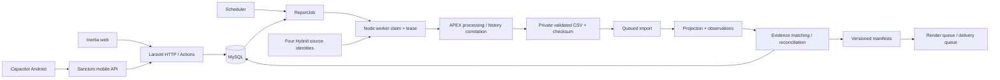

# Architecture and implementation inventory

## Snapshot and boundaries

This is one Laravel modular monolith with an Inertia web client, a separately bundled Capacitor Android React client, and a Node/Playwright report worker. The worker claims durable application jobs over authenticated internal HTTP; it is not a second system of record. MySQL persists operational transactions and imported evidence. No microservices, CQRS/event-sourcing infrastructure or repository layer is required to explain the implementation.

Installed PHP dependencies were confirmed by `composer show --direct`: PHP CLI 8.5.10; Laravel 13.35.0; inertia-laravel 3.5.1; Fortify 1.41.0; Sanctum 4.3.3; Wayfinder 0.1.21; Pest 5.3.1; Larastan 3.13.0; Pint 1.32.1. The declared PHP constraint is ^8.3, while this environment and CI use 8.5. Installed JS package manifests report React 19.3.0, Inertia React 3.9.1, TypeScript 5.9.3, Vite 8.3.4 and Vitest 4.1.11; package.json declares React ^19.2 and Inertia ^3.0. Node is 24.21.0. Capacitor core/Android/CLI are pinned 8.5.3; worker Playwright is pinned 1.64.1 with Node >=24. Tailwind 4 and Vite Plus are present. See composer.json, package.json, workers/jne-report/package.json and evidence/schema-indexes.json.

Inventory counts are files, not classes or business-capability counts: 79 Actions, 39 models, 38 controllers, 25 Form Requests, 5 resources, 9 Laravel jobs, 1 policy, 62 migrations, 106 files under Feature (includes worker helpers), 2 Unit files, 37 web pages, 39 mobile source files.

## Module map

| Capability | Entry points | Domain implementation / persisted evidence |
|---|---|---|
| Customer and operational users | CustomerController; OperationalUserController; customer directory imports | Customer; validated allowlists; versioned customer updates; alias/code master separate from JNE account |
| Auth / settings | FortifyServiceProvider; MobileTokenController; settings controllers | User role helpers; web active-user middleware; Sanctum device tokens and EnsureMobileToken |
| Pickup schedule / assignment / takeover | PickupScheduleController; PickupTaskController; PickupLifecycleController | GenerateScheduledPickups command / Scheduling/GeneratePickupTasks action; CreatePickupTask; AssignPickupTasks; TakeOverTask; StartPickup; RecordPickupVisit; task versions and events |
| POP | ProofOfPickupController; OperationalCorrectionController | FinalizePickup; CorrectPickupRecord; PickupRecord, attachments, immutable initial values and appended revisions; receipt attempts |
| Handover / retail verification | HandoverController | CreateSession; AmendSession; VerifyItem; CloseSession; CorrectVerification; session versions, unique task membership, verification baseline revisions |
| Sertim Cashless collection / correction | PickupCashlessAwbController; CashlessHandoverController | RecordCashlessAwb; RecordCashlessHandover; AWB evidence/events separate from POP totals; cashless collection closure timestamp |
| External cashless input / result | InternalCashlessEntryController; CashlessEntryResultController; cashless:entries | ManageCashlessEntryBatches; batch/item/event/lane records; Node cashless-entry.mjs; UNKNOWN holds |
| Report scheduling and pulling | ReportRunController; ReportJobController; InternalReportJobController; ApexBatchController | QueueScheduledJneReports; ManageReportJobs; ManageApexBatches; CombineHybridReports; ReportJob and report batch checkpoints |
| Import / source provenance | Internal upload then ImportJneReportAwbs job | ValidateReportCsv/HybridReportCsv/ApexAwbReport; ImportReportAwbs; ReadJneSourceEvidence; JneReportAwb raw JSON/checksums |
| Customer identity / pickup attribution | Jne evidence/alias/exception controllers | ResolveJneCustomers/CustomerCodes; JneEvidenceScope; MatchJnePickupDates; MatchJneShipments; ReviewJneExceptions; decision events |
| Reconciliation / pending / manifests | PickupAutomationController; PickupProcessingController; results controllers | ReconcileCustomerPickupDay; ReconcilePickupProcessing; AllocatePickupAwbBuckets; ReviewPickupAwbs; pending items, exclusions, manifest snapshots and deliveries |
| Tracking / dashboards / exports | JneMonitoringController; JneCustomerDashboardController; PickupResultController; OperationalDashboardController | QueryActiveJneAwbs; ProjectJneShipments; QueryJneCustomerDashboard; QueryPickupResults/ReportPickupResults; snapshot observations |
| Push / receipts | notification, push-device and receipt controllers | assignment/cashless observers; FcmClient; mobile-push jobs; SendPickupReceipt; DeliverPickupAwbManifest |
| Android | resources/mobile/src and android/app/src/main/java/com/retailpickup/mobile/dev | native SecureSession/MobileLocal plugins; separate encrypted stores; camera recovery; shared typed routes and presentational components |

Some controllers (especially JneMonitoringController) cover several related workspace endpoints. Their size alone is not a defect: aggregation, CSV streaming and page composition are separable concerns already backed by Actions. Large matcher/reconciliation classes implement evidence decisions that should not be casually decomposed during performance remediation.

## Data flow

Report submission, external processing, CSV storage, import/projection readiness, business attribution and delivery acknowledgment have different states. A successful local upload is not JNE confirmation. Tracking is a report snapshot; later arrival time alone does not make its status newer.

The standard legacy combined inventory is roberto/cashless, roberto/manual, nuralamt/cashless, nuralamt/manual (ReportJob.php:58). New server-specific profiles intentionally combine the two kinds for that server, while retaining all four distinguishable identities across the system. Source membership/checksums survive merge via child jobs and source_evidence.

## Routes, schema and runtime

routes/web.php contains authenticated web and same-session operational JSON endpoints; routes/api.php contains mobile/v1 Sanctum routes and internal worker routes; routes/settings.php contains account settings. Route-level auth is supplemented by controller, Form Request and Action authorization. Only one Policy file does not mean authorization is absent.

The model/schema relationships are predominantly belongsTo/hasMany/hasOne. Reviewed hot paths use explicit eager loading, aggregate SQL, unique constraints and stable ID tie-breaks. No polymorphic or many-to-many hot path was established as a problem. The live schema summary and focused index inventories are retained as metadata evidence; migrations remain the source-controlled history.

Queues: default (report import, mapping and producer work), reconciliation, documents, deliveries, mobile-push. The report/cashless Node worker has application leases and source slots, separate from Laravel queue reservation. routes/console.php schedules report due work, pickup generation and automation/recovery. Local bootstrap exists in AppServiceProvider, penarikan.bat and workers/jne-report/start-local.ps1. These are evidence of local runtime support, not of production process supervision.

CI has a MySQL 8.4 service, PHP 8.5, Node 24, worker browser tests, Composer checks and builds. It is not a deployment pipeline. No deployed supervisor topology, backup system, secret manager or production monitoring configuration was verified.

## Proportionality

The architecture is proportionate to these coupled operational workflows. Existing Actions, durable report jobs and snapshot evidence provide useful boundaries. Main opportunities are smaller database reads, bounded invalidation and recovery diagnostics, not new services or generalized repositories. Actual sustained user/report volume and infrastructure capacity remain unknown. An untracked Retail_Operations_Platform directory and output/presentation assets were inventoried as ancillary workspace content; no independent production backend or replacement application was inferred from their names.

